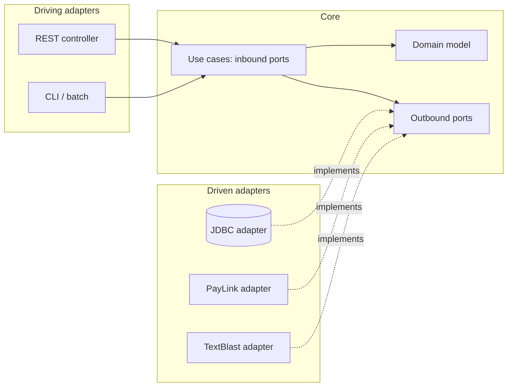
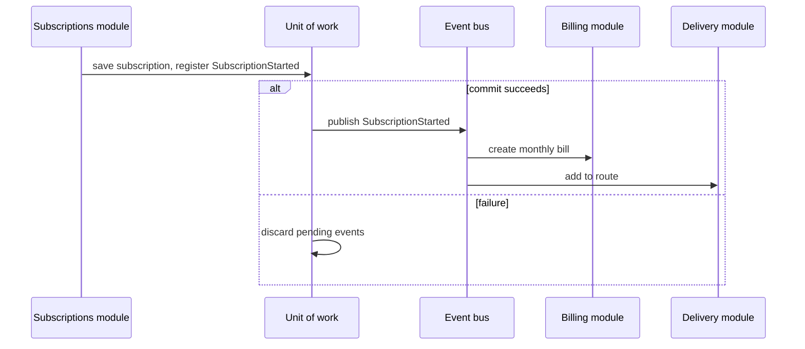

# Architectural Patterns

<span class="badge-l4">L4 🟠 Senior / Lead</span> · <span class="read-time">⏱ 45 min read</span> · Prerequisites: [Enterprise Application Patterns](../l3-professional/enterprise-application-patterns.md), [Dependency Injection](../l2-practitioner/dependency-injection.md)

!!! abstract "TL;DR"
    Architectural patterns decide the **shape of a whole application**: which parts exist, which may depend on which, and how they communicate. **Layered** architecture is the familiar default. **Hexagonal** (ports and adapters) and **Clean/Onion** put the domain at the centre and push frameworks, databases and UIs to the edges, so they can be swapped and the core tested alone. A **modular monolith** gives microservice-like boundaries inside one deployable. **Microkernel** builds a small core extended by plugins. **Event-driven** architecture connects parts through published facts instead of direct calls. The senior skill isn't knowing the diagrams; it's choosing based on team size, change patterns and operational cost, and **enforcing** the chosen boundaries with automated checks.

## 1. What It Is

**Plain English.** Design patterns organise classes; architectural patterns organise the whole system. They answer questions like "can the checkout code talk to the database directly?", "how do we swap SMS providers?", and "should payments be a separate service?"

**Definition.**

| Pattern | Core rule | Typical fit |
|---------|-----------|-------------|
| Layered | Each layer depends only on the one below | CRUD-heavy business apps |
| Hexagonal (ports and adapters) | Core defines ports; adapters implement them | Apps with several integrations or UIs |
| Clean / Onion | Dependencies point inwards to entities and use cases | Long-lived domains |
| Modular monolith | Modules with public APIs in one deployable | Most products before (or instead of) microservices |
| Microkernel / plugin | Small core, features as plugins | Platforms, IDEs, payment methods |
| Event-driven | Components publish and react to events | Workflows across many components |

## 2. Why It Exists

Without an agreed shape, every developer chooses their own shortcuts: controllers query tables, domain classes call HTTP clients, modules read each other's data. Each shortcut is small; together they create a "big ball of mud" where any change can break anything. Architectural patterns trade some upfront structure for **changeability**: swapping a payment provider touches one adapter, a new UI reuses the same use cases, and teams can own parts independently.

## 3. Mental Model / Analogy

**Analogy.** A city. **Layered** is a building with floors: you only take the stairs to the next one. **Hexagonal** is a power plant with standard sockets: any appliance (adapter) fits a socket (port). **Clean/Onion** is a castle with walls: the keep (domain) never depends on the market outside. A **modular monolith** is a shopping mall: separate shops with front doors (APIs), one building. **Microkernel** is a phone with apps. **Event-driven** is a town notice board: people post news, and whoever cares reacts.

**Technical model.** An architecture is a set of **components**, **allowed dependencies** between them, and **communication styles** (calls, events). Its value comes from the dependencies it *forbids*.

## 4. How It Works





## 5. Subtopics

### Layered architecture

**Description.** The application is split into horizontal layers, typically presentation, application (services), domain, and infrastructure (data access). Each layer depends only on layers below it. It's simple, widely understood and the default in most Spring Boot projects.

**Advantages / features.** Clear separation of concerns; easy onboarding; works well for CRUD-centric apps.

**Before (a shortcut through the layers) and after (calls go layer by layer):**

```java title="LayeredArchitectureDemo.java"
--8<-- "examples/l4-senior/architectural-patterns/LayeredArchitectureDemo.java"
```

1. The infrastructure layer holds storage details.
2. The controller only talks to the service, which applies the "in stock" rule.
3. A controller that skips the service also skips its rules: out-of-stock paneer appears.

**Run it:** `java LayeredArchitectureDemo.java`

```text
--8<-- "examples/l4-senior/architectural-patterns/LayeredArchitectureDemo.expected.txt"
```

| Variant | Rule | Trade-off |
|---------|------|-----------|
| Strict layering | Only the layer directly below | Safe but adds pass-through code |
| Relaxed layering | Any lower layer | Less code, more coupling |
| Layers by feature (package by feature) | Layers inside each feature package | Better cohesion, same rules |

**Use** layered architecture for straightforward business apps. **Avoid** letting the domain depend on infrastructure (JPA entities as the domain, repositories returning rows); that's where layered apps rot.
**Real-world Java:** Spring Boot's `@Controller` → `@Service` → `@Repository` convention.
**Best practice:** package by feature first (`orders`, `catalog`), then by layer inside. **Gotcha:** in classic layering, the domain depends on the persistence layer below it; hexagonal and clean architecture invert that.

### Hexagonal (ports and adapters)

**Description.** Alistair Cockburn's hexagonal architecture puts the application core in the middle. The core defines **ports**: inbound ports (use cases) that drivers call, and outbound ports (interfaces) for things it needs, like payments or notifications. **Adapters** connect the outside world: REST controllers and CLIs drive the core; JDBC, HTTP and SMS adapters implement outbound ports. The core has no framework or I/O code.

**Advantages / features.** Swap infrastructure without touching the core; test use cases with fakes; several UIs share one core.

```java title="HexagonalDemo.java"
--8<-- "examples/l4-senior/architectural-patterns/HexagonalDemo.java"
```

1. The inbound port: what the application can do.
2. Outbound ports: what the application needs, defined by the core in its own terms.
3. Adapters implement ports; production uses PayLink and SMS, tests use fakes and push, and the core doesn't change.

**Run it:** `java HexagonalDemo.java`

```text
--8<-- "examples/l4-senior/architectural-patterns/HexagonalDemo.expected.txt"
```

| Element | Owns | Depends on |
|---------|------|------------|
| Core (use cases + domain) | Business rules, port interfaces | Nothing external |
| Driving adapter | Protocol (HTTP, CLI, messages) | Inbound port |
| Driven adapter | Technology (JDBC, HTTP client, SMTP) | Outbound port, external library |
| Configuration | Wiring adapters to ports | Everything |

**Use** hexagonal when the app has several integrations, several entry points, or integrations likely to change. **Avoid** it for thin CRUD services; ports for every table add ceremony with no benefit.
**Real-world Java:** Spring apps with `domain`, `application` and `adapter` packages; jMolecules annotations (`@Port`, `@Adapter`); Quarkus and Micronaut examples.
**Best practice:** name ports after domain needs (`PaymentPort.charge`), not technologies (`PayLinkClient`). **Gotcha:** letting framework annotations (`@Entity`, `@Transactional`) into the core quietly undoes the pattern.

### Clean and onion architecture

**Description.** Robert C. Martin's Clean Architecture and Jeffrey Palermo's Onion Architecture refine the same idea as concentric rings: entities in the centre, then use cases, then interface adapters, then frameworks and drivers. The **dependency rule**: source code dependencies only point inwards. Inner rings define interfaces; outer rings implement them.

**Advantages / features.** Business rules independent of frameworks, UI and database; the rule is simple enough to check automatically.

```java title="CleanOnionDemo.java"
--8<-- "examples/l4-senior/architectural-patterns/CleanOnionDemo.java"
```

1. Rings ordered from inside out; each class declares its ring.
2. A rule breaker: a use case depending on a concrete JDBC adapter.
3. A reflection-based check, like an ArchUnit test, finds dependencies pointing outwards.

**Run it:** `java CleanOnionDemo.java`

```text
--8<-- "examples/l4-senior/architectural-patterns/CleanOnionDemo.expected.txt"
```

| | Hexagonal | Onion | Clean |
|-|-----------|-------|-------|
| Picture | Hexagon with ports | Concentric layers | Concentric circles |
| Centre | Application core | Domain model | Entities |
| Key rule | Core defines ports | Dependencies inward | Dependency rule |
| Extra | Driving vs driven sides | Domain services ring | Use-case interactors, presenters |

**Use** these when the domain is complex and long-lived. **Avoid** cargo-culting every ring: many teams need entities, use cases and adapters, not eight packages per feature.
**Real-world Java:** ArchUnit's `onionArchitecture()` and `layeredArchitecture()` rule builders.
**Best practice:** enforce the dependency rule with an ArchUnit test in CI. **Gotcha:** mapping between ring-specific models (entity, DTO, persistence model) can dominate the code; share models where the rule allows.

### Modular monolith

**Description.** One deployable application split into **modules** aligned with business capabilities (subscriptions, billing, delivery). Each module has a public API (interfaces, events) and private internals (its tables, classes). Modules communicate only through APIs or in-process events. You get strong boundaries without network calls, distributed transactions or many deployments.

**Advantages / features.** Simple operations; refactoring across modules is still easy; modules can later be extracted into services along clean seams.

```java title="ModularMonolithDemo.java"
--8<-- "examples/l4-senior/architectural-patterns/ModularMonolithDemo.java"
```

1. The inventory module's public API; its stock map is private.
2. Orders publish a fact instead of calling notifications directly.
3. The notifications module depends only on the event, not on orders' internals.

**Run it:** `java ModularMonolithDemo.java`

```text
--8<-- "examples/l4-senior/architectural-patterns/ModularMonolithDemo.expected.txt"
```

| | Layered monolith | Modular monolith | Microservices |
|-|------------------|------------------|---------------|
| Boundaries | Technical layers | Business modules | Services |
| Deployment | One | One | Many |
| Communication | Method calls | API calls, in-process events | Network |
| Data | Shared schema | Schema per module (logically) | Database per service |
| Operational cost | Low | Low | High |

**Use** a modular monolith as the default for new products and teams under ~50 engineers. **Avoid** shared tables between modules; that's where monoliths become balls of mud.
**Real-world Java:** Spring Modulith (`ApplicationModules.verify()`, `@ApplicationModuleListener`), Java modules (JPMS), Shopify's Rails monolith (same ideas).
**Best practice:** give each module its own schema or table prefix and forbid cross-module joins. **Gotcha:** in-process events are synchronous by default; a slow listener slows the publisher, and failures can roll back the publisher's transaction unless listeners run after commit.

### Microkernel / plugin architecture

**Description.** A minimal core provides lifecycle, registration and shared services; features are **plugins** implementing a contract the core defines. The core discovers plugins (ServiceLoader, classpath scanning, configuration), checks compatibility, and isolates failures. New capabilities ship as new plugins without changing the core.

**Advantages / features.** Extensibility without core changes; third parties can add features; plugins can be enabled per market or customer.

```java title="MicrokernelPluginDemo.java"
--8<-- "examples/l4-senior/architectural-patterns/MicrokernelPluginDemo.java"
```

1. The plugin contract, including a version for compatibility checks.
2. The kernel refuses plugins built for an unsupported API version.
3. A failing plugin is contained: the customer is asked to choose another method, and the kernel keeps running.

**Run it:** `java MicrokernelPluginDemo.java`

```text
--8<-- "examples/l4-senior/architectural-patterns/MicrokernelPluginDemo.expected.txt"
```

| Discovery | Example |
|-----------|---------|
| `ServiceLoader` (`META-INF/services`) | JDBC drivers, `java.time` zone providers |
| Classpath scanning | Spring Boot auto-configuration |
| OSGi bundles | Eclipse IDE, Apache Karaf |
| Configuration / database | Payment methods enabled per country |

**Use** microkernel for platforms with a stable core and many optional features. **Avoid** it when features are tightly coupled; the plugin contract becomes a leaky, ever-changing API.
**Real-world Java:** Eclipse, IntelliJ, Jenkins, Gradle, Maven plugins, Spring Boot starters.
**Best practice:** version the plugin API and test plugins against the contract. **Gotcha:** plugins running in-process can still crash or slow the core (memory, threads); isolate risky ones with timeouts or separate processes.

### Event-driven architecture

**Description.** Components communicate by publishing **events** (facts that happened) to a broker; other components subscribe and react. **Event notification** sends a minimal event (an ID); consumers call back for details. **Event-carried state transfer** includes the data, so consumers keep their own copies and don't call back. Producers don't know their consumers.

**Advantages / features.** Loose coupling; new consumers without changing producers; natural fit for workflows and integration.

```java title="EventDrivenArchitectureDemo.java"
--8<-- "examples/l4-senior/architectural-patterns/EventDrivenArchitectureDemo.java"
```

1. A broker that queues events and delivers them later, as real brokers do.
2. Notification style: only the SKU; the consumer calls back for the price.
3. State-transfer style: the price is in the event, so the consumer needs no callback.

**Run it:** `java EventDrivenArchitectureDemo.java`

```text
--8<-- "examples/l4-senior/architectural-patterns/EventDrivenArchitectureDemo.expected.txt"
```

| Style | Event carries | Consumer gets | Trade-off |
|-------|---------------|---------------|-----------|
| Event notification | ID | Current state (via callback) | Extra calls; producer must be up |
| Event-carried state transfer | Data | State at event time | Larger events; copies of data |
| Event sourcing | Every change | Full history | Complex; see [Distributed Data Patterns](distributed-data-patterns.md) |

The search index read the price *at delivery time* (Rs 640), not the value when the event was published. The cart's copy has the value from the event (Rs 620); the catalogue would publish another event for the second change.

**Use** events for reactions that don't need an immediate answer (notifications, projections, integrations). **Avoid** events for request/response flows that need a result now, and "event chains" so long that nobody can follow the workflow.
**Real-world Java:** Spring `ApplicationEventPublisher`, Kafka, RabbitMQ, Spring Cloud Stream, Axon.
**Best practice:** name events in the past tense (`OrderPlaced`), version their schemas, and make consumers idempotent. **Gotcha:** event-driven systems are eventually consistent; screens and support tools must handle "not updated yet".

## 6. Examples (exactly 3, progressively harder)

### Example 1: Minimal (L2)

**Scenario:** QuickDrop's saved-address feature, written in three layers so validation lives in one place.

```java title="ThreeLayerDemo.java"
--8<-- "examples/l4-senior/architectural-patterns/ThreeLayerDemo.java"
```

1. The service holds the rule (valid PIN) and uses the repository.
2. The controller translates between HTTP-like input/output and the service.

**Run it:** `java ThreeLayerDemo.java`

**Output:**

```text
--8<-- "examples/l4-senior/architectural-patterns/ThreeLayerDemo.expected.txt"
```

**What to notice:**

- Any new entry point (mobile API, batch import) reuses the service and gets the same validation.

### Example 2: Realistic (in FreshCart grocery delivery)

**Scenario:** FreshCart is moving delivery slots from its in-house scheduler to ParcelGo, city by city. Both must work at once, and the checkout code shouldn't care which is used. Define a port, write an adapter per provider, and run one contract test against both.

```java title="SlotProviderPortDemo.java"
--8<-- "examples/l4-senior/architectural-patterns/SlotProviderPortDemo.java"
```

1. The port, in FreshCart's terms (slots, holds).
2. The ParcelGo adapter translates their model (minutes since midnight, "remaining") into ours.
3. A contract test every adapter must pass: no full slots offered, holds up to capacity, never overbook, unknown slots refused.

**Run it:** `java SlotProviderPortDemo.java`

**Output:**

```text
--8<-- "examples/l4-senior/architectural-patterns/SlotProviderPortDemo.expected.txt"
```

**What to notice:**

- Checkout depends on `SlotProvider` only; choosing the provider per city is configuration.
- The contract test catches an adapter that, for example, ignores ParcelGo's "remaining = 0" and overbooks.

### Example 3: Production-grade

**Scenario:** DairyDay runs a modular monolith with subscriptions, billing and delivery modules. Billing and delivery react to new subscriptions, but must never see a subscription that was rolled back. The team also wants CI to fail if anyone reaches into another module's internals, adds an undeclared dependency, or creates a cycle.

```java title="ModularMonolithFitnessDemo.java"
--8<-- "examples/l4-senior/architectural-patterns/ModularMonolithFitnessDemo.java"
```

1. The architecture check: every cross-module access must be a declared dependency and must not touch `internal` packages.
2. Cycle detection over declared dependencies, reporting each cycle once.
3. A unit of work holds events until commit and discards them on rollback.
4. The subscription event is registered inside the transaction, not published immediately.
5. Billing and delivery depend only on the published event type.

**Run it:** `java ModularMonolithFitnessDemo.java`

**Output:**

```text
--8<-- "examples/l4-senior/architectural-patterns/ModularMonolithFitnessDemo.expected.txt"
```

**What to notice:**

- The "sneaky" build is rejected for two reasons: delivery used a subscriptions internal type, and depended on billing without declaring it.
- Ravi's subscription failed after saving; because events wait for commit, billing never billed him and delivery never routed him.
- Spring Modulith provides both parts for real: `ApplicationModules.of(App.class).verify()` and `@ApplicationModuleListener` with an event publication registry.

## 7. Pros, Cons & Trade-offs

| Pattern | Pros | Cons |
|---------|------|------|
| Layered | Simple, familiar | Domain often depends on persistence; pass-through code |
| Hexagonal | Swappable adapters, testable core | More interfaces and mapping |
| Clean / Onion | Framework-independent domain | Ceremony; model mapping between rings |
| Modular monolith | Strong boundaries, simple ops | Needs discipline and tooling to keep boundaries |
| Microkernel | Extensible, per-market features | Plugin API design is hard to change |
| Event-driven | Loose coupling, easy to add consumers | Eventual consistency, harder debugging |

## 8. When to Use / When NOT to Use

**Use them when:**

- the codebase will live for years and grow beyond one team;
- integrations are numerous or likely to change;
- different parts change at different rates.

**Don't overdo them when:**

- the app is a small CRUD service or prototype; a simple layered app is fine;
- the team can't yet enforce boundaries (start with packages and one ArchUnit rule);
- event-driven would hide a simple synchronous workflow.

## 9. Best Practices

1. **Choose the simplest architecture that supports the expected change.** *(Consensus.)*
2. **Organise by business capability first, technical layer second.** *(Consensus.)*
3. **Keep the domain free of framework and I/O code.** *(Consensus for complex domains.)*
4. **Enforce boundaries with tests (ArchUnit, Spring Modulith).** *(Consensus.)*
5. **Prefer a modular monolith before microservices.** *(Consensus; Fowler's "MonolithFirst".)*
6. **Record decisions in ADRs (architecture decision records).** *(Consensus.)*
7. **Publish events after commit; make consumers idempotent.** *(Consensus.)*

## 10. Pitfalls & Anti-Patterns

!!! danger "Events published before commit (production failure mode)"
    **Symptom:** customers received "subscription started" SMS and first deliveries for subscriptions that showed as failed in the app.
    **Root cause:** the event was published inside the transaction; the transaction later rolled back, but listeners had already acted.
    **Fix:** publish after commit (`@TransactionalEventListener(phase = AFTER_COMMIT)`, Spring Modulith's event registry, or a transactional outbox).

!!! danger "Boundaries only on the whiteboard"
    **Symptom:** a "modular" monolith where every module imports every other; a change to billing breaks delivery.
    **Root cause:** no automated enforcement; one shortcut at a time.
    **Fix:** architecture tests in CI from day one; module APIs and `internal` packages.

!!! danger "Architecture astronautics"
    **Symptom:** a three-endpoint service with 40 interfaces, five model classes per entity and mappers between them.
    **Root cause:** Clean Architecture applied mechanically regardless of complexity.
    **Fix:** collapse rings where they add nothing; keep ports only where variation exists.

!!! danger "Distributed monolith"
    **Symptom:** microservices that must be deployed together and fail together.
    **Root cause:** splitting before boundaries were understood; shared database; synchronous call chains.
    **Fix:** merge back into a modular monolith; extract later along proven module boundaries.

## 11. Configuration & Tuning

| Setting / tool | Default | What it does | When to change it | Risk of changing |
|----------------|---------|--------------|-------------------|------------------|
| ArchUnit `layeredArchitecture()` | — | Fails build on layer violations | Add on day one | Initial violations in legacy code |
| Spring Modulith `verify()` | — | Checks module dependencies and cycles | Modular monoliths | Requires package conventions |
| `@ApplicationModuleListener` | — | Async, after-commit, transactional listener | Cross-module reactions | Eventual consistency |
| `spring.modulith.events.republish-outstanding-events-on-restart` | false | Retries unfinished event publications | Production | Duplicate deliveries (need idempotency) |
| JPMS `module-info.java` | none | Compiler-enforced module exports | Libraries, strict boundaries | Build complexity |
| ADR template | — | Records decisions and context | Every significant choice | None |

## 12. Security Considerations

- Adapters are the trust boundary: validate input at driving adapters, and treat data from driven adapters (third-party APIs) as untrusted.
- Authorisation belongs in the application core's use cases, so every entry point (REST, CLI, events) enforces it.
- Plugins run with the core's privileges; review, sign and version them.
- Events may carry personal data across many consumers; minimise payloads and classify topics.

## 13. Performance & Scalability

Layers and ports cost almost nothing at runtime (see [Performance Cost of Patterns](../l3-professional/performance-of-patterns.md)); the real costs are mapping between models and extra queries from strict layering. A modular monolith scales vertically and by running more identical instances; extract a module into a service only when it needs different scaling, availability or release cadence. Event-driven designs absorb spikes through queues but add latency.

## 14. Testing It

Architectures are tested at three levels: the core with fakes (hexagonal), adapters with contract tests, and the structure itself with fitness functions:

```java title="ModularMonolithTest.java"
--8<-- "examples/l4-senior/architectural-patterns/ModularMonolithTest.java"
```

In real projects: ArchUnit rules, Spring Modulith's `ApplicationModules.verify()` and `@ApplicationModuleTest`, and Testcontainers for driven adapters.

## 15. Observability & Operations

Tag logs, metrics and traces with the module or bounded context (e.g., `module=billing`) so a monolith's dashboards look like a set of services. Track event publication lag and failed publications. Generate architecture documentation from code (Spring Modulith's `Documenter`, C4 diagrams via Structurizr) so diagrams don't drift.

## 16. Version Notes

| Year / version | Change |
|----------------|--------|
| 1990s | Layered architectures (POSA, 1996) |
| 2005 | Hexagonal architecture (Alistair Cockburn) |
| 2008 | Onion architecture (Jeffrey Palermo) |
| 2012 / 2017 | Clean Architecture (blog post / book, Robert C. Martin) |
| 2017 | Java 9 module system (JPMS) |
| 2018+ | ArchUnit widely adopted |
| 2023 | Spring Modulith 1.0 |

## 17. Expert Deep Dive

- **Fitness functions.** From *Building Evolutionary Architectures*: automated checks (dependency rules, latency budgets, coupling metrics) that protect architectural characteristics as the code evolves.
- **Conway's Law and the inverse Conway manoeuvre.** Architecture mirrors team communication; design team boundaries to match the module boundaries you want.
- **Ports granularity.** One port per external capability (payments, slots), not per method or per table; ports are designed from the core's needs.
- **Evolution path.** Layered → modular monolith → selective extraction is the most common successful path; each step is reversible until the network boundary.
- **Event publication registries.** Persisting outgoing events with the business transaction (outbox) and marking them complete when listeners succeed gives at-least-once delivery even across crashes.

!!! example "War story: the subscription that billed a ghost"
    DairyDay's first modular monolith used Spring's `ApplicationEventPublisher` inside `@Transactional` service methods, with plain `@EventListener`s in billing and delivery. One evening, a database failover made about 2% of subscription saves roll back after the event had been published. Billing created invoices and delivery added 340 customers to routes for subscriptions that didn't exist; riders knocked on doors with milk nobody had ordered. **Fixes:** listeners moved to `@ApplicationModuleListener` (after commit, asynchronous, with Spring Modulith's event publication registry so unfinished deliveries are retried after a crash); billing and delivery became idempotent by subscription ID; and an architecture test now fails if a module listens to another module's events with a plain synchronous listener. **Lesson:** module boundaries need transaction boundaries too.

## 18. Interview Corner

=== "🟢 L1–L2"

    1. **What's layered architecture?** **Layers** (presentation, service, data) each calling the one **below**.
    2. **Why separate layers?** **Separation of concerns** and reuse.
    3. **What's an adapter?** Code that **connects the app to external technology**.
    4. **What's a monolith?** **One deployable** application.
    5. **What's an event?** A **fact that happened**, published for others to react to.

=== "🟡 L3"

    1. **Hexagonal vs layered?** Hexagonal: **core defines ports**, infrastructure depends on the core, not vice versa.
    2. **What's the dependency rule?** **Dependencies point inwards** to the domain.
    3. **What's a modular monolith?** **Business modules with APIs** inside one deployable.
    4. **Event notification vs state transfer?** **ID only + callback** vs **data in the event**.
    5. **How do you enforce boundaries?** **ArchUnit / Spring Modulith** tests in CI.

=== "🔴 L4–L5"

    1. **Monolith or microservices for a new product with 8 engineers?** **Modular monolith**, extract later along proven seams.
    2. **How do you keep events consistent with the database?** **After-commit publication or outbox**, idempotent consumers.
    3. **When is Clean Architecture overkill?** **Simple CRUD, short-lived services, tiny teams.**
    4. **How does team structure influence architecture?** **Conway's Law**; align modules with team ownership.
    5. **How do you evolve a big ball of mud?** **Identify modules, add fitness functions, strangle incrementally.**

=== "💻 Hands-on"

    **Task:** Extend the fitness check in `ModularMonolithFitnessDemo` to forbid any module from depending on more than two others.

    ??? success "Solution"
        ```java
        static List<String> fanOut(List<Module> modules, int max) {
            return modules.stream()
                    .filter(m -> m.allowedDependencies().size() > max)
                    .map(m -> m.name() + " depends on " + m.allowedDependencies().size() + " modules (max " + max + ")")
                    .toList();
        }
        // in verify(): problems.addAll(fanOut(modules, 2));
        ```

## 19. Practice

- [ ] Add an ArchUnit test to a Spring project: controllers must not access repositories.
    ??? tip "Hint"
        `noClasses().that().resideInAPackage("..web..").should().dependOnClassesThat().resideInAPackage("..repository..")`.
- [ ] Convert `ModularMonolithDemo` to Spring Modulith and run `ApplicationModules.verify()`.
    ??? tip "Hint"
        One top-level package per module under the application's package.
- [ ] Add a third slot adapter (a test double that fails randomly) and make the contract test catch it.
    ??? tip "Hint"
        Use a fixed `Random` seed so the failure is reproducible.
- [ ] Write an ADR choosing between hexagonal and layered for a new service.
    ??? tip "Hint"
        Context, decision, consequences; keep it to one page.

## 20. Quick Revision Card

!!! tip "Remember in 30 seconds"
    - Layered: simple default; watch domain → persistence coupling.
    - Hexagonal / Clean / Onion: domain in the middle, dependencies inwards, adapters at the edges.
    - Modular monolith: business modules with APIs in one deployable; the best default.
    - Microkernel: small core + versioned plugin contract.
    - Event-driven: facts, not commands; publish after commit; idempotent consumers.
    - Enforce boundaries with automated fitness functions.

    ```java
    interface PaymentPort { boolean charge(String customer, long paise); }   // core defines it
    final class PayLinkAdapter implements PaymentPort { ... }                 // edge implements it
    ```

## 21. Further Reading

- Alistair Cockburn, ["Hexagonal Architecture"](https://alistair.cockburn.us/hexagonal-architecture/).
- Robert C. Martin, *Clean Architecture* (2017).
- Mark Richards and Neal Ford, *Fundamentals of Software Architecture* (2nd ed., 2025).
- Neal Ford et al., *Building Evolutionary Architectures* (2nd ed., 2022).
- [Spring Modulith reference](https://docs.spring.io/spring-modulith/reference/) and [ArchUnit user guide](https://www.archunit.org/userguide/html/000_Index.html).

---

[← Previous: L4 Senior / Lead](index.md) · [Next: Domain-Driven Design: Tactical Patterns →](ddd-tactical.md)
