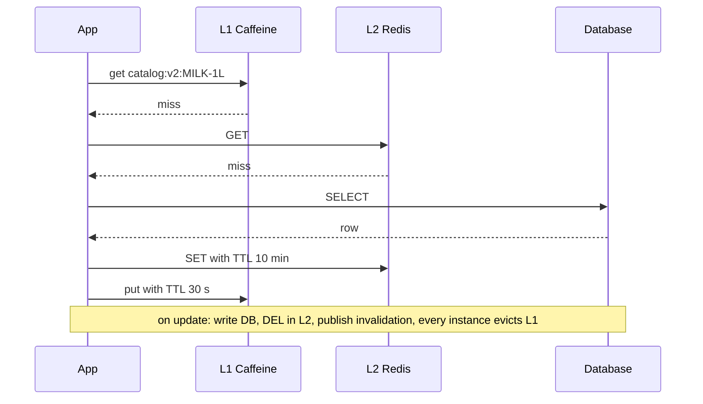
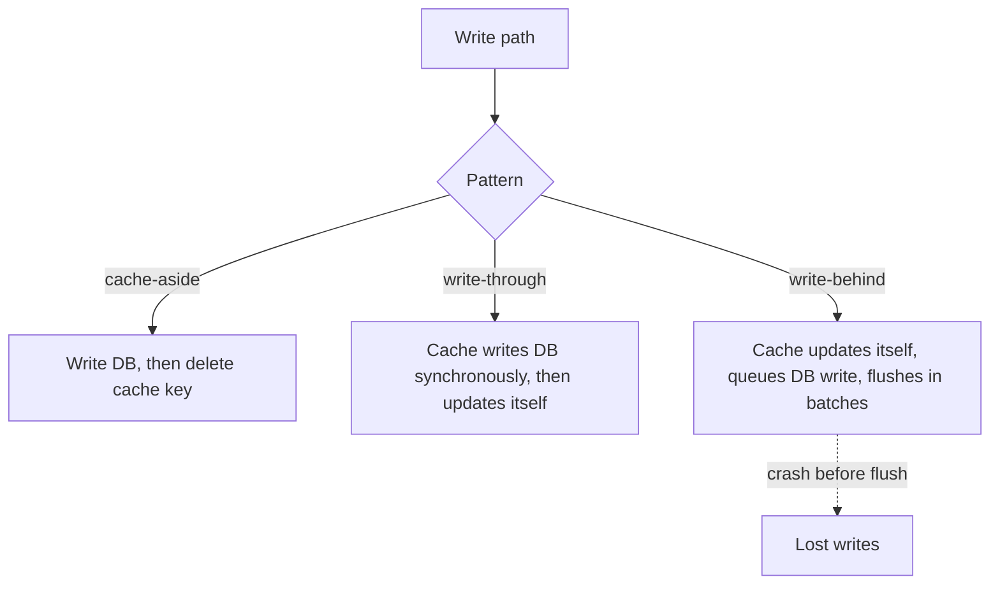

# Caching Patterns

<span class="badge-l4">L4 🟠 Senior / Lead</span> · <span class="read-time">⏱ 30 min read</span> · Prerequisites: [Proxy](../l2-practitioner/proxy.md), [Distributed Data Patterns](distributed-data-patterns.md)

!!! abstract "TL;DR"
    A cache trades freshness and memory for speed and load reduction. **Cache-aside** (the app loads on a miss and deletes on write) is the default. **Read-through / write-through** put the cache in front of the store so callers only talk to the cache. **Write-behind** acknowledges writes from the cache and flushes later: fast, but unflushed data can be lost. **Invalidation** is the hard part: combine TTLs (bounded staleness), explicit deletes on write, broadcast invalidation for local caches and versioned keys. Protect hot keys from **stampedes** with single-flight loading and TTL jitter. In Java, **Caffeine** is the in-process cache and **Redis** the usual shared cache; many systems use both as L1 and L2.

## 1. What It Is

**Plain English.** FreshCart's app asks for the same product prices and menus thousands of times a minute, and they change rarely. Keeping copies close to where they're needed (in memory, or in a fast shared store) answers most requests without touching the database. These patterns decide who fills the copy, when it's updated, and how to stop serving it once it's wrong.

**Definition.**

| Pattern | Who loads on a miss | Who writes the store |
|---------|---------------------|----------------------|
| Cache-aside | Application | Application (then invalidates cache) |
| Read-through | Cache (via loader) | — |
| Write-through | — | Cache, synchronously |
| Write-behind | — | Cache, asynchronously in batches |
| Refresh-ahead | Cache, before expiry | — |

## 2. Why It Exists

Databases and remote services are orders of magnitude slower than memory and have limited capacity. Read-heavy workloads (catalogs, configs, sessions, prices) repeat the same queries; caching them cuts latency from milliseconds to microseconds and protects the database during spikes. The cost is consistency: every cache is a second copy of data that can go stale. As Phil Karlton put it, cache invalidation is one of the two hard things in computer science.

## 3. Mental Model / Analogy

**Analogy.** A shop counter. The shopkeeper keeps the most-asked items on the counter (cache) instead of walking to the storeroom (database). If an item isn't on the counter, they fetch it and leave one there (cache-aside). Price stickers have a "check again after" date (TTL). When the supplier changes a price, the shopkeeper removes the old sticker (invalidation). If 50 customers ask for the same missing item at once, one person goes to the storeroom and the rest wait (single-flight).

**Technical model.** A key-value map with a bounded size, an eviction policy (LRU, LFU, W-TinyLFU), expiry (TTL, TTI) and a loading strategy, either in-process (per instance) or shared over the network.

## 4. How It Works





## 5. Subtopics

### Cache-aside

**Description.** The application owns the logic: read the cache; on a miss, load from the store and put the value in the cache; on a write, update the store and **delete** the cache entry (rather than updating it, which races with concurrent writers). Only requested data is cached.

**Advantages / features.** Simple; works with any cache and store; the cache can fail without breaking reads (fall back to the store); memory holds only what's used.

```java title="CacheAsideDemo.java"
--8<-- "examples/l4-senior/caching-patterns/CacheAsideDemo.java"
```

1. Check the cache first.
2. On a miss, load from the database and remember it.
3. On a write, update the database and delete the cached copy.

**Run it:** `java CacheAsideDemo.java`

```text
--8<-- "examples/l4-senior/caching-patterns/CacheAsideDemo.expected.txt"
```

| Write strategy in cache-aside | Risk |
|-------------------------------|------|
| Update DB, then delete cache | Small race window (see invalidation); recommended |
| Update DB, then set cache | Concurrent writers can leave the older value |
| Delete cache, then update DB | Reader can reload the old value in between |
| Set cache only | Lost data if cache evicts |

**Use** as the default for read-heavy data. **Avoid** forgetting the delete in any write path (admin tools, batch jobs, SQL fixes).
**Real-world Java:** Spring `@Cacheable` / `@CacheEvict`, `RedisTemplate` or Lettuce, Caffeine `Cache.get(key, loader)`.
**Best practice:** always set a TTL as a safety net for missed invalidations. **Gotcha:** the first request after a deploy or flush pays the full load; warm hot keys if needed.

### Read-through and write-through

**Description.** The cache is configured with a loader (read-through) and a writer (write-through), and callers use only the cache API. On a miss, the cache calls the loader. On a write, the cache writes the store synchronously and then updates itself, so the cache is never older than the store for writes that go through it.

**Advantages / features.** Simpler callers; loading logic in one place; consistent cache after writes; natural fit for in-process caches and data grids.

```java title="ReadWriteThroughDemo.java"
--8<-- "examples/l4-senior/caching-patterns/ReadWriteThroughDemo.java"
```

1. Read-through: the cache loads missing entries itself.
2. Write-through: the store is written first...
3. ...then the cache, so the next read is a fresh hit.

**Run it:** `java ReadWriteThroughDemo.java`

```text
--8<-- "examples/l4-senior/caching-patterns/ReadWriteThroughDemo.expected.txt"
```

| | Cache-aside | Read/write-through |
|-|-------------|--------------------|
| Who knows the store | Application | Cache |
| Write latency | Store write + delete | Store write + cache write |
| Cache outage | Reads fall back to store | Reads fail unless handled |
| Cached data | Requested only | Requested + written |

**Use** when one component should own loading and writing (data grids, repositories with built-in caching). **Avoid** write-through for data that's written often but rarely read (it fills the cache with cold entries).
**Real-world Java:** Caffeine `LoadingCache`, JCache (JSR 107) `CacheLoader`/`CacheWriter`, Hazelcast `MapStore`, Infinispan.
**Best practice:** keep loaders idempotent and fast; set timeouts on them. **Gotcha:** writes that bypass the cache (other services, SQL scripts) still make it stale.

### Write-behind

**Description.** Writes update the cache and return immediately; the cache flushes dirty entries to the store later, in batches, coalescing repeated writes to the same key. The store is eventually consistent with the cache.

**Advantages / features.** Very fast writes; far fewer store writes for hot counters; smooths write spikes.

```java title="WriteBehindDemo.java"
--8<-- "examples/l4-senior/caching-patterns/WriteBehindDemo.java"
```

1. Dirty entries are tracked separately; the latest value per key wins.
2. A flush writes all dirty entries in one batch.
3. Anything not yet flushed is lost if the node crashes.

**Run it:** `java WriteBehindDemo.java`

```text
--8<-- "examples/l4-senior/caching-patterns/WriteBehindDemo.expected.txt"
```

| Data | Write-behind? |
|------|---------------|
| View counts, analytics counters | Yes |
| Rate-limit counters, session activity | Yes |
| Orders, payments, stock | No |
| Anything with legal or financial meaning | No |

**Use** for high-volume, loss-tolerant data. **Avoid** for anything the business can't afford to lose.
**Real-world Java:** Hazelcast `MapStore` with `write-delay-seconds`, Redis counters flushed by a scheduled job, Ehcache write-behind.
**Best practice:** bound the flush interval and dirty-queue size; flush on graceful shutdown. **Gotcha:** the store doesn't see recent writes, so reports and other services read old values.

### Cache invalidation strategies

**Description.** Ways to stop serving stale data: **TTL** (expire after a time; bounded staleness), **explicit invalidation** (delete on write), **event-driven invalidation** (broadcast deletes to all instances, or CDC-driven), and **versioned keys** (change the key so old entries are never read). Combine them: delete on write for freshness, TTL as a safety net.

**Advantages / features.** Each strategy bounds a different failure: TTL bounds missed deletes, deletes give freshness, versions avoid races and schema mismatches after deploys.

```java title="CacheInvalidationDemo.java"
--8<-- "examples/l4-senior/caching-patterns/CacheInvalidationDemo.java"
```

1. The slow reader puts the value it read before the update back into the cache, after the writer's delete.
2. With a TTL, that stale value disappears on its own.
3. With versioned keys, the stale value lands under an old key nobody reads.

**Run it:** `java CacheInvalidationDemo.java`

```text
--8<-- "examples/l4-senior/caching-patterns/CacheInvalidationDemo.expected.txt"
```

| Strategy | Staleness | Cost |
|----------|-----------|------|
| TTL only | Up to TTL | None; simplest |
| Delete on write | Small race window | Every write path must do it |
| Broadcast to L1 caches | Milliseconds | Pub/sub channel; missed messages need TTL |
| CDC-driven | Seconds | Infrastructure; catches all writers |
| Versioned keys | None for reads via version | Version lookup; old entries expire via TTL |
| Delayed double delete | Smaller race window | Extra delete after a delay |

**Use** delete-on-write plus TTL by default; add broadcast for local caches. **Avoid** caches without any TTL.
**Real-world Java:** Redis pub/sub or keyspace notifications, Debezium to invalidate caches, Spring `@CacheEvict`.
**Best practice:** document the acceptable staleness for each cached item with the business. **Gotcha:** caching inside a database transaction that later rolls back caches data that never existed.

### Caffeine and Redis

**Description.** **Caffeine** is a high-performance in-process cache for Java (W-TinyLFU eviction, size and weight bounds, expiry, refresh-ahead, async loading, statistics). **Redis** is a shared, networked in-memory store used as a distributed cache (strings, hashes, TTLs, pub/sub). Caffeine is microseconds and per instance; Redis is about a millisecond and shared. Combined, Caffeine is L1 and Redis is L2.

**Advantages / features.** Caffeine: near-optimal hit rates, no network, refresh-ahead; Redis: one copy for all instances, survives app restarts, rich data types.

This example is a small Maven project using the real library: [`examples/l4-senior/caching-patterns/caffeine`](https://github.com/khiruashish/java-design-pattern-mobile-app/tree/claude/add-playbook-master-prompt/examples/l4-senior/caching-patterns/caffeine).

```java title="CaffeineDemo.java"
--8<-- "examples/l4-senior/caching-patterns/caffeine/src/main/java/com/freshcart/caching/CaffeineDemo.java"
```

1. Bounded size, a hard expiry and a softer refresh interval, with statistics on.
2. The loader makes this a read-through cache.
3. After the refresh interval, the old value is served while a reload runs in the background.
4. After the hard expiry, entries are gone.

**Run it:** `mvn -q compile exec:java -Dexec.mainClass=com.freshcart.caching.CaffeineDemo` (or `mvn verify`, which checks this output)

```text
--8<-- "examples/l4-senior/caching-patterns/caffeine/expected/CaffeineDemo.expected.txt"
```

| | Caffeine (L1) | Redis (L2) |
|-|---------------|------------|
| Latency | ~microseconds | ~0.5–1 ms in-region |
| Scope | One JVM | All instances |
| Consistency across instances | Needs broadcast invalidation | One copy |
| Capacity | Heap-limited | Memory of the Redis cluster |
| Survives app restart | No | Yes |
| Failure mode | GC pressure | Network/cluster outage |

**Use** Caffeine for hot, small, read-mostly data; Redis for shared state and larger datasets; both for very hot keys. **Avoid** Guava `CacheBuilder` in new code (Caffeine is its successor).
**Real-world Java:** Spring Boot `spring.cache.type=caffeine` or `redis`, Spring `CaffeineCacheManager`, Lettuce/Jedis/Redisson clients.
**Best practice:** export Caffeine stats and Redis hit ratio to Micrometer. **Gotcha:** Redis `maxmemory-policy` defaults to `noeviction`; a full cache then rejects writes instead of evicting.

## 6. Examples (exactly 3, progressively harder)

### Example 1: Minimal (L2)

**Scenario:** the FreshCart app loads its category menu on every launch; the menu changes a few times a day.

```java title="CategoryMenuCacheDemo.java"
--8<-- "examples/l4-senior/caching-patterns/CategoryMenuCacheDemo.java"
```

1. Reload only when there's no copy or the copy is older than the TTL.
2. Remember when the copy was made.

**Run it:** `java CategoryMenuCacheDemo.java`

**Output:**

```text
--8<-- "examples/l4-senior/caching-patterns/CategoryMenuCacheDemo.expected.txt"
```

**What to notice:**

- A five-minute TTL turned 900 queries into 3; a menu change shows up within five minutes, which the business accepted.

### Example 2: Realistic (in FreshCart grocery delivery)

**Scenario:** during a sale, 50 hot SKUs receive 20 price requests per second each. Their cache entries were all filled at the same moment, so they all expire together.

```java title="PriceStampedeDemo.java"
--8<-- "examples/l4-senior/caching-patterns/PriceStampedeDemo.java"
```

1. Single-flight: requests arriving during a load wait for it instead of starting their own.
2. TTL jitter: entries filled together expire at different times.
3. The worst second shows the peak load on the pricing database.

**Run it:** `java PriceStampedeDemo.java`

**Output:**

```text
--8<-- "examples/l4-senior/caching-patterns/PriceStampedeDemo.expected.txt"
```

**What to notice:**

- Without protection, the pricing database got 200 queries in one second (4 per SKU while each load was in flight).
- With protection, 50 loads were spread out, at most 8 in a second; 150 requests joined an in-flight load.
- Caffeine's `get(key, loader)` is single-flight per key within one JVM; across instances, use a short Redis lock or refresh-ahead.

### Example 3: Production-grade

**Scenario:** FreshCart's catalog service runs many instances. Each keeps a small L1 cache; all share an L2 cache. Price updates must show up on every instance immediately, lookups for nonexistent SKUs (bots, old app versions) must not hammer the database, and a deploy that changes the cached format must not read old entries.

```java title="TwoTierCatalogCacheDemo.java"
--8<-- "examples/l4-senior/caching-patterns/TwoTierCatalogCacheDemo.java"
```

1. The shared cache with a pub/sub channel for invalidations (Redis in production).
2. Keys carry a schema version; a format change bumps it.
3. The local cache is small, LRU-bounded and short-lived.
4. "Not found" is cached too, with a shorter TTL (negative caching).
5. Writes delete the shared entry and broadcast an invalidation to every instance's L1.

**Run it:** `java TwoTierCatalogCacheDemo.java`

**Output:**

```text
--8<-- "examples/l4-senior/caching-patterns/TwoTierCatalogCacheDemo.expected.txt"
```

**What to notice:**

- Eight lookups needed only three database reads, including one for a SKU that doesn't exist.
- After app-a's price update, app-b saw Rs 70 straight away because its L1 copy was invalidated.
- The L1 TTL is a safety net for missed pub/sub messages (Redis pub/sub is fire-and-forget).

## 7. Pros, Cons & Trade-offs

| Pattern | Pros | Cons |
|---------|------|------|
| Cache-aside | Simple, resilient to cache outage | Invalidation in every write path; first-hit latency |
| Read-through | Simple callers, central loading | Cache becomes a required dependency |
| Write-through | Fresh cache after writes | Higher write latency; caches cold data |
| Write-behind | Fast writes, coalescing | Possible data loss; store lags |
| TTL | Bounded staleness, no coordination | Stale until expiry |
| Two-tier | Microsecond hits, shared state | Two invalidation paths to get right |

## 8. When to Use / When NOT to Use

**Cache when:**

- data is read far more than written;
- the same keys are requested repeatedly (skewed access);
- some staleness is acceptable and agreed.

**Don't when:**

- every read must see the latest write (balances, stock at checkout);
- access is uniformly random over a huge key space (low hit rate);
- the underlying query is already fast enough; caches add failure modes.

## 9. Best Practices

1. **Every cache entry has a TTL.** *(Consensus.)*
2. **Delete on write rather than set on write.** *(Consensus.)*
3. **Bound cache size; never use an unbounded `HashMap` as a cache.** *(Consensus.)*
4. **Protect hot keys from stampedes (single-flight, jitter, refresh-ahead).** *(Consensus.)*
5. **Version keys when the cached format changes.** *(Consensus.)*
6. **Measure hit rate, latency and evictions.** *(Consensus.)*
7. **Agree acceptable staleness per data type with the business.** *(Widely used.)*

## 10. Pitfalls & Anti-Patterns

!!! danger "Cache stampede on a hot key (production failure mode)"
    **Symptom:** every hour on the hour, the pricing database spiked to 100% CPU and checkout latency tripled.
    **Root cause:** a nightly job warmed all price keys at once with the same 1-hour TTL; they expired together under peak traffic.
    **Fix:** TTL jitter, single-flight loading, refresh-ahead for hot keys (Example 2).

!!! danger "Unbounded in-memory cache"
    **Symptom:** heap grew steadily; full GCs; `OutOfMemoryError` after a few days.
    **Root cause:** a static `ConcurrentHashMap` used as a cache with no size limit or expiry.
    **Fix:** Caffeine with `maximumSize` and `expireAfterWrite`.

!!! danger "Forgotten invalidation path"
    **Symptom:** prices fixed by the ops team via SQL stayed wrong in the app for a day.
    **Root cause:** only the API's write path deleted cache keys; TTL was 24 hours.
    **Fix:** shorter TTL, CDC-driven invalidation, and an admin "evict" tool.

!!! danger "Caching personal data in shared keys"
    **Symptom:** a customer saw another customer's cart.
    **Root cause:** a cache key built without the customer ID on a personalised endpoint.
    **Fix:** include every input that changes the response in the key; review cache keys for personalised data.

## 11. Configuration & Tuning

| Setting | Default | What it does | When to change it | Risk of changing |
|---------|---------|--------------|-------------------|------------------|
| Caffeine `maximumSize` | unbounded | Entry limit | Always set | Too small: low hit rate |
| Caffeine `expireAfterWrite` | none | Hard TTL | Always set | Too long: staleness |
| Caffeine `refreshAfterWrite` | none | Background refresh | Hot keys | Extra loads |
| Redis `maxmemory-policy` | noeviction | Behaviour when full | `allkeys-lru` or `allkeys-lfu` for caches | Wrong policy evicts sessions |
| Redis `maxmemory` | 0 (no limit, 64-bit) | Memory cap | Always set for caches | OOM kills |
| Spring `spring.cache.redis.time-to-live` | none | Default TTL for `@Cacheable` | Always set | Staleness |

## 12. Security Considerations

- Cache keys for personalised data must include the user or tenant; review them like access-control code.
- Don't cache secrets or tokens longer than their validity; encrypt sensitive values in shared caches.
- Redis must not be reachable from the internet; enable AUTH/ACLs and TLS.
- Unbounded keys from user input (search terms) can be used to flush or bloat a cache; bound and normalise them.

## 13. Performance & Scalability

Hit rate drives everything: at a 95% hit rate, the database sees 5% of reads; at 50%, the cache may cost more than it saves. W-TinyLFU (Caffeine) gives near-optimal hit rates for skewed workloads. Serialisation dominates Redis cost for large values; prefer compact formats and small values. Hot keys in Redis concentrate on one shard; add an L1 or replicate the key. Watch GC impact of large on-heap caches; use weights for variable-size values.

## 14. Testing It

Test hit/miss paths, invalidation across instances, negative caching, expiry and bounds with a controllable clock:

```java title="TwoTierCatalogCacheTest.java"
--8<-- "examples/l4-senior/caching-patterns/TwoTierCatalogCacheTest.java"
```

For Caffeine, inject a `Ticker` (as in `CaffeineDemo`) and a same-thread or manual executor; for Redis, use Testcontainers.

## 15. Observability & Operations

Export hit rate, miss rate, load time, evictions and size per cache (Caffeine `recordStats()` with Micrometer; Redis `INFO stats` keyspace hits/misses). Alert on sudden hit-rate drops (often a key-format bug after a deploy). Track Redis memory, evicted keys and latency. Keep a safe tool for evicting a key or prefix during incidents.

## 16. Version Notes

| Year | Change |
|------|--------|
| 2009 | Redis released |
| 2011 | Guava `CacheBuilder` |
| 2014 | JCache (JSR 107) final |
| 2015 | Caffeine released as Guava cache successor (W-TinyLFU eviction added in 2.x) |
| 2021 | Caffeine 3.0 (Java 11 baseline) |
| 2024 | Redis licence change; Valkey fork under the Linux Foundation |
| 2025 | Redis 8 adds AGPLv3 as a licensing option |

## 17. Expert Deep Dive

- **W-TinyLFU.** Caffeine admits new entries only if their estimated frequency beats the eviction victim's, using a compact count-min sketch; this resists scans that flush LRU caches.
- **Probabilistic early expiration (XFetch).** Each reader refreshes slightly before expiry with a probability that grows near the deadline, avoiding stampedes without locks.
- **Client-side caching in Redis 6+.** Server-assisted invalidation (`CLIENT TRACKING`) tells clients when keys they cached change.
- **Cache consistency models.** Read-your-writes can be provided per session by bypassing or updating the cache for the writer.
- **Hot key detection.** Redis `--hotkeys` (with LFU policy) and client-side sampling find keys that need L1 or replication.

!!! example "War story: the top of the hour"
    FreshCart's pricing database spiked to full CPU at exactly :00 every hour during evening peak, and checkout latency tripled for about 40 seconds. A nightly warm-up job had loaded all 30,000 price keys with a fixed 1-hour TTL, so they expired together, every hour, forever. Each expiry produced hundreds of identical queries per hot SKU. **Fixes:** TTL jitter of plus or minus 10%, `refreshAfterWrite` in the L1 Caffeine cache so hot keys refreshed in the background, and a short Redis lock for loads of the same key across instances. The spike disappeared. **Lesson:** caches that are filled together expire together; jitter is cheap.

## 18. Interview Corner

=== "🟢 L1–L2"

    1. **Why cache?** **Lower latency, less load** on slow stores.
    2. **What's a TTL?** **Time after which an entry expires.**
    3. **What's cache-aside?** The **app loads on a miss and invalidates on write**.
    4. **What's a cache hit rate?** **Hits / (hits + misses).**
    5. **What's eviction?** **Removing entries** when the cache is full.

=== "🟡 L3"

    1. **Write-through vs write-behind?** **Synchronous store write** vs **asynchronous batched**.
    2. **Why delete instead of update on write?** **Concurrent writers can leave the older value.**
    3. **What's a cache stampede?** **Many misses loading the same key at once.**
    4. **Caffeine vs Redis?** **In-process, per JVM** vs **shared over network**.
    5. **What's negative caching?** **Caching "not found"** briefly.

=== "🔴 L4–L5"

    1. **How do you keep L1 caches consistent across instances?** **Broadcast invalidation + short TTL.**
    2. **How do you prevent stampedes across instances?** **Single-flight per JVM, distributed lock or refresh-ahead, jitter.**
    3. **When is caching the wrong answer?** **Strong consistency needs, low hit rates, already fast queries.**
    4. **What's W-TinyLFU?** **Frequency-based admission** with a sketch; resists scans.
    5. **How do you roll out a change to cached formats?** **Versioned keys.**

=== "💻 Hands-on"

    **Task:** Add refresh-ahead to `CategoryMenuCacheDemo`: after 240 seconds, return the cached menu but schedule a reload.

    ??? success "Solution"
        ```java
        static boolean refreshScheduled;
        static List<String> menu(long now) {
            if (cachedMenu == null || now - cachedAt >= TTL_SECONDS) return reload(now);
            if (now - cachedAt >= 240 && !refreshScheduled) { refreshScheduled = true; executor.execute(() -> reload(now)); }
            return cachedMenu;   // callers never wait for a reload once the menu is cached
        }
        ```

## 19. Practice

- [ ] Add Caffeine to a Spring Boot app with `@Cacheable` and expose its stats via Actuator.
    ??? tip "Hint"
        `spring.cache.caffeine.spec=maximumSize=10000,expireAfterWrite=10m,recordStats`.
- [ ] Reproduce the cache-aside race with two threads and a latch.
    ??? tip "Hint"
        Pause the reader between its DB read and its cache put.
- [ ] Implement single-flight for Redis with `SET key value NX PX 2000`.
    ??? tip "Hint"
        Losers wait briefly and re-read the cache.
- [ ] Measure the hit rate of `TwoTierCatalogCacheDemo` with 1,000 random SKUs from a Zipf distribution.
    ??? tip "Hint"
        Skewed access makes small caches effective.

## 20. Quick Revision Card

!!! tip "Remember in 30 seconds"
    - Cache-aside by default: read, load on miss, delete on write.
    - Read/write-through: cache owns loading and writing; write-behind risks loss.
    - TTL on everything; jitter it; delete on write; version keys.
    - Stampedes: single-flight, jitter, refresh-ahead.
    - Caffeine = L1 in-process; Redis = L2 shared; broadcast invalidations to L1.
    - Measure hit rate; bound size.

    ```java
    Caffeine.newBuilder().maximumSize(10_000).expireAfterWrite(Duration.ofMinutes(10))
            .refreshAfterWrite(Duration.ofMinutes(1)).recordStats().build(loader);
    ```

## 21. Further Reading

- [Caffeine wiki](https://github.com/ben-manes/caffeine/wiki), including "Efficiency" (W-TinyLFU).
- [Redis documentation: client-side caching and eviction policies](https://redis.io/docs/latest/).
- Martin Kleppmann, *Designing Data-Intensive Applications* (2017), chapter on derived data.
- Vattani, Chierichetti and Lowenstein, "Optimal Probabilistic Cache Stampede Prevention" (VLDB 2015).

---

[← Previous: Messaging and Integration Patterns](messaging-patterns.md) · [Next: API Design Patterns →](api-design-patterns.md)
