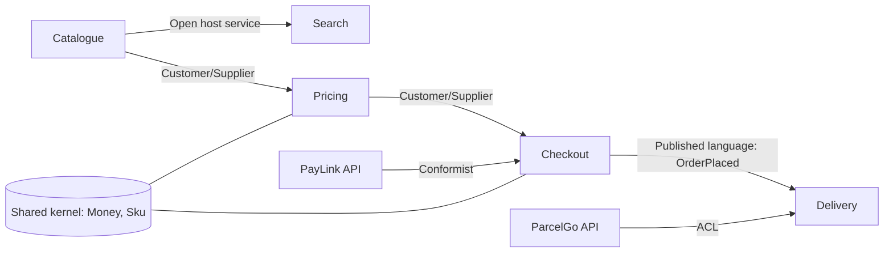
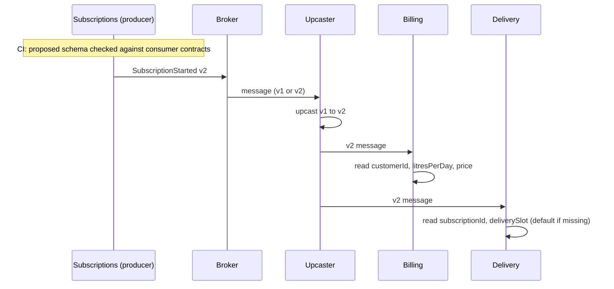

# Domain-Driven Design: Strategic Patterns

<span class="badge-l4">L4 🟠 Senior / Lead</span> · <span class="read-time">⏱ 40 min read</span> · Prerequisites: [Domain-Driven Design: Tactical Patterns](ddd-tactical.md), [Architectural Patterns](architectural-patterns.md)

!!! abstract "TL;DR"
    Strategic DDD is about **where one model ends and another begins**. A **ubiquitous language** makes code read like the business. A **bounded context** is the boundary inside which a model and its language are consistent; "product" can mean different things in Catalogue, Warehouse and Pricing, and that's fine. A **context map** documents how contexts relate (customer/supplier, conformist, partnership, shared kernel, open host service). An **anti-corruption layer** translates a foreign model so it can't distort yours. A **shared kernel** is a small model two contexts deliberately share; a **published language** is a documented, versioned format for integration. These decisions shape team boundaries, service boundaries and integration contracts, and they matter more than any tactical pattern.

## 1. What It Is

**Plain English.** In a grocery company, the warehouse, the app team and finance all talk about "products" and "orders", but they mean different things and care about different details. Strategic DDD accepts that: it gives each area its own model and language, draws clear boundaries between them, and designs how they exchange information.

**Definition.**

| Pattern | Purpose |
|---------|---------|
| Ubiquitous language | One shared vocabulary per context, used in conversation and code |
| Bounded context | Explicit boundary within which a model is consistent |
| Context map | Diagram and description of relationships between contexts |
| Anti-corruption layer (ACL) | Translation layer protecting a model from a foreign one |
| Shared kernel | Small, jointly owned model shared by two contexts |
| Published language | Well-documented exchange format for integration |
| Open host service | A protocol/API one context offers to many consumers |

## 2. Why It Exists

Large systems fail when one model tries to serve everyone: a 60-field `Product` class that every team edits, where each change breaks someone else, and nobody can agree what "available" means. Splitting by technical layers doesn't help. Evans' insight was that **models are only valid within a context**, and that the boundaries between contexts are a design decision with organisational consequences (Conway's Law). Getting them right enables independent teams and services; getting them wrong creates distributed monoliths.

## 3. Mental Model / Analogy

**Analogy.** Countries. Each has its own language and laws (bounded context, ubiquitous language). A map shows borders and treaties (context map). Interpreters translate at borders so foreign laws don't apply at home (anti-corruption layer). Some neighbours share a currency they must agree on before changing (shared kernel). International shipping uses standard documents everyone can read (published language).

**Technical model.** A bounded context is usually owned by one team, has its own code base or module and its own data, and integrates with others only through explicit contracts.

## 4. How It Works





## 5. Subtopics

### Ubiquitous language

**Description.** Within a bounded context, developers and domain experts use **one vocabulary**, and the code uses the same words: classes, methods and events named after business concepts (`Subscription.canSkip`, `SKIP_CUTOFF`), not technical stand-ins (`DataManager.process`, `flag2`). The language is refined in conversations and kept in a glossary.

**Advantages / features.** Experts can review rules by reading code; fewer translation errors; new developers learn the business from the code.

**Before (technical names) and after (domain language):**

```java title="UbiquitousLanguageDemo.java"
--8<-- "examples/l4-senior/ddd-strategic/UbiquitousLanguageDemo.java"
```

1. Before: the rule is correct but unreadable to anyone outside the team.
2. After: the same rule in the words a DairyDay operations manager uses.
3. A glossary keeps terms precise; code and conversations both use it.

**Run it:** `java UbiquitousLanguageDemo.java`

```text
--8<-- "examples/l4-senior/ddd-strategic/UbiquitousLanguageDemo.expected.txt"
```

| Smell | Language fix |
|-------|--------------|
| `Manager`, `Processor`, `Data`, `Info` names | Name the business concept or action |
| Boolean flags (`f2`, `isSpecial`) | Named states (`Paused`, `VipCustomer`) |
| Developers translating in meetings | Adopt the experts' words in code |
| Same word, different meanings | Split into contexts or qualify the term |

**Use** the experts' terms even when they seem odd ("dahi" vs "curd" if that's what the business says). **Avoid** inventing technical synonyms; every synonym is a translation bug waiting to happen.
**Real-world Java:** event names (`OrderPlaced`), method names (`order.place()`), package names by subdomain.
**Best practice:** keep a short glossary in the repo, and update code when the language changes. **Gotcha:** a language is only "ubiquitous" inside its context; forcing one glossary across the whole company recreates the God model.

### Bounded contexts

**Description.** A bounded context is the explicit boundary within which a particular model applies. Inside it, every term has one meaning. The same real-world thing (a product) can be modelled differently in different contexts, linked by a shared identifier. Contexts typically align with subdomains and teams, and often (not always) with deployable services.

**Advantages / features.** Smaller, focused models; teams change their model without coordinating with everyone; clear ownership.

```java title="BoundedContextsDemo.java"
--8<-- "examples/l4-senior/ddd-strategic/BoundedContextsDemo.java"
```

1. The shared identifier is the only thing all contexts agree on.
2. Each context models only what it needs: the warehouse cares about bins and chilling, not descriptions.
3. Before: one model with every field, which every team must coordinate on.

**Run it:** `java BoundedContextsDemo.java`

```text
--8<-- "examples/l4-senior/ddd-strategic/BoundedContextsDemo.expected.txt"
```

| Finding boundaries | Signal |
|--------------------|--------|
| Language changes meaning | "Product", "order", "delivery" mean different things |
| Different experts | Warehouse staff vs marketing vs finance |
| Different change rates | Prices change hourly, descriptions monthly |
| Different consistency needs | Stock must be exact; search can lag |
| Event storming | Clusters of events and commands around pivotal events |

**Use** bounded contexts to split large domains and organisations. **Avoid** one context per entity (too fine) or one for the whole company (too coarse).
**Real-world Java:** modules in a modular monolith, separate Spring Boot services, separate schemas.
**Best practice:** one team per context; a context can have several services, but a service shouldn't span contexts. **Gotcha:** sharing database tables across contexts silently merges their models again.

### Context mapping

**Description.** A context map documents how bounded contexts relate, technically and organisationally. Common relationships: **Partnership** (teams succeed or fail together), **Shared Kernel**, **Customer/Supplier** (upstream plans for downstream needs), **Conformist** (downstream adopts upstream's model as is), **Anti-corruption layer**, **Open Host Service** with a **Published Language**, and **Separate Ways**.

**Advantages / features.** Makes dependencies and power dynamics visible; shows where change ripples; guides integration design.

```java title="ContextMappingDemo.java"
--8<-- "examples/l4-senior/ddd-strategic/ContextMappingDemo.java"
```

1. The standard relationship types from the DDD community.
2. Each link names upstream, downstream and how they integrate.
3. Impact analysis: changes flow downstream, except where an anti-corruption layer absorbs them.

**Run it:** `java ContextMappingDemo.java`

```text
--8<-- "examples/l4-senior/ddd-strategic/ContextMappingDemo.expected.txt"
```

| Relationship | Downstream influence on upstream | Coupling |
|--------------|----------------------------------|----------|
| Partnership | High (joint planning) | High |
| Shared kernel | Shared ownership | High, small surface |
| Customer/Supplier | Negotiated | Medium |
| Conformist | None | High (adopts model) |
| Anti-corruption layer | None | Low (translated) |
| Open host + published language | Via versioned protocol | Low |
| Separate ways | n/a | None |

**Use** a context map early, and keep it current; it's the best overview of a large system. **Avoid** conformist relationships with volatile upstreams; put an ACL in between.
**Real-world Java:** Context Mapper DSL (CML) tooling, C4 container diagrams annotated with relationships.
**Best practice:** record the organisational reality (who can influence whom), not the ideal. **Gotcha:** "Customer/Supplier" fails if the supplier team has no incentive to serve the customer; escalate or switch to an ACL.

### Anti-corruption layer

**Description.** When integrating with a legacy system or third-party API whose model differs from yours, an anti-corruption layer **translates** between them: foreign codes, units, formats and concepts are mapped into your domain model at the boundary. Inside your context, nothing knows the foreign model exists.

**Advantages / features.** Your model stays clean; changes to the foreign system are contained in one place; unknown inputs can be quarantined.

```java title="AntiCorruptionLayerDemo.java"
--8<-- "examples/l4-senior/ddd-strategic/AntiCorruptionLayerDemo.java"
```

1. The legacy ERP's model: German-abbreviated field names, decimal commas, tax-inclusive prices, deletion flags.
2. The translator is the only code that knows those details.
3. Business meaning is translated, not just field names: prices become tax-exclusive and weights become grams.

**Run it:** `java AntiCorruptionLayerDemo.java`

```text
--8<-- "examples/l4-senior/ddd-strategic/AntiCorruptionLayerDemo.expected.txt"
```

| ACL component | Role |
|---------------|------|
| Facade | Simplifies the foreign API's calls |
| Adapter | Implements our port using the foreign client |
| Translator | Converts foreign data to our model and back |
| Quarantine / dead letter | Holds inputs that can't be translated |

**Use** an ACL for legacy systems, third-party APIs and any upstream you can't influence. **Avoid** one for stable, well-designed upstream models you can conform to cheaply.
**Real-world Java:** adapters around SAP/ERP connectors, payment gateway SDK wrappers, Spring Integration transformers.
**Best practice:** make the translator a pure function with thorough tests from real payloads. **Gotcha:** ACLs that grow business logic become a hidden context; keep them about translation.

### Shared kernel and published language

**Description.** A **shared kernel** is a small subset of the model (e.g., `Money`, `Sku`) that two contexts share as code and change only by agreement. A **published language** is a documented exchange format (event schemas, API specs) that a context offers to many consumers, versioned and evolved compatibly. Consumers should be **tolerant readers**: read only what they need, ignore unknown fields, default optional ones.

**Advantages / features.** Shared kernel avoids duplicate value types between close partners; published language lets many consumers integrate without coupling to internals.

```java title="SharedKernelPublishedLanguageDemo.java"
--8<-- "examples/l4-senior/ddd-strategic/SharedKernelPublishedLanguageDemo.java"
```

1. A shared kernel value object, jointly owned and deliberately tiny.
2. The published `OrderPlaced` message: type, version and documented fields.
3. A tolerant reader handles v1 (missing field), v2, and v3 (extra field) without changes.

**Run it:** `java SharedKernelPublishedLanguageDemo.java`

```text
--8<-- "examples/l4-senior/ddd-strategic/SharedKernelPublishedLanguageDemo.expected.txt"
```

| Format | Typical use |
|--------|-------------|
| JSON Schema / OpenAPI | REST APIs and JSON events |
| Avro / Protobuf + schema registry | Kafka events with compatibility checks |
| AsyncAPI | Documenting event-driven interfaces |
| CloudEvents | Common event envelope (type, source, id, time) |

**Use** a shared kernel only between closely cooperating teams, for small, stable concepts. **Avoid** "shared libraries" that grow into a shared domain model; that couples every team.
**Real-world Java:** shared `money` modules, Confluent Schema Registry with Avro/Protobuf, Spring Cloud Contract.
**Best practice:** version every published message and run compatibility checks in CI. **Gotcha:** Jackson fails on unknown properties by default (`FAIL_ON_UNKNOWN_PROPERTIES`); configure tolerant reading for consumers.

## 6. Examples (exactly 3, progressively harder)

### Example 1: Minimal (L2)

**Scenario:** at QuickDrop, customers and riders both talk about "deliveries", and every argument about the delivery model is really about two different things.

```java title="DeliveryTermsDemo.java"
--8<-- "examples/l4-senior/ddd-strategic/DeliveryTermsDemo.java"
```

1. To a customer, a delivery is when their order arrives.
2. To a rider, a delivery is one stop on a trip; the trip is the unit of work.

**Run it:** `java DeliveryTermsDemo.java`

**Output:**

```text
--8<-- "examples/l4-senior/ddd-strategic/DeliveryTermsDemo.expected.txt"
```

**What to notice:**

- Two small models are easier to get right than one model that must satisfy both groups.

### Example 2: Realistic (in FreshCart grocery delivery)

**Scenario:** FreshCart's Delivery context receives ParcelGo webhooks with ParcelGo's status codes (`MAN`, `OFD`, `UDL`, `RTO`) and reason codes. Translate them into FreshCart's delivery lifecycle and customer messages, and quarantine anything unexpected.

```java title="PartnerShipmentAclDemo.java"
--8<-- "examples/l4-senior/ddd-strategic/PartnerShipmentAclDemo.java"
```

1. ParcelGo's codes map to FreshCart's statuses in one table.
2. Unknown statuses and payloads without a FreshCart order reference are quarantined, not guessed.
3. Customer messages are FreshCart's language, chosen per status and reason.

**Run it:** `java PartnerShipmentAclDemo.java`

**Output:**

```text
--8<-- "examples/l4-senior/ddd-strategic/PartnerShipmentAclDemo.expected.txt"
```

**What to notice:**

- `RTO` (return to origin) isn't modelled yet; quarantining it creates a review task instead of a wrong status.
- If FreshCart switches to another partner, only a new ACL is needed; the Delivery model doesn't change.

### Example 3: Production-grade

**Scenario:** DairyDay's Subscriptions context publishes `SubscriptionStarted` to Billing and Delivery, which are owned by different teams. Old v1 messages are still in the broker. The Subscriptions team wants to rename a field and must not break anyone. Billing also integrates PayLink's mandate API, whose states change without notice.

```java title="ContextIntegrationDemo.java"
--8<-- "examples/l4-senior/ddd-strategic/ContextIntegrationDemo.java"
```

1. The published language: a schema per version with required and optional fields.
2. Upcasting converts old messages to the current version in one place, so consumers handle only one shape.
3. Each consumer declares the fields it uses (a consumer-driven contract).
4. Consumers build their own models from the message: billing accounts, route stops.
5. An anti-corruption layer maps PayLink's states, treating unknown ones as rejected.

**Run it:** `java ContextIntegrationDemo.java`

**Output:**

```text
--8<-- "examples/l4-senior/ddd-strategic/ContextIntegrationDemo.expected.txt"
```

**What to notice:**

- The v1 message was billed correctly after upcasting, and delivery defaulted the missing slot.
- The proposed v3 renamed `pricePerLitrePaise`; the contract check names exactly which consumer would break, before anything is deployed.
- In production, the same checks run with a schema registry (Avro/Protobuf compatibility rules) or Spring Cloud Contract / Pact.

## 7. Pros, Cons & Trade-offs

| Pattern | Pros | Cons |
|---------|------|------|
| Ubiquitous language | Shared understanding, readable code | Needs ongoing collaboration with experts |
| Bounded contexts | Focused models, team autonomy | Duplication of similar concepts; integration work |
| Context map | Visibility of dependencies and power | Must be kept current |
| Anti-corruption layer | Protected model, contained change | Extra translation code to maintain |
| Shared kernel | No duplication between partners | Coupled release coordination |
| Published language | Many consumers, safe evolution | Versioning discipline required |

## 8. When to Use / When NOT to Use

**Use them when:**

- several teams work on one domain or system;
- the business uses the same words with different meanings;
- integrating with legacy or third-party systems.

**Don't overdo them when:**

- one small team owns a simple domain; one context is fine;
- contexts would be split purely along technical lines;
- integration formats would be versioned for consumers that don't exist.

## 9. Best Practices

1. **Discover contexts with domain experts (event storming), not by drawing boxes alone.** *(Consensus.)*
2. **One team per bounded context.** *(Consensus.)*
3. **No shared database tables across contexts.** *(Consensus.)*
4. **ACLs for legacy and third-party upstreams.** *(Consensus.)*
5. **Version published languages; consumers read tolerantly.** *(Consensus.)*
6. **Keep shared kernels tiny and stable.** *(Consensus.)*
7. **Draw the context map as it is, then as you want it.** *(Opinion, widely used.)*

## 10. Pitfalls & Anti-Patterns

!!! danger "Breaking a published message (production failure mode)"
    **Symptom:** billing stopped creating invoices for new subscriptions; nobody noticed for four days.
    **Root cause:** the Subscriptions team renamed `pricePerLitrePaise` in their event; billing read `null` and skipped the message as invalid.
    **Fix:** consumer-driven contract checks in the producer's CI; additive changes only (add the new field, deprecate the old, remove after consumers migrate); alerts on skipped messages.

!!! danger "One model to rule them all"
    **Symptom:** a 60-field shared `Product` library; every release needs sign-off from six teams.
    **Root cause:** no bounded contexts; "reuse" of one model everywhere.
    **Fix:** split into context-specific models linked by SKU; keep only `Sku` and `Money` shared.

!!! danger "Conformist to a volatile partner"
    **Symptom:** every ParcelGo API change broke FreshCart's delivery screens.
    **Root cause:** ParcelGo's statuses were used directly in the domain and UI.
    **Fix:** an anti-corruption layer translating to FreshCart's own statuses.

!!! danger "Contexts drawn around technology"
    **Symptom:** "frontend context", "database context", "notification context"; every feature touches all of them.
    **Root cause:** boundaries by technical layer rather than business capability.
    **Fix:** redraw around business capabilities and language.

## 11. Configuration & Tuning

| Setting / tool | Default | What it does | When to change it | Risk of changing |
|----------------|---------|--------------|-------------------|------------------|
| Jackson `FAIL_ON_UNKNOWN_PROPERTIES` | true | Fails on unknown JSON fields | false for tolerant consumers | Typos go unnoticed |
| Schema registry compatibility | BACKWARD | Allowed schema changes | FULL for shared topics | Slower evolution |
| Spring Cloud Contract / Pact | — | Consumer-driven contracts | Cross-team APIs/events | Contract maintenance |
| Context Mapper (CML) | — | Context maps as code | Large landscapes | Tooling learning curve |
| CloudEvents envelope | — | Standard event metadata | Multi-team event platforms | Migration of existing events |

## 12. Security Considerations

- Context boundaries are natural trust boundaries: validate everything crossing them, especially from external upstreams.
- ACLs should sanitise and validate foreign data, not only translate it.
- Published languages should exclude personal data consumers don't need; classify fields.
- Shared kernels must not include security-sensitive logic one team could change for both.

## 13. Performance & Scalability

Bounded contexts allow different scaling strategies per context (search scaled for reads, checkout for writes). Translation layers cost little CPU; the main costs are extra network hops and data duplication. Event-carried data reduces cross-context calls at the price of storage and eventual consistency. Keep published messages compact and avoid chatty request/response integration across contexts.

## 14. Testing It

Test translations with real payloads, schemas against consumer contracts, and upcasters with old messages:

```java title="ContextIntegrationTest.java"
--8<-- "examples/l4-senior/ddd-strategic/ContextIntegrationTest.java"
```

## 15. Observability & Operations

Monitor each integration point: messages consumed, skipped, quarantined and upcast per version; ACL translation failures by reason. Alert on quarantine growth. Track schema versions in use per consumer so old versions can be retired. A context map in the docs, linked to dashboards per context, helps on-call engineers understand blast radius.

## 16. Version Notes

| Year | Change |
|------|--------|
| 2003 | Evans' *Domain-Driven Design*: bounded context, context map, ACL |
| 2013 | Vernon's *Implementing DDD*: context mapping in practice |
| 2013 | Brandolini introduces Event Storming |
| 2014+ | Microservices popularise bounded contexts as service boundaries |
| 2019 | Team Topologies links contexts to team design |
| 2020s | DDD Crew context map canvas, Context Mapper DSL |

## 17. Expert Deep Dive

- **Subdomain types.** Core (competitive advantage: invest), supporting (necessary, custom), generic (buy or use off-the-shelf). Spend DDD effort on core subdomains.
- **Team Topologies.** Stream-aligned teams own contexts; platform teams offer open host services; enabling teams help adopt patterns.
- **Context boundaries vs service boundaries.** A context may be one service, a module in a monolith, or several services; boundaries are about models and language, deployment is a separate choice.
- **Evolving boundaries.** Contexts split as understanding grows; plan for it with published languages and ACLs that make re-partitioning cheaper.
- **Data mesh parallels.** Domain-owned data products are bounded contexts for analytics, with published languages for data.

!!! example "War story: four days without invoices"
    DairyDay's Subscriptions team renamed `pricePerLitrePaise` to `unitPrice` in `SubscriptionStarted`, a "cleanup" approved in their own review. Billing's consumer treated messages without a price as malformed and skipped them, logging at DEBUG. For four days, 1,900 new subscribers received milk with no invoices. **Fixes:** a consumer-driven contract check in the producer's pipeline (exactly the check in Example 3); a rule that published fields are only added or deprecated, never renamed in place; quarantine with an alert for skipped messages; and a context map review in each team's planning. Recovered revenue required a manual backfill from the event log. **Lesson:** a published language is a promise to other teams; the producer's CI must check it.

## 18. Interview Corner

=== "🟢 L1–L2"

    1. **What's a ubiquitous language?** A **shared vocabulary** used by experts and in code.
    2. **What's a bounded context?** The **boundary within which a model is consistent**.
    3. **Can "product" mean different things?** **Yes**, in different contexts.
    4. **What does an ACL do?** **Translates a foreign model** into ours.
    5. **What's a published language?** A **documented exchange format**.

=== "🟡 L3"

    1. **Shared kernel vs shared library?** Shared kernel is **small, deliberately co-owned**; libraries often grow into shared models.
    2. **Conformist vs ACL?** **Adopt upstream's model** vs **translate it**.
    3. **How do you find context boundaries?** **Language shifts, experts, change rates, event storming.**
    4. **What's a tolerant reader?** A consumer that **ignores unknown fields** and **defaults optional ones**.
    5. **Should contexts share database tables?** **No**.

=== "🔴 L4–L5"

    1. **How do contexts relate to teams and services?** **One team per context**; context may be one or more services or a module.
    2. **How do you evolve an event schema safely?** **Additive changes, versions, upcasting, consumer-driven contracts, registry compatibility.**
    3. **Customer/Supplier isn't working; what now?** **Escalate priorities**, or switch to **ACL / separate ways**.
    4. **Where do you invest DDD effort?** **Core subdomains**; buy generic ones.
    5. **How do you migrate from a shared God model?** **Identify contexts, introduce context-specific models with ACLs, strangle the shared model.**

=== "💻 Hands-on"

    **Task:** Add a schema compatibility rule to `ContextIntegrationDemo`: a new version may not make a previously optional field required.

    ??? success "Solution"
        ```java
        static List<String> optionalBecameRequired(Schema previous, Schema proposed) {
            return previous.optional().stream()
                    .filter(proposed.required()::contains)
                    .sorted()
                    .map(f -> "'" + f + "' changed from optional to required")
                    .toList();
        }
        // old producers (and old messages in the broker) may not include it; upcasters would need a default
        ```

## 19. Practice

- [ ] Run a one-hour event storming session on FreshCart's checkout and mark candidate bounded contexts.
    ??? tip "Hint"
        Look for pivotal events like `OrderPlaced` where language changes.
- [ ] Draw FreshCart's context map with the relationship types from this page.
    ??? tip "Hint"
        Start from `ContextMappingDemo.FRESHCART`.
- [ ] Write an ACL for a public API you use (weather, maps) into your own model.
    ??? tip "Hint"
        Translate units and codes; quarantine unknowns.
- [ ] Configure a Jackson `ObjectMapper` as a tolerant reader and test it with an extra field.
    ??? tip "Hint"
        `disable(DeserializationFeature.FAIL_ON_UNKNOWN_PROPERTIES)`.

## 20. Quick Revision Card

!!! tip "Remember in 30 seconds"
    - Language and model are valid only inside a bounded context.
    - Same word, different meanings → different contexts, linked by IDs.
    - Context map: partnership, shared kernel, customer/supplier, conformist, ACL, open host/published language.
    - ACL for legacy and volatile upstreams; quarantine what can't be translated.
    - Published language: versioned, additive changes, tolerant readers, consumer contracts.
    - One team per context; no shared tables.

    ```java
    for (ConsumerContract c : contracts)
        for (String f : c.fieldsUsed())
            if (!proposed.required().contains(f) && !proposed.optional().contains(f))
                broken.add(c.consumer() + " needs '" + f + "'");
    ```

## 21. Further Reading

- Eric Evans, *Domain-Driven Design* (2003), Part IV "Strategic Design".
- Vlad Khononov, *Learning Domain-Driven Design* (2021).
- Alberto Brandolini, *Introducing EventStorming* (Leanpub).
- Matthew Skelton and Manuel Pais, *Team Topologies* (2nd ed., 2025).
- [DDD Crew: context mapping](https://github.com/ddd-crew/context-mapping) and [Context Mapper](https://contextmapper.org/).

---

[← Previous: Domain-Driven Design: Tactical Patterns](ddd-tactical.md) · [Next: Microservice Patterns →](microservice-patterns.md)
