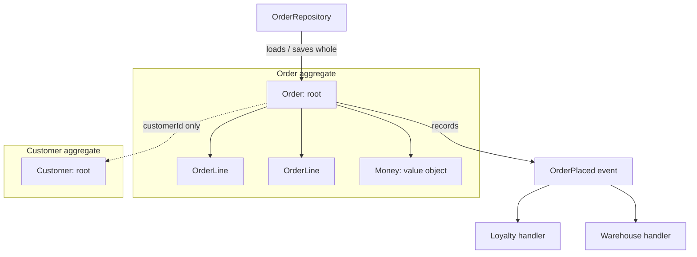
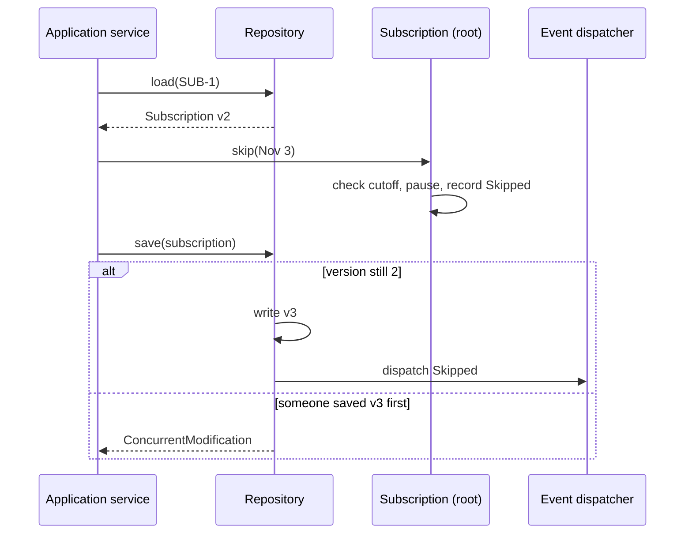

# Domain-Driven Design: Tactical Patterns

<span class="badge-l4">L4 🟠 Senior / Lead</span> · <span class="read-time">⏱ 45 min read</span> · Prerequisites: [Architectural Patterns](architectural-patterns.md), [Enterprise Application Patterns](../l3-professional/enterprise-application-patterns.md)

!!! abstract "TL;DR"
    DDD's tactical patterns are the building blocks for modelling a complex domain in code. **Entities** have identity that persists as attributes change. **Value objects** are immutable, compared by value and validate themselves (`Money`, `PinCode`). **Aggregates** group objects that must stay consistent, with one **root** that enforces invariants; one transaction changes one aggregate. **Domain events** record meaningful things that happened. **Domain services** hold logic that belongs to no single object. **Factories** create valid aggregates, and **repositories** store and load whole aggregates by ID. In Java 21, records, sealed types and pattern matching make these patterns lighter than ever.

## 1. What It Is

**Plain English.** A grocery business has concepts with rules: an order can't exceed the cash-on-delivery limit, a subscription can't be skipped after 10 pm the night before, money is never negative. Tactical DDD puts those concepts and rules into code objects that protect themselves, instead of scattering checks through services.

**Definition.**

| Pattern | Identity | Mutability | Example |
|---------|----------|------------|---------|
| Entity | By ID | Mutable | `Customer`, `Rider` |
| Value object | By value | Immutable | `Money`, `PinCode`, `DeliveryWindow` |
| Aggregate (root) | By root ID | Mutable through root only | `Order` with lines, `Subscription` |
| Domain event | n/a | Immutable | `OrderPlaced`, `SubscriptionPaused` |
| Domain service | n/a | Stateless | `RefundPolicy`, `MonthlyBilling` |
| Factory | n/a | n/a | `SubscriptionFactory` |
| Repository | n/a | n/a | `SubscriptionRepository` |

## 2. Why It Exists

In many business applications, rules live in services that manipulate data classes ([anaemic domain model](../l3-professional/anti-patterns-and-code-smells.md)). As rules grow, they get duplicated, forgotten and contradicted, and invalid states reach the database. Eric Evans' *Domain-Driven Design* (2003) proposed modelling the domain in rich objects shaped by the language of domain experts, with explicit consistency boundaries. Tactical patterns are how that model is built; [strategic patterns](ddd-strategic.md) decide where models end.

## 3. Mental Model / Analogy

**Analogy.** A bank branch. A customer (entity) is the same person even after changing their phone number. A ₹500 note (value object) is interchangeable with any other ₹500 note. A locker with its contents (aggregate) is opened only by the locker key-holder (root), who checks the rules. "Locker opened" is written in the logbook (domain event). Currency exchange (domain service) involves two currencies and a rate; it belongs to neither. Account opening forms (factory) make sure new accounts are complete; the vault (repository) stores and retrieves whole lockers.

**Technical model.** Aggregates are consistency boundaries; within one, invariants hold after every transaction. Between aggregates, consistency is eventual, via events.

## 4. How It Works





## 5. Subtopics

### Entities

**Description.** An entity has a **stable identity** that persists across changes to its attributes and across storage, sessions and systems. Equality is by identity. Use a dedicated ID type (`CustomerId`) rather than a bare `String` or `Long`, so IDs of different entities can't be mixed up.

**Advantages / features.** Correct behaviour in sets and maps as attributes change; tracking over time; clear lifecycle.

**Before (equality by all fields) and after (equality by identity):**

```java title="EntityDemo.java"
--8<-- "examples/l4-senior/ddd-tactical/EntityDemo.java"
```

1. A typed ID that validates its format.
2. Equality and hash code use only the ID.
3. Before: a record (or Lombok `@Data`) compares all fields, so the "same" customer stops being equal after a phone change.

**Run it:** `java EntityDemo.java`

```text
--8<-- "examples/l4-senior/ddd-tactical/EntityDemo.expected.txt"
```

| Question | Entity | Value object |
|----------|--------|--------------|
| Do we track it over time? | Yes | No |
| Can two with equal attributes be different? | Yes | No |
| Mutable? | Usually | Never |
| Java shape | Class with ID-based `equals` | `record` |

**Use** entities for things the business tracks individually (customers, orders, riders). **Avoid** making everything an entity; most concepts are better as value objects.
**Real-world Java:** JPA `@Entity` with `@Id`; jMolecules `@Entity` and `Identifier`.
**Best practice:** generate IDs in the domain (UUIDs, or ULIDs for ordering) so new entities have identity before saving. **Gotcha:** JPA entities with database-generated IDs have no ID until persisted, breaking `equals`/`hashCode` in sets; use application-assigned IDs or compare carefully.

### Value objects

**Description.** A value object describes a characteristic with no identity of its own: money, quantities, addresses, date ranges. It's **immutable**, equal by value, and **validates itself** on construction, so an invalid one can't exist. Behaviour that belongs to the concept (adding money, checking window overlap) lives on it.

**Advantages / features.** Eliminates primitive obsession; thread-safe; no defensive copies; tiny, testable units of logic.

```java title="ValueObjectDemo.java"
--8<-- "examples/l4-senior/ddd-tactical/ValueObjectDemo.java"
```

1. `Money` validates amount and currency and provides arithmetic returning new values.
2. `DeliveryWindow` encodes business rules (two-hour windows, operating hours) and behaviour (overlap).
3. Records give value equality for free.

**Run it:** `java ValueObjectDemo.java`

```text
--8<-- "examples/l4-senior/ddd-tactical/ValueObjectDemo.expected.txt"
```

| Primitive | Value object | Gains |
|-----------|--------------|-------|
| `long amountPaise` | `Money` | Unit safety, arithmetic, formatting |
| `String pin` | `PinCode` | Validation, region lookup |
| `int start, int end` | `DeliveryWindow` | Invariants, overlap logic |
| `String email` | `Email` | Normalisation, validation |

**Use** value objects generously; they're the cheapest, highest-return DDD pattern. **Avoid** value objects with setters or identity fields.
**Real-world Java:** `java.time` types, `BigDecimal`, `Currency`, JSR 354 `MonetaryAmount`.
**Best practice:** persist with JPA `@Embeddable` (records are supported as embeddables in Jakarta Persistence 3.2 / Hibernate 6.2+). **Gotcha:** `BigDecimal.equals` compares scale (`2.0` ≠ `2.00`); normalise in the value object or use `compareTo`.

### Aggregates and invariants

**Description.** An aggregate is a cluster of entities and value objects treated as one unit for changes. External code holds references only to the **aggregate root** and changes the aggregate only through its methods, which enforce **invariants**: rules that must always be true. One transaction should modify one aggregate; aggregates refer to each other by ID.

**Advantages / features.** Invariants enforced in one place; clear transaction and locking boundaries; safe concurrency.

```java title="AggregateDemo.java"
--8<-- "examples/l4-senior/ddd-tactical/AggregateDemo.java"
```

1. The root owns its lines and the rules about them: item limit, COD limit, frozen after placing.
2. Other aggregates (the customer) are referenced by ID, never by object.
3. The lines are exposed read-only, so the only way to add one is through the rule-checking method.

**Run it:** `java AggregateDemo.java`

```text
--8<-- "examples/l4-senior/ddd-tactical/AggregateDemo.expected.txt"
```

| Vaughn Vernon's aggregate rules | Why |
|---------------------------------|-----|
| Model true invariants in consistency boundaries | Only rules that must be immediately consistent belong together |
| Design small aggregates | Less contention, faster loads |
| Reference other aggregates by identity | No accidental cross-aggregate changes |
| Use eventual consistency outside the boundary | Domain events between aggregates |

**Use** aggregates for any cluster with rules spanning several objects. **Avoid** huge aggregates ("Customer with all orders"): every change locks everything and loads too much.
**Real-world Java:** JPA root entity with `@OneToMany(cascade = ALL, orphanRemoval = true)` children; Spring Data repositories per root only; Axon aggregates.
**Best practice:** if two users regularly edit the same aggregate concurrently, it's probably too big. **Gotcha:** returning a mutable internal collection (even a JPA-managed `List`) lets callers bypass invariants; return unmodifiable views or copies.

### Domain events

**Description.** A domain event records something that happened in the domain that domain experts care about: `OrderPlaced`, `SubscriptionPaused`. Aggregates **record** events when state changes; the application **dispatches** them after the aggregate is saved. Handlers update other aggregates, send notifications, or inform other bounded contexts.

**Advantages / features.** Side effects decoupled from the aggregate; an explicit record of business facts; the basis for eventual consistency between aggregates.

```java title="DomainEventsDemo.java"
--8<-- "examples/l4-senior/ddd-tactical/DomainEventsDemo.java"
```

1. A sealed hierarchy of events, named in the past tense.
2. The aggregate records events as part of the state change, without knowing who listens.
3. Events are dispatched only after saving, so handlers never act on unsaved changes.

**Run it:** `java DomainEventsDemo.java`

```text
--8<-- "examples/l4-senior/ddd-tactical/DomainEventsDemo.expected.txt"
```

| Kind | Scope | Delivery | Example |
|------|-------|----------|---------|
| Domain event | Within a bounded context | In-process, after commit | `OrderPlaced` → loyalty points |
| Integration event | Between contexts/services | Broker, via outbox | `OrderPlaced` → warehouse system |
| Event-sourced event | The aggregate's own history | Stored as the state | See [Distributed Data Patterns](distributed-data-patterns.md) |

**Use** domain events for consequences that live outside the aggregate. **Avoid** events as hidden method calls that must happen in the same transaction for correctness; that's a sign the boundary is wrong.
**Real-world Java:** Spring Data's `@DomainEvents` / `AbstractAggregateRoot.registerEvent`, Spring Modulith, Axon.
**Best practice:** events carry IDs and the facts handlers need, and are immutable records. **Gotcha:** Spring Data publishes `@DomainEvents` only when you call `save()` on the repository; modifying a managed entity without `save()` publishes nothing.

### Domain services

**Description.** Some domain logic doesn't naturally belong to one entity or value object: it involves several aggregates, or a policy that uses external facts. A **domain service** is a stateless object, named in the domain language, that holds that logic. It differs from an application service, which orchestrates use cases (load, call, save) but contains no business rules.

**Advantages / features.** Keeps entities focused; puts cross-object rules somewhere explicit and testable.

```java title="DomainServiceDemo.java"
--8<-- "examples/l4-senior/ddd-tactical/DomainServiceDemo.java"
```

1. A refund policy needs the order, the complaint and membership status, so no single object owns it.
2. Rules are expressed in domain terms: complaint window, kind of complaint.
3. Member perks are a business rule, not a technical one, so they belong here too.

**Run it:** `java DomainServiceDemo.java`

```text
--8<-- "examples/l4-senior/ddd-tactical/DomainServiceDemo.expected.txt"
```

| | Domain service | Application service |
|-|----------------|---------------------|
| Contains business rules | Yes | No |
| Transactions, security | No | Yes |
| Talks to repositories | Rarely (via interfaces) | Yes |
| Named after | Domain concept (`RefundPolicy`) | Use case (`ResolveComplaint`) |

**Use** a domain service when a rule spans aggregates or needs external facts. **Avoid** moving entity behaviour into services; that slides back to an anaemic model.
**Real-world Java:** pricing engines, tax calculators, routing/allocation policies.
**Best practice:** keep domain services pure (inputs in, result out) so they're trivially testable. **Gotcha:** a "service" with 30 methods operating on one entity is a God Object, not a domain service.

### Factories and repositories in DDD

**Description.** A **factory** creates aggregates that are valid from the start when construction is complex (choosing a plan, checking allowed days, generating IDs). A **repository** gives collection-like access to aggregates: one repository per aggregate root, which loads and stores the **whole** aggregate. There are no repositories for internal entities, and no queries that return half an aggregate for modification.

**Advantages / features.** Construction rules in one place; persistence hidden behind domain language; aggregate boundaries respected by data access.

```java title="DddFactoryRepositoryDemo.java"
--8<-- "examples/l4-senior/ddd-tactical/DddFactoryRepositoryDemo.java"
```

1. The factory checks the plan exists and the chosen days are allowed before creating anything.
2. The repository interface is per aggregate root, in domain language.
3. There's no `SubscriptionDayRepository`: days are only reachable through their subscription.

**Run it:** `java DddFactoryRepositoryDemo.java`

```text
--8<-- "examples/l4-senior/ddd-tactical/DddFactoryRepositoryDemo.expected.txt"
```

| Factory form | When |
|--------------|------|
| Static creation method on the root | Simple creation (`Order.draft(customerId)`) |
| Factory class | Needs other data (plans, catalogues) or dependencies |
| Factory method on another aggregate | Creation is part of another's behaviour (`customer.startSubscription(...)`) |
| Reconstitution in the repository | Rebuilding from storage, bypassing "new" rules |

**Use** factories when creation has rules beyond field validation. **Avoid** a factory class for objects whose constructor is enough.
**Real-world Java:** Spring Data repositories per aggregate root; `jMolecules` `@Factory`, `@Repository`.
**Best practice:** separate "create new" (applies business rules, records `Started`) from "reconstitute from storage" (no events). **Gotcha:** generic repositories with `findAll(Specification)` for every entity invite loading and modifying internal entities directly.

## 6. Examples (exactly 3, progressively harder)

### Example 1: Minimal (L2)

**Scenario:** QuickDrop passes PIN codes around as strings, validated (or not) in a dozen places. Introduce a `PinCode` value object.

```java title="PinCodeDemo.java"
--8<-- "examples/l4-senior/ddd-tactical/PinCodeDemo.java"
```

1. Normalisation and validation happen once, in the compact constructor.
2. Domain behaviour (region, same city) lives with the data.

**Run it:** `java PinCodeDemo.java`

**Output:**

```text
--8<-- "examples/l4-senior/ddd-tactical/PinCodeDemo.expected.txt"
```

**What to notice:**

- Every method that takes a `PinCode` can trust it; the dozen scattered checks can be deleted.

### Example 2: Realistic (in FreshCart grocery delivery)

**Scenario:** FreshCart's cart has rules: at most 2 kg of mangoes per order during the season, one coupon per order, nothing changes after checkout. Other contexts (analytics, recommendations) want to know what happened.

```java title="CartAggregateDemo.java"
--8<-- "examples/l4-senior/ddd-tactical/CartAggregateDemo.java"
```

1. Lines are internal to the aggregate, keyed by SKU, so adding the same item merges quantities.
2. Invariants are checked on every change, including the merged quantity.
3. Checkout records an event with the final total.

**Run it:** `java CartAggregateDemo.java`

**Output:**

```text
--8<-- "examples/l4-senior/ddd-tactical/CartAggregateDemo.expected.txt"
```

**What to notice:**

- Refused operations recorded no events; the event list is an accurate history of accepted changes.
- No code outside `Cart` can break the mango limit, however it's called.

### Example 3: Production-grade

**Scenario:** DairyDay's milk subscription. Customers skip days (until 22:00 the night before) and pause up to 30 days; support staff resume subscriptions; a customer's phone and the support desk sometimes edit the same subscription at once. Billing charges per delivered litre. Every accepted change must produce an event for delivery planning, and no event may escape from a failed save.

```java title="SubscriptionAggregateDemo.java"
--8<-- "examples/l4-senior/ddd-tactical/SubscriptionAggregateDemo.java"
```

1. A version number enables optimistic concurrency.
2. Invariants live on the root: the 22:00 cutoff, no skipping paused days, the pause limit.
3. The factory creates valid subscriptions and records the `Started` event.
4. The repository saves the whole aggregate, checks the version, and only then publishes its events.
5. Billing is a domain service: it needs the subscription and the calendar.

**Run it:** `java SubscriptionAggregateDemo.java`

**Output:**

```text
--8<-- "examples/l4-senior/ddd-tactical/SubscriptionAggregateDemo.expected.txt"
```

**What to notice:**

- The stale browser tab's skip was rejected instead of silently overwriting the support desk's resume.
- The November bill counts 24 delivery days: 30 days minus 5 Sundays minus 1 skip.
- Only events from successful saves were published; the stale tab's `Skipped` event never escaped.

## 7. Pros, Cons & Trade-offs

| Pattern | Pros | Cons |
|---------|------|------|
| Entities with typed IDs | Clear identity, no ID mix-ups | More small types |
| Value objects | Validation once, expressive code | Mapping to persistence |
| Aggregates | Enforced invariants, clear transactions | Design effort; wrong boundaries hurt |
| Domain events | Decoupled side effects | Eventual consistency; more moving parts |
| Domain services | Explicit cross-object rules | Risk of anaemic drift |
| Factories / repositories | Valid creation, aggregate-shaped persistence | More types than plain CRUD |

## 8. When to Use / When NOT to Use

**Use them when:**

- the domain has real, changing business rules (pricing, scheduling, subscriptions);
- domain experts are available and the language matters;
- the code will live for years.

**Don't use them when:**

- the service is CRUD over a few tables with no rules;
- it's a reporting or analytics workload (use read models and SQL);
- the team has no access to domain knowledge; patterns without the model are ceremony.

## 9. Best Practices

1. **Prefer value objects; make entities only for tracked things.** *(Consensus.)*
2. **Small aggregates, referenced by ID.** *(Consensus; Vaughn Vernon.)*
3. **One aggregate per transaction; eventual consistency between aggregates.** *(Consensus, with pragmatic exceptions.)*
4. **Dispatch domain events after the save succeeds.** *(Consensus.)*
5. **Use optimistic locking on aggregates.** *(Consensus.)*
6. **Name everything in the ubiquitous language.** *(Consensus.)*
7. **Keep framework annotations out of the domain where practical.** *(Opinion; many teams accept JPA annotations.)*

## 10. Pitfalls & Anti-Patterns

!!! danger "Invariant bypassed through a mutable collection (production failure mode)"
    **Symptom:** orders with 60 items went through despite a 30-item limit; packers ran out of crates.
    **Root cause:** a bulk-import feature called `order.getLines().addAll(...)` on the JPA-managed list, bypassing `addLine`.
    **Fix:** expose read-only views, keep the collection private, and add a test that external modification fails.

!!! danger "Giant aggregate"
    **Symptom:** `OptimisticLockException` storms whenever a customer is busy; loading a customer takes 2 seconds.
    **Root cause:** `Customer` aggregate contained all orders, addresses and subscriptions.
    **Fix:** split into separate aggregates referencing `CustomerId`; keep only true invariants together.

!!! danger "Events published before save"
    **Symptom:** loyalty points granted for orders that failed to save.
    **Root cause:** events dispatched from inside the aggregate method.
    **Fix:** record in the aggregate, dispatch after commit.

!!! danger "Value objects with setters"
    **Symptom:** a shared `Money` instance changed in one order and altered another's total.
    **Root cause:** mutable "value" object shared between aggregates.
    **Fix:** immutable records; operations return new instances.

## 11. Configuration & Tuning

| Setting / tool | Default | What it does | When to change it | Risk of changing |
|----------------|---------|--------------|-------------------|------------------|
| JPA `@Version` | none | Optimistic locking per aggregate root | Always on roots | Must handle conflicts |
| `@Embeddable` records | — | Value objects as columns | Value objects | Older Hibernate versions need classes |
| `@OneToMany(orphanRemoval = true)` | false | Child lifecycle bound to root | Aggregate internals | Accidental deletes if misused |
| Spring Data `AbstractAggregateRoot` | — | Event registration on save | Domain events | Only on `save()` |
| jMolecules + ArchUnit rules | — | Verifies DDD building-block rules | Larger teams | Learning curve |
| ID generation (UUIDv7/ULID) | DB sequence | Identity before persistence | Domain-generated IDs | Index locality (use time-ordered IDs) |

## 12. Security Considerations

- Aggregates enforce business invariants; authorisation (who may call `skip`) usually belongs to the application service, but domain rules like "only the owner can pause" can be modelled explicitly.
- Typed IDs prevent mixing `CustomerId` and `OrderId`, a source of IDOR bugs.
- Value objects centralise input validation (lengths, formats), reducing injection risk at deeper layers.
- Domain events may carry personal data; include only what consumers need.

## 13. Performance & Scalability

Small aggregates load fast and lock little. Large collections inside aggregates hurt; model them as separate aggregates or query them via read models. Value objects are typically scalar-replaced or cheap. Optimistic concurrency scales well when conflicts are rare; frequent conflicts mean the aggregate boundary is too wide. Use read models (CQRS) for list screens instead of loading many aggregates.

## 14. Testing It

Aggregates and value objects are plain Java: test invariants, state transitions, events and concurrency behaviour directly, without Spring or a database:

```java title="SubscriptionAggregateTest.java"
--8<-- "examples/l4-senior/ddd-tactical/SubscriptionAggregateTest.java"
```

## 15. Observability & Operations

Log domain events (type and aggregate ID) as structured logs; they make an excellent audit trail. Count invariant violations by rule (`skip_refused{reason="cutoff"}`) to show product teams where users struggle. Track optimistic-lock conflicts per aggregate type; spikes suggest contention or oversized aggregates.

## 16. Version Notes

| Year / version | Change |
|----------------|--------|
| 2003 | Evans, *Domain-Driven Design* |
| 2011 | Vernon's "Effective Aggregate Design" essays |
| 2013 | Vernon, *Implementing Domain-Driven Design* |
| Java 16 | Records: concise value objects and events |
| Java 17 | Sealed types: closed event hierarchies |
| Java 21 | Pattern matching for `switch`: exhaustive event handling |
| Hibernate 6.2 / Jakarta Persistence 3.2 | Records as embeddables |

## 17. Expert Deep Dive

- **Invariants vs policies.** Invariants must hold within the aggregate after every transaction; policies ("when an order is placed, award points") can be eventually consistent and belong in event handlers.
- **Reconstitution.** Loading from storage must not re-run "new" rules or record events; use a separate path (package-private constructor, factory method) for repositories.
- **Aggregate design by contention.** Look at which data is edited together and by whom; the boundary that minimises concurrent edits while keeping invariants is usually right.
- **Event granularity.** Fine-grained events (`ItemAdded`) serve analytics; coarse events (`CheckedOut`) serve integration. Don't publish internal events to other contexts unchanged.
- **Modelling with types.** Sealed types make illegal states unrepresentable (`Active`, `Paused(from, to)`, `Cancelled(reason)` instead of nullable fields).

!!! example "War story: the 60-item orders"
    FreshCart's `Order` aggregate enforced a 30-item limit in `addLine`. A new B2B bulk-order feature, written under deadline, built orders by calling `order.getLines().addAll(importedLines)`; the getter returned Hibernate's managed `PersistentBag`. For three weeks, cafés placed 60-item orders that didn't fit in delivery vans; riders had to make second trips at FreshCart's cost. **Fixes:** the getter now returns an unmodifiable view; bulk orders got their own `addLines` method that checks limits (with a higher B2B limit as an explicit rule); an ArchUnit test forbids public methods returning mutable collections from aggregate roots. **Lesson:** an invariant is only as strong as the encapsulation around it.

## 18. Interview Corner

=== "🟢 L1–L2"

    1. **Entity vs value object?** **Identity** vs **value equality**.
    2. **Why make value objects immutable?** **Safe sharing**, no surprise changes.
    3. **What's an aggregate root?** The **entry point** that enforces the aggregate's rules.
    4. **What's a domain event?** A **business fact that happened**, in the past tense.
    5. **What's a repository in DDD?** Collection-like access to **whole aggregates**.

=== "🟡 L3"

    1. **Why reference other aggregates by ID?** To **avoid cross-aggregate changes** and huge object graphs.
    2. **Domain service vs application service?** **Business rules** vs **orchestration/transactions**.
    3. **When are domain events dispatched?** **After the aggregate is saved** (commit).
    4. **How do you protect invariants?** **Encapsulation**: private state, read-only views, methods that check rules.
    5. **Why typed IDs?** **Type safety**: can't pass an `OrderId` where a `CustomerId` is expected.

=== "🔴 L4–L5"

    1. **How do you choose aggregate boundaries?** **True invariants + contention patterns**; keep them small.
    2. **What if a business rule spans two aggregates?** **Eventual consistency with events and compensation**, or reconsider the boundary.
    3. **How do you handle concurrent edits?** **Optimistic locking** with conflict handling in the UI.
    4. **When is tactical DDD overkill?** **CRUD and reporting**; little behaviour to model.
    5. **How do you persist rich models with JPA without leaking?** **Embeddables, field access, protected constructors**, or separate persistence models.

=== "💻 Hands-on"

    **Task:** Add a `changeLitres(Litres, LocalDate effectiveFrom)` rule to `Subscription`: changes take effect from the day after tomorrow at the earliest, and record a `LitresChanged` event.

    ??? success "Solution"
        ```java
        record LitresChanged(SubscriptionId id, int litres, LocalDate from) implements Event {}   // add to the sealed list

        void changeLitres(Litres newLitres, LocalDate from, LocalDate today) {
            if (from.isBefore(today.plusDays(2))) throw new IllegalStateException("changes apply from " + today.plusDays(2));
            if (newLitres.equals(litres)) return;
            litres = newLitres;            // a fuller model would keep a schedule of changes by date
            events.add(new LitresChanged(id, newLitres.value(), from));
        }
        ```

## 19. Practice

- [ ] Replace `String` IDs in a project with typed ID records and see what the compiler finds.
    ??? tip "Hint"
        Start with the most frequently passed ID.
- [ ] Map `Money` as a JPA `@Embeddable` record and persist an aggregate with it.
    ??? tip "Hint"
        Hibernate 6.2+ supports records as embeddables.
- [ ] Model subscription status as a sealed type (`Active`, `Paused`, `Cancelled`) instead of nullable dates.
    ??? tip "Hint"
        Pattern-match in `deliversOn`.
- [ ] Find an aggregate in your code base that's edited concurrently by different roles and propose a split.
    ??? tip "Hint"
        Look at optimistic-lock failures in logs.

## 20. Quick Revision Card

!!! tip "Remember in 30 seconds"
    - Entity: identity; value object: immutable, equal by value, self-validating.
    - Aggregate: one root enforces invariants; small; referenced by ID; one per transaction.
    - Domain events: recorded by aggregates, dispatched after save.
    - Domain service: stateless rule spanning objects; application service orchestrates.
    - Factory creates valid aggregates; repository loads/saves whole aggregates.

    ```java
    record Money(long paise) {
        Money { if (paise < 0) throw new IllegalArgumentException("negative"); }
        Money plus(Money o) { return new Money(paise + o.paise); }
    }
    ```

## 21. Further Reading

- Eric Evans, *Domain-Driven Design* (2003).
- Vaughn Vernon, *Implementing Domain-Driven Design* (2013) and ["Effective Aggregate Design"](https://www.dddcommunity.org/library/vernon_2011/).
- Scott Wlaschin, *Domain Modeling Made Functional* (2018), for type-driven modelling ideas that translate well to Java 21.
- [jMolecules](https://github.com/xmolecules/jmolecules) for expressing DDD concepts in Java.
- [Spring Data: publishing events from aggregate roots](https://docs.spring.io/spring-data/commons/reference/repositories/core-domain-events.html).

---

[← Previous: Architectural Patterns](architectural-patterns.md) · [Next: Domain-Driven Design: Strategic Patterns →](ddd-strategic.md)
