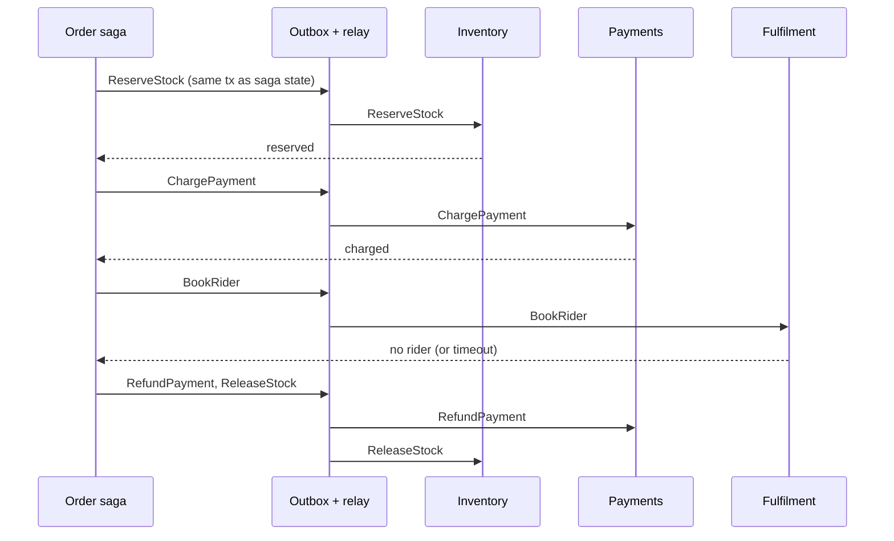
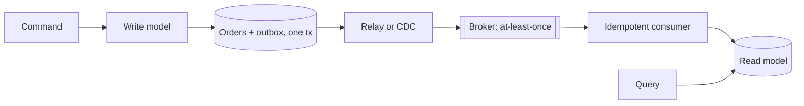

# Distributed Data Patterns

<span class="badge-l4">L4 🟠 Senior / Lead</span> · <span class="read-time">⏱ 40 min read</span> · Prerequisites: [Microservice Patterns](microservice-patterns.md), [Resilience Patterns](resilience-patterns.md)

!!! abstract "TL;DR"
    Once each service owns its data, there's no single ACID transaction across them. A **saga** runs a business transaction as a series of local transactions with **compensating actions** for undo. The **transactional outbox** writes the event in the same local transaction as the data, so "saved but never published" can't happen; a relay publishes afterwards, at least once. **CQRS** separates the write model (rules) from read models (shaped for queries), updated from events. **Event sourcing** stores events as the source of truth and derives state from them. **Idempotent consumers** make at-least-once delivery safe. **Change data capture** turns the database's own change log into events. Together they trade immediate consistency for availability and autonomy, so design every screen and rule for eventual consistency.

## 1. What It Is

**Plain English.** Placing a FreshCart order touches Inventory, Payments and Fulfilment, each with its own database. These patterns keep the data consistent anyway: by undoing steps when a later one fails, by never losing events, by building fast read views from events, by keeping a full history, by handling duplicate messages, and by streaming database changes to other systems.

**Definition.**

| Pattern | Purpose |
|---------|---------|
| Saga | Multi-service transaction as local steps plus compensations |
| Transactional outbox | Atomically save state and the event that announces it |
| CQRS | Separate models for commands (writes) and queries (reads) |
| Event sourcing | Events are the source of truth; state is derived |
| Idempotent consumer | Processing the same message twice has the effect of once |
| Change data capture (CDC) | Stream committed row changes from the database log |

## 2. Why It Exists

Two-phase commit (XA) across services couples their availability (all participants must be up), holds locks across the network, and isn't supported by most brokers and cloud databases. Meanwhile, the naive alternative, "write to my database, then publish an event", loses events on every crash between the two. These patterns come from the database and messaging communities (Garcia-Molina and Salem's sagas, 1987; Greg Young's CQRS and event sourcing, around 2010; Debezium-style CDC) and became mainstream with microservices.

## 3. Mental Model / Analogy

**Analogy.** Booking a trip with separate airline, hotel and car bookings. If the car isn't available, you cancel the hotel and the flight (saga with compensations). You write the booking in your notebook and the "send confirmation" note on the same page, so you can't forget one (outbox). Your accountant keeps every receipt (event sourcing) and also a monthly summary sheet (CQRS read model). If the hotel sends the same confirmation twice, you don't book twice (idempotent consumer).

**Technical model.** Each service commits locally; events flow through a broker with at-least-once delivery; consumers are idempotent and build their own models; long-running processes are explicit state machines persisted in a database.

## 4. How It Works





## 5. Subtopics

### Saga

**Description.** A saga is a sequence of local transactions, one per service. Each step has a **compensating action** that semantically undoes it (refund, release stock). If a step fails, the saga runs compensations for completed steps in reverse. **Orchestration** has a central coordinator issuing commands; **choreography** has services react to each other's events.

**Advantages / features.** No distributed locks; services stay available independently; business-level undo (a refund) instead of technical rollback.

```java title="SagaDemo.java"
--8<-- "examples/l4-senior/distributed-data-patterns/SagaDemo.java"
```

1. Each step pairs an action with its compensation.
2. On failure, completed steps are compensated in reverse order.
3. A charge can't be rolled back, only refunded: compensation is a new business action.

**Run it:** `java SagaDemo.java`

```text
--8<-- "examples/l4-senior/distributed-data-patterns/SagaDemo.expected.txt"
```

| | Orchestration | Choreography |
|-|---------------|--------------|
| Control | Central coordinator | Each service reacts to events |
| Visibility | Saga state in one place | Spread across services |
| Coupling | Coordinator knows all steps | Services know each other's events |
| Good for | 4+ steps, complex rules | 2–3 steps, simple flows |

**Use** sagas for business processes spanning services. **Avoid** them inside one service: use a local ACID transaction.
**Real-world Java:** Axon Framework sagas, Eventuate Tram, Temporal and Camunda for orchestration, Spring State Machine.
**Best practice:** put irreversible steps (send SMS, ship) last, and make every step and compensation idempotent. **Gotcha:** sagas have no isolation: others can see intermediate states (stock reserved for an order that will be cancelled); use semantic locks such as a `PENDING` status.

### Transactional outbox

**Description.** In the same database transaction that changes business data, insert the event into an `outbox` table. A separate relay (polling or CDC) reads the outbox, publishes to the broker and marks rows as sent. Delivery is at least once: a crash after publishing but before marking means a duplicate.

**Advantages / features.** No lost or phantom events; works with any broker; preserves order per aggregate if published in order.

```java title="TransactionalOutboxDemo.java"
--8<-- "examples/l4-senior/distributed-data-patterns/TransactionalOutboxDemo.java"
```

1. A stand-in for a local database transaction: all or nothing.
2. The order row and its event row commit together.
3. The relay publishes unsent rows, retries on failure and may publish twice after a crash.

**Run it:** `java TransactionalOutboxDemo.java`

```text
--8<-- "examples/l4-senior/distributed-data-patterns/TransactionalOutboxDemo.expected.txt"
```

| Relay option | How | Trade-off |
|--------------|-----|-----------|
| Polling publisher | `SELECT ... FOR UPDATE SKIP LOCKED` every N ms | Simple; adds DB load and latency |
| CDC (Debezium outbox router) | Tail the outbox table's log | Low latency; more infrastructure |
| Listen/notify | Postgres `NOTIFY` wakes the relay | Faster polling; still need polling fallback |

**Use** whenever a state change must be announced. **Avoid** publishing to the broker inside the database transaction (a slow broker holds locks; rollback after publish leaves a phantom event).
**Real-world Java:** Spring Modulith event publication registry, Debezium outbox event router, Eventuate Tram.
**Best practice:** include an event ID and aggregate version in each outbox row; clean up sent rows. **Gotcha:** the outbox guarantees at-least-once, not exactly-once; consumers must be idempotent.

### CQRS

**Description.** Command Query Responsibility Segregation: commands are handled by a write model that enforces invariants; queries are served by one or more read models (projections) optimised for specific screens, kept up to date by events. Read models are eventually consistent.

**Advantages / features.** Reads and writes scale and evolve independently; queries become simple lookups; several read models for different needs (search, dashboards, mobile).

```java title="CqrsDemo.java"
--8<-- "examples/l4-senior/distributed-data-patterns/CqrsDemo.java"
```

1. The write side enforces rules and records events.
2. The read side is a denormalised view per customer, built from events.
3. Until the projection catches up, the view shows the old total.

**Run it:** `java CqrsDemo.java`

```text
--8<-- "examples/l4-senior/distributed-data-patterns/CqrsDemo.expected.txt"
```

| Level | What's separated |
|-------|------------------|
| Method level | Commands return nothing; queries change nothing (CQS) |
| Model level | Separate classes/DTOs for reads, same database |
| Store level | Read models in separate tables or stores (Elasticsearch, Redis) |
| With event sourcing | Write side is an event store; all reads are projections |

**Use** when read and write shapes or loads differ greatly. **Avoid** for simple CRUD screens; it doubles the moving parts.
**Real-world Java:** Axon Framework, Spring Data projections, Kafka Streams materialised views, Elasticsearch read models.
**Best practice:** make projections rebuildable from the event history. **Gotcha:** "read your own writes": after placing an order, the user may not see it yet; return the result from the command or poll with the new version.

### Event sourcing

**Description.** Instead of storing current state, store the sequence of events that happened to an aggregate in an append-only event store. Current (or past) state is computed by replaying events. Appends use optimistic concurrency: "append if the stream is still at version N".

**Advantages / features.** Complete audit trail; time travel ("balance on day 3"); new read models from history; natural fit with CQRS and events.

```java title="EventSourcingDemo.java"
--8<-- "examples/l4-senior/distributed-data-patterns/EventSourcingDemo.java"
```

1. Appends check the expected version, so concurrent writers can't both succeed on stale state.
2. State is a fold over events, optionally only up to a point in time.
3. A command loads the version, checks the rule against derived state and appends.

**Run it:** `java EventSourcingDemo.java`

```text
--8<-- "examples/l4-senior/distributed-data-patterns/EventSourcingDemo.expected.txt"
```

| Concern | Technique |
|---------|-----------|
| Long streams | Snapshots every N events |
| Schema evolution | Upcasters, versioned events (never edit history) |
| Personal data and erasure | Crypto-shredding (delete the key) or store PII outside events |
| Queries | Projections (CQRS) |
| Concurrency | Expected-version appends |

**Use** where history is the business (ledgers, wallets, compliance, logistics tracking). **Avoid** as a default persistence style; it adds complexity to every change.
**Real-world Java:** Axon Server, EventStoreDB Java client, Kafka as a log (with care), Postgres append-only tables.
**Best practice:** design events in business language and keep them small and immutable. **Gotcha:** fixing a bug in history means appending correcting events, not editing old ones.

### Idempotent consumer

**Description.** Brokers deliver at least once: after a consumer crash or rebalance, messages are redelivered. An idempotent consumer records each processed message ID (or uses a natural key) in the same transaction as its side effect, and ignores messages it has already processed.

**Advantages / features.** Exactly-once *effect* on top of at-least-once delivery; safe retries and replays.

```java title="IdempotentConsumerDemo.java"
--8<-- "examples/l4-senior/distributed-data-patterns/IdempotentConsumerDemo.java"
```

1. A processed-messages table; in production a database table with a unique key.
2. A duplicate is recognised and skipped.
3. The side effect and the ID record must commit in the same transaction.

**Run it:** `java IdempotentConsumerDemo.java`

```text
--8<-- "examples/l4-senior/distributed-data-patterns/IdempotentConsumerDemo.expected.txt"
```

| Technique | Example |
|-----------|---------|
| Processed-message table | `INSERT INTO processed(id)` with a unique constraint |
| Natural idempotency | `SET status = 'PAID'` instead of `balance += x` |
| Version check | Apply only if `event.version == current + 1` |
| Upsert by business key | `INSERT ... ON CONFLICT DO NOTHING` |

**Use** for every consumer of at-least-once messaging. **Avoid** relying on "exactly-once" broker settings alone; they rarely cover your database side effects.
**Real-world Java:** Spring Kafka with a JDBC dedupe table, Spring Integration `IdempotentReceiverInterceptor`.
**Best practice:** keep processed IDs at least as long as the broker's redelivery window. **Gotcha:** checking for the ID in one transaction and writing the effect in another reopens the race.

### Change data capture

**Description.** CDC reads the database's replication log (Postgres WAL, MySQL binlog) and emits an event for each committed insert, update or delete, with before and after images. The connector stores its log position (offset) to resume after restarts. It can feed caches, search indexes and analytics, or relay an outbox table.

**Advantages / features.** No application changes; captures every committed change including manual fixes; ordered per table/key; low latency.

```java title="ChangeDataCaptureDemo.java"
--8<-- "examples/l4-senior/distributed-data-patterns/ChangeDataCaptureDemo.java"
```

1. Every committed change is written to the log with a sequence number (LSN).
2. The connector stores the last LSN it has published.
3. Each change event has an operation and before/after images, like Debezium's envelope.

**Run it:** `java ChangeDataCaptureDemo.java`

```text
--8<-- "examples/l4-senior/distributed-data-patterns/ChangeDataCaptureDemo.expected.txt"
```

| CDC source | Use for | Caution |
|------------|---------|---------|
| Raw table changes | Search index, cache invalidation, analytics | Leaks internal schema to consumers |
| Outbox table | Domain events | Needs the outbox discipline |
| Initial snapshot | Bootstrapping a new consumer | Large tables take time |

**Use** for integrating legacy systems, keeping derived stores in sync, and as an outbox relay. **Avoid** exposing raw table changes as your public event contract.
**Real-world Java:** Debezium (Kafka Connect or embedded engine), AWS DMS, Flink CDC.
**Best practice:** route raw CDC through a translation step (or use outbox events) before other teams consume it. **Gotcha:** a stuck connector stops the database from discarding WAL (Postgres replication slots), which can fill the disk.

## 6. Examples (exactly 3, progressively harder)

### Example 1: Minimal (L2)

**Scenario:** GreenValley's warehouse used to overwrite a `stock` column and could never explain mismatches. Now each movement is recorded.

```java title="StockLedgerDemo.java"
--8<-- "examples/l4-senior/distributed-data-patterns/StockLedgerDemo.java"
```

1. Stock on hand is computed from movements.
2. Movements are appended, never edited.

**Run it:** `java StockLedgerDemo.java`

**Output:**

```text
--8<-- "examples/l4-senior/distributed-data-patterns/StockLedgerDemo.expected.txt"
```

**What to notice:**

- "How many were damaged?" is a simple query on history; with an overwritten column it's unanswerable.

### Example 2: Realistic (in FreshCart grocery delivery)

**Scenario:** the "My orders" screen reads a projection fed by order events. Events arrive duplicated and out of order.

```java title="OrderHistoryProjectionDemo.java"
--8<-- "examples/l4-senior/distributed-data-patterns/OrderHistoryProjectionDemo.java"
```

1. Events at or below the applied version are duplicates or stale: skip.
2. An event from the future is parked until the missing version arrives.
3. After applying, any parked successor is applied too.

**Run it:** `java OrderHistoryProjectionDemo.java`

**Output:**

```text
--8<-- "examples/l4-senior/distributed-data-patterns/OrderHistoryProjectionDemo.expected.txt"
```

**What to notice:**

- FC-1 never showed `OUT_FOR_DELIVERY` before `PACKED`, and never went backwards.
- Partitioning the topic by order ID keeps per-order order in Kafka, but versions still protect against replays and redeliveries.

### Example 3: Production-grade

**Scenario:** FreshCart's fulfilment saga coordinates Inventory, Payments and Fulfilment. Orchestrator instances crash and get replaced, replies are redelivered, and ParcelGo sometimes takes minutes to confirm a rider.

```java title="FulfilmentSagaDemo.java"
--8<-- "examples/l4-senior/distributed-data-patterns/FulfilmentSagaDemo.java"
```

1. A reply only counts if the saga is running and waiting for exactly that step; duplicates are ignored.
2. A step that takes longer than its timeout is treated as failed.
3. Commands go into the outbox (in the same transaction as the saga state, in a real database).
4. Compensations for completed steps are queued in reverse order.
5. Saga state is persisted after every transition, so any instance can continue it.

**Run it:** `java FulfilmentSagaDemo.java`

**Output:**

```text
--8<-- "examples/l4-senior/distributed-data-patterns/FulfilmentSagaDemo.expected.txt"
```

**What to notice:**

- node2 continued FC-1 from the stored state; nothing was held in memory.
- FC-2's rider booking timed out, so payment was refunded and stock released.
- The rider booking then succeeded late, and the saga compensated that too (`CancelRider`). Timeouts don't mean the step didn't happen.

## 7. Pros, Cons & Trade-offs

| Pattern | Pros | Cons |
|---------|------|------|
| Saga | No distributed locks, independent availability | No isolation; compensations to design |
| Outbox | No lost events | Extra table and relay; duplicates |
| CQRS | Fast, tailored reads | Eventual consistency; more code |
| Event sourcing | Full history, time travel | Complexity, schema evolution, learning curve |
| Idempotent consumer | Safe redelivery | Dedupe storage and cleanup |
| CDC | No app changes, complete capture | Infrastructure; schema coupling if raw |

## 8. When to Use / When NOT to Use

**Use them when:**

- data is split across services and business processes span them;
- events must reliably follow state changes;
- reads need very different shapes or scale from writes.

**Don't when:**

- one database and one transaction can do the job;
- the team hasn't operated message brokers before and the domain is simple;
- strong consistency is a hard requirement (keep that data in one service).

## 9. Best Practices

1. **Use the outbox (or CDC) for every event that announces a state change.** *(Consensus.)*
2. **Make every consumer idempotent.** *(Consensus.)*
3. **Persist saga state; make steps and compensations idempotent.** *(Consensus.)*
4. **Put irreversible steps last in a saga.** *(Consensus.)*
5. **Version events and keep projections rebuildable.** *(Consensus.)*
6. **Use event sourcing only where history is a business need.** *(Consensus.)*
7. **Design UIs for eventual consistency (pending states, optimistic updates).** *(Widely used.)*

## 10. Pitfalls & Anti-Patterns

!!! danger "Dual write loses events (production failure mode)"
    **Symptom:** a few orders a day were paid but never packed; the warehouse never heard of them.
    **Root cause:** `orderRepository.save()` then `kafkaTemplate.send()`; pod restarts and broker blips between the two lost events.
    **Fix:** transactional outbox with a relay; reconciliation job comparing orders and fulfilment records.

!!! danger "Non-idempotent consumer"
    **Symptom:** loyalty points doubled after a consumer rebalance.
    **Root cause:** `points += n` with no dedupe; redelivered messages were applied again.
    **Fix:** processed-message table in the same transaction.

!!! danger "Treating a timeout as \"didn't happen\""
    **Symptom:** customers were refunded but riders still arrived.
    **Root cause:** the saga compensated on timeout but ignored the late success reply.
    **Fix:** handle late replies for cancelled sagas by compensating them (Example 3).

!!! danger "Event sourcing everything"
    **Symptom:** simple settings screens took weeks; queries needed projections for everything.
    **Root cause:** event sourcing adopted as the default persistence style.
    **Fix:** use it only for aggregates where history matters; CRUD elsewhere.

## 11. Configuration & Tuning

| Setting | Default | What it does | When to change it | Risk of changing |
|---------|---------|--------------|-------------------|------------------|
| Kafka producer `enable.idempotence` | true (3.0+) | No duplicates from producer retries | Keep on | Off: duplicates on retry |
| Kafka consumer `enable.auto.commit` | true | Commits offsets in background | false; commit after processing | Auto: lost or duplicate processing |
| Kafka `isolation.level` | read_uncommitted | Visibility of transactional messages | read_committed with transactions | Slight latency |
| Outbox poll interval | — | Relay latency vs DB load | 100 ms – 1 s typical | Too low: DB load |
| Debezium `snapshot.mode` | initial | Snapshot before streaming | `never`/`when_needed` for big tables | Missing history |
| Postgres `max_slot_wal_keep_size` | -1 (unlimited) | Cap WAL kept for slots | Set to protect disk | Slot invalidated if exceeded |

## 12. Security Considerations

- Events often carry personal data; event stores and topics need the same protection and retention rules as databases.
- Event sourcing and GDPR erasure conflict: keep PII outside events or encrypt per subject and delete the key.
- CDC streams expose raw tables, including columns you didn't mean to publish; filter columns at the connector.
- Compensations (refunds) are financially sensitive: authorise and audit them like the original action.

## 13. Performance & Scalability

Outbox adds one insert per transaction; polling adds load proportional to frequency. Projections scale reads independently and can be rebuilt in parallel per partition. Event-sourced aggregates with long streams need snapshots. Saga throughput is limited by the slowest step; persist state compactly. CDC latency is typically sub-second; watch connector lag.

## 14. Testing It

Test sagas as state machines: happy path, failures at each step, duplicates, timeouts, late replies and restarts:

```java title="FulfilmentSagaTest.java"
--8<-- "examples/l4-senior/distributed-data-patterns/FulfilmentSagaTest.java"
```

Integration-test outbox relays and consumers with Testcontainers (Postgres, Kafka), including killing the consumer mid-batch.

## 15. Observability & Operations

Track outbox backlog and age of the oldest unsent row, consumer lag, duplicates skipped, parked out-of-order events, projection lag (now minus last event time), saga counts by state and age, compensations executed, and CDC connector lag and replication slot size. Alert on stuck sagas (running longer than any step timeout) and on growing outbox backlog. Keep a reconciliation report for money and stock.

## 16. Version Notes

| Year | Change |
|------|--------|
| 1987 | Garcia-Molina and Salem, "Sagas" |
| 2005 | Fowler describes Event Sourcing |
| 2010 | Greg Young popularises CQRS |
| 2016 | Debezium 0.x for CDC |
| 2017 | Kafka 0.11 adds idempotent producers and transactions |
| 2021 | Kafka 3.0 enables producer idempotence by default |
| 2023 | Spring Modulith event publication registry (an outbox) |

## 17. Expert Deep Dive

- **Pivot transactions.** In a saga, steps before the pivot are compensatable, the pivot is the point of no return, and steps after it must be retriable until they succeed.
- **Semantic locks and countermeasures.** `PENDING` states, commutative updates and re-reading values reduce anomalies from the lack of isolation.
- **Durable execution engines.** Temporal and similar engines persist workflow state and replay code deterministically, removing hand-written saga state machines.
- **Exactly-once in Kafka.** Transactions give exactly-once within Kafka (read-process-write); external side effects still need idempotency.
- **Event-carried state transfer vs notification.** Fat events reduce callbacks but couple consumers to more fields; thin events need a follow-up read.

!!! example "War story: the riders who came anyway"
    FreshCart's first fulfilment saga cancelled orders when ParcelGo didn't confirm a rider within 60 seconds and refunded the customer. On busy evenings ParcelGo's confirmations took up to 3 minutes, and the saga ignored replies for cancelled orders. Riders turned up at doors with orders that had been refunded, and the dark store had already put the items back on the shelf. **Fixes:** late successful replies for cancelled sagas trigger compensation (`CancelRider`); the rider step's timeout was raised based on measured p99; a reconciliation job compares ParcelGo bookings with active orders nightly. **Lesson:** a timeout tells you that you stopped waiting, not that the other side stopped working.

## 18. Interview Corner

=== "🟢 L1–L2"

    1. **Why not one transaction across services?** **Each owns its database**; 2PC couples availability.
    2. **What's a compensating action?** A **business undo**, like a refund.
    3. **What's the outbox?** A **table written in the same transaction** as the data, published later.
    4. **What's CQRS?** **Separate models for writes and reads.**
    5. **What does idempotent mean?** **Doing it twice has the same effect as once.**

=== "🟡 L3"

    1. **Orchestration vs choreography?** **Central coordinator** vs **services reacting to events**.
    2. **Why is outbox delivery at least once?** The relay can **crash after publishing, before marking**.
    3. **How does a projection handle out-of-order events?** **Versions: skip old, park future.**
    4. **Event sourcing concurrency?** **Expected-version appends.**
    5. **What is CDC?** **Streaming committed changes from the database log.**

=== "🔴 L4–L5"

    1. **How do you handle saga isolation anomalies?** **Semantic locks, pending states, commutative updates, re-reads.**
    2. **Where do you place irreversible steps?** **After the pivot, at the end**, and make them retriable.
    3. **Event sourcing and GDPR?** **PII outside events or crypto-shredding.**
    4. **Exactly-once processing?** **At-least-once delivery + idempotent effects**; Kafka EOS only inside Kafka.
    5. **Raw CDC vs outbox events?** **Outbox is a designed contract**; raw CDC leaks schema.

=== "💻 Hands-on"

    **Task:** Make `TransactionalOutboxDemo` deliver each event at most once to a consumer even though the relay can publish twice.

    ??? success "Solution"
        ```java
        Set<String> processed = new HashSet<>();
        for (String event : broker) {
            if (!processed.add(event)) continue;   // the event ID (here the text) is the dedupe key
            System.out.println("consumer handled " + event);
        }
        // in production: an event ID column in the outbox, and a processed-messages table on the consumer side
        ```

## 19. Practice

- [ ] Model FreshCart's return-and-refund flow as a saga; mark the pivot step.
    ??? tip "Hint"
        Collecting the item from the customer is hard to undo.
- [ ] Implement a polling outbox relay with `FOR UPDATE SKIP LOCKED` against Postgres in Testcontainers.
    ??? tip "Hint"
        Run two relay instances and check no row is published by both at once.
- [ ] Add snapshots to `EventSourcingDemo` every 3 events.
    ??? tip "Hint"
        Store (version, balance) and replay only later events.
- [ ] Run Debezium against a local Postgres and watch change events for an `UPDATE`.
    ??? tip "Hint"
        Look for `op`, `before` and `after` in the payload.

## 20. Quick Revision Card

!!! tip "Remember in 30 seconds"
    - No cross-service ACID: sagas with compensations; irreversible steps last.
    - Outbox: state + event in one local tx; relay publishes at least once.
    - Consumers are idempotent: processed IDs or versions in the same tx.
    - CQRS: write model enforces rules; read models are projections, eventually consistent.
    - Event sourcing: append-only events, state = fold, expected-version appends.
    - CDC: database log to events; don't expose raw schemas.

    ```java
    if (e.version() <= current) return;            // duplicate or stale
    if (e.version() > current + 1) { park(e); return; }
    apply(e);
    ```

## 21. Further Reading

- Chris Richardson, *Microservices Patterns* (2018), chapters on sagas, outbox and CQRS; [microservices.io](https://microservices.io/patterns/data/saga.html).
- Martin Kleppmann, *Designing Data-Intensive Applications* (2017), chapters 11–12.
- Hector Garcia-Molina and Kenneth Salem, "Sagas" (SIGMOD 1987).
- [Debezium documentation](https://debezium.io/documentation/), including the outbox event router.

---

[← Previous: Resilience Patterns](resilience-patterns.md) · [Next: Messaging and Integration Patterns →](messaging-patterns.md)
