# L4 · Senior / Lead

L4 🟠 Senior / Lead · Experience: 6–10 yrs

**Goal:** after this level you can choose architecture and distributed-system patterns and defend the trade-offs.

**Who it's for:** engineers with roughly 6–10 yrs of Java experience, or anyone who finished the previous level.

## Pages in this level

| Page | What you'll learn | Read time |
|------|-------------------|-----------|
| [Architectural Patterns](architectural-patterns.md) | Structure whole applications. | 40 min |
| [Domain-Driven Design: Tactical Patterns](ddd-tactical.md) | Model a rich domain in code. | 40 min |
| [Domain-Driven Design: Strategic Patterns](ddd-strategic.md) | Split a large domain into models and teams. | 35 min |
| [Microservice Patterns](microservice-patterns.md) | Decompose and connect services. | 40 min |
| [Resilience Patterns](resilience-patterns.md) | Keep systems up when dependencies fail. | 35 min |
| [Distributed Data Patterns](distributed-data-patterns.md) | Keep data consistent across services. | 40 min |
| [Messaging and Integration Patterns](messaging-patterns.md) | Connect systems with messages (Enterprise Integration Patterns). | 35 min |
| [Caching Patterns](caching-patterns.md) | Choose where and how to cache. | 30 min |
| [API Design Patterns](api-design-patterns.md) | Design APIs that stay stable as they grow. | 30 min |

## How the pages relate

```mermaid
flowchart LR
    L4_0["Architectural Patterns"] --> L4_1["Domain-Driven Design: Tactical Patterns"]
    L4_1["Domain-Driven Design: Tactical Patterns"] --> L4_2["Domain-Driven Design: Strategic Patterns"]
    L4_2["Domain-Driven Design: Strategic Patterns"] --> L4_3["Microservice Patterns"]
    L4_3["Microservice Patterns"] --> L4_4["Resilience Patterns"]
    L4_4["Resilience Patterns"] --> L4_5["Distributed Data Patterns"]
    L4_5["Distributed Data Patterns"] --> L4_6["Messaging and Integration Patterns"]
    L4_6["Messaging and Integration Patterns"] --> L4_7["Caching Patterns"]
    L4_7["Caching Patterns"] --> L4_8["API Design Patterns"]
```

## Ready for the next level when you can…

- [ ] Choose and defend an application architecture (layered, hexagonal, modular monolith)
- [ ] Model a domain with aggregates, value objects and bounded contexts
- [ ] Design resilient, consistent distributed flows with sagas, outbox and circuit breakers

---

[← Previous: Performance Cost of Patterns](../l3-professional/performance-of-patterns.md) · [Next: Architectural Patterns →](architectural-patterns.md)
