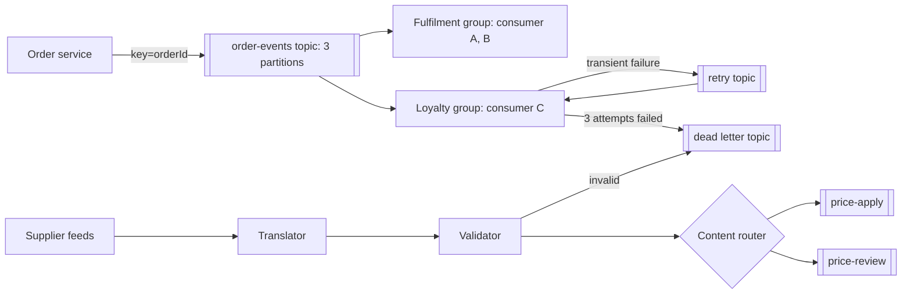
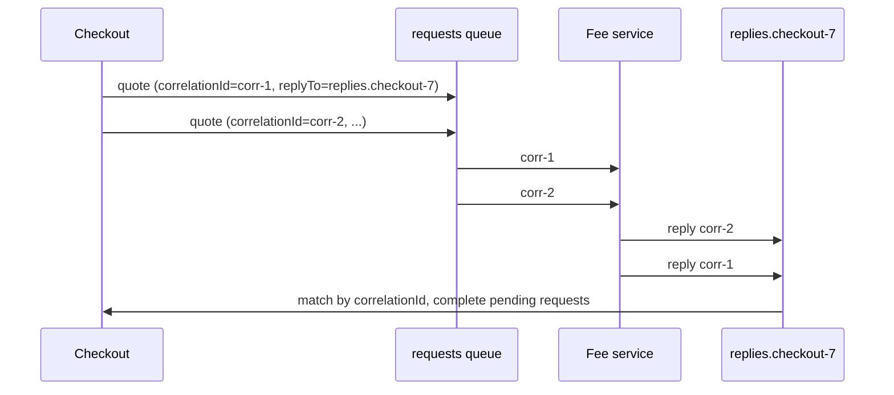

# Messaging and Integration Patterns

<span class="badge-l4">L4 🟠 Senior / Lead</span> · <span class="read-time">⏱ 35 min read</span> · Prerequisites: [Distributed Data Patterns](distributed-data-patterns.md), [Observer](../l1-foundations/observer.md)

!!! abstract "TL;DR"
    Messaging connects systems through channels instead of direct calls, so senders and receivers don't need to be up at the same time or know each other. A **queue** (point-to-point) gives each message to one receiver; a **topic** (publish-subscribe) gives a copy to every subscriber. **Competing consumers** scale a queue, and **partitioning by key** keeps per-entity ordering. A **content-based router** sends each message to the right channel. A **dead letter channel** parks messages that keep failing, with the reason, so they neither block nor vanish. A **message translator** converts external formats into a canonical model at the edge. **Request-reply** over messaging uses a **correlation ID** and a reply-to channel. These are the Enterprise Integration Patterns (Hohpe and Woolf), implemented today by Kafka, RabbitMQ, Spring Integration and Apache Camel.

## 1. What It Is

**Plain English.** Instead of FreshCart's services calling each other and waiting, they drop messages into channels, like letters into post boxes. These patterns describe the post boxes (queues and topics), how many workers share the sorting, how letters get routed, what happens to letters that can't be delivered, how foreign letters get translated, and how to get an answer back.

**Definition.**

| Pattern | Purpose |
|---------|---------|
| Point-to-point channel (queue) | Each message processed by exactly one receiver |
| Publish-subscribe channel (topic) | Each message delivered to all subscribers |
| Competing consumers | Several receivers on one channel for throughput |
| Message router / content-based router | Choose the destination channel per message |
| Dead letter channel | Destination for messages that can't be processed |
| Message translator | Convert between message formats |
| Request-reply with correlation ID | Get a response over asynchronous channels |

## 2. Why It Exists

Synchronous calls couple availability (the callee must be up), throughput (the caller waits) and knowledge (the caller must know every callee). Messaging decouples all three: a broker buffers spikes, consumers process at their own pace, and new subscribers join without changing the producer. Hohpe and Woolf catalogued 65 patterns in *Enterprise Integration Patterns* (2003) from years of integration projects; the vocabulary still describes Kafka and RabbitMQ systems today.

## 3. Mental Model / Analogy

**Analogy.** A post office. A personal letter goes to one addressee (queue); a newsletter goes to every subscriber (topic). Several clerks share the counter (competing consumers), but each customer's packages stay with one clerk (partitioning by key). A sorter reads the address and picks the bag (router). Undeliverable mail goes to the dead letter office with a note. Foreign forms are translated at the border. A reply envelope carries your reference number so you know which letter it answers (correlation ID).

**Technical model.** Producers write to channels in a broker; consumers read with at-least-once delivery and acknowledge (or commit offsets) after processing; routing, translation and error handling are small, composable steps (pipes and filters).

## 4. How It Works





## 5. Subtopics

### Point-to-point and pub-sub

**Description.** A **point-to-point channel** (queue) delivers each message to one consumer: use it for commands and work items ("pick order FC-1"). A **publish-subscribe channel** (topic) delivers each message to every subscriber: use it for events ("OrderPlaced"). In Kafka, a topic plus consumer groups gives both: each group gets every message, and within a group each partition goes to one consumer.

**Advantages / features.** Producers don't know consumers; new subscribers join without changes; work is spread across receivers.

```java title="PointToPointPubSubDemo.java"
--8<-- "examples/l4-senior/messaging-patterns/PointToPointPubSubDemo.java"
```

1. A queue hands each message to one receiver.
2. A topic hands a copy to every subscriber.
3. Adding a subscriber doesn't change the publisher.

**Run it:** `java PointToPointPubSubDemo.java`

```text
--8<-- "examples/l4-senior/messaging-patterns/PointToPointPubSubDemo.expected.txt"
```

| | Queue | Topic |
|-|-------|-------|
| Delivery | One receiver per message | Every subscriber |
| Typical content | Commands, tasks | Events, notifications |
| RabbitMQ | Queue | Fanout/topic exchange + queue per subscriber |
| Kafka | Topic + one consumer group | Topic + one group per subscriber |
| JMS | `Queue` | `Topic` |

**Use** queues for work, topics for facts. **Avoid** using a topic as a command bus ("everyone, maybe do this").
**Real-world Java:** Spring Kafka `@KafkaListener(groupId=...)`, Spring AMQP `@RabbitListener`, Jakarta Messaging.
**Best practice:** name events in the past tense (`OrderPlaced`) and commands as imperatives (`PickOrder`). **Gotcha:** a subscriber that's offline misses messages on non-durable topics; use durable subscriptions or log-based brokers.

### Competing consumers

**Description.** Several consumers read from the same channel; the broker gives each message to one of them. This scales throughput horizontally. Ordering is lost unless messages are **partitioned by key**: all messages for one order go to the same partition and therefore the same consumer.

**Advantages / features.** Horizontal scaling; failover when a consumer dies; load spreads automatically.

```java title="CompetingConsumersDemo.java"
--8<-- "examples/l4-senior/messaging-patterns/CompetingConsumersDemo.java"
```

1. Round-robin spreads messages evenly; key hashing pins each order to one consumer.
2. Each consumer processes one message at a time at its own speed.
3. With a slow consumer, round-robin applies statuses out of order; key partitioning doesn't.

**Run it:** `java CompetingConsumersDemo.java`

```text
--8<-- "examples/l4-senior/messaging-patterns/CompetingConsumersDemo.expected.txt"
```

| Concern | Kafka | RabbitMQ |
|---------|-------|----------|
| Unit of parallelism | Partition | Queue consumer + prefetch |
| Ordering | Per partition | Per queue, lost with many consumers |
| Max useful consumers | Number of partitions | Unbounded |
| Key-based ordering | Partition by key | Consistent-hash exchange |

**Use** for scaling any queue. **Avoid** more consumers than partitions in Kafka; extras sit idle.
**Real-world Java:** Spring Kafka `concurrency`, Spring AMQP `concurrentConsumers` and `prefetchCount`.
**Best practice:** choose the key that defines your ordering need (order ID, customer ID). **Gotcha:** a hot key (one huge customer) overloads one partition; consider a composite key.

### Message router and content-based router

**Description.** A **message router** consumes from one channel and sends each message to one of several channels. A **content-based router** decides using the message content (payment type, city, size). Related patterns: message filter (drop), recipient list (send to several), splitter and aggregator.

**Advantages / features.** Producers stay simple; routing rules live in one place and can change without touching consumers.

```java title="ContentBasedRouterDemo.java"
--8<-- "examples/l4-senior/messaging-patterns/ContentBasedRouterDemo.java"
```

1. Routes are an ordered list of rules: data, not code paths in every producer.
2. The first matching rule wins; anything else goes to a default channel.
3. Rule order matters: unsupported cities are caught before any other route.

**Run it:** `java ContentBasedRouterDemo.java`

```text
--8<-- "examples/l4-senior/messaging-patterns/ContentBasedRouterDemo.expected.txt"
```

| Routing pattern | Effect |
|-----------------|--------|
| Content-based router | One destination chosen per message |
| Message filter | Drop unwanted messages |
| Recipient list | Several destinations per message |
| Splitter / aggregator | One message into many / many into one |
| Routing slip | Route carried in the message itself |

**Use** when different message types need different processing paths. **Avoid** routers that grow into hidden business-logic engines.
**Real-world Java:** Spring Integration `@Router`, Apache Camel `choice().when(...)`, RabbitMQ topic exchanges (routing by key).
**Best practice:** always have a default route and count messages per route. **Gotcha:** overlapping rules depend on order; test the rule table, not just individual rules.

### Dead letter channel

**Description.** When a message can't be processed after a limited number of attempts (poison message, bug, invalid data), move it to a dead letter channel with metadata (reason, attempts, original topic and offset). The main flow continues. After a fix, operators **redrive** dead letters back.

**Advantages / features.** One bad message doesn't block a queue or partition; nothing is silently dropped; failures are inspectable.

```java title="DeadLetterChannelDemo.java"
--8<-- "examples/l4-senior/messaging-patterns/DeadLetterChannelDemo.java"
```

1. Failed messages are retried until the attempt limit.
2. Then they're dead-lettered with the reason, and the queue moves on.
3. After the parser is fixed, dead letters are redriven and processed.

**Run it:** `java DeadLetterChannelDemo.java`

```text
--8<-- "examples/l4-senior/messaging-patterns/DeadLetterChannelDemo.expected.txt"
```

| Failure type | Handling |
|--------------|----------|
| Transient (timeout, 503) | Retry with backoff (retry topic or delayed redelivery) |
| Poison (unparseable) | Dead letter immediately or after few attempts |
| Business rejection | Not an error: publish a rejection event |
| Bug in consumer | Dead letter, fix, redrive |

**Use** on every consumer. **Avoid** infinite redelivery loops (RabbitMQ requeue without limit, Kafka consumer stuck retrying one offset).
**Real-world Java:** Spring Kafka `DeadLetterPublishingRecoverer` and `@RetryableTopic`, RabbitMQ dead-letter exchanges (`x-dead-letter-exchange`), SQS redrive policies.
**Best practice:** alert on DLQ growth and have a documented redrive tool. **Gotcha:** a DLQ nobody watches is a slow data-loss bug.

### Message translator

**Description.** Converts messages from one format to another. At system edges, translate each external format into a **canonical data model**, so internal consumers see one shape. This is the messaging form of the Adapter pattern and of DDD's anti-corruption layer.

**Advantages / features.** Internal code is insulated from partner formats; adding a partner adds one translator.

```java title="MessageTranslatorDemo.java"
--8<-- "examples/l4-senior/messaging-patterns/MessageTranslatorDemo.java"
```

1. The canonical model every internal consumer understands.
2. One translator per external format, registered by format name.
3. Translators also normalise units, identifiers and dates.

**Run it:** `java MessageTranslatorDemo.java`

```text
--8<-- "examples/l4-senior/messaging-patterns/MessageTranslatorDemo.expected.txt"
```

| Translation level | Example |
|-------------------|---------|
| Transport | HTTP webhook to Kafka message |
| Data format | CSV, XML, key-value to JSON/Avro |
| Data types | Rupees with decimals to paise; DD/MM/YYYY to ISO dates |
| Data structure | Partner item codes to FreshCart SKUs |

**Use** at every boundary with external formats. **Avoid** letting partner formats travel deep into your system.
**Real-world Java:** Spring Integration transformers, Camel `unmarshal()`/`marshal()`, MapStruct, Jackson.
**Best practice:** keep translators pure functions with tests built from real partner samples. **Gotcha:** a "canonical model" for the whole company becomes a God model; keep it per bounded context.

### Request-reply and correlation

**Description.** When an answer is needed over messaging, the requester sends a message with a **reply-to** channel and a **correlation ID**; the replier sends the response to that channel with the same ID. The requester matches replies to pending requests and times out ones that never come back.

**Advantages / features.** Request-response semantics with broker buffering and load-levelling; many requests in flight on one channel.

```java title="RequestReplyDemo.java"
--8<-- "examples/l4-senior/messaging-patterns/RequestReplyDemo.java"
```

1. Pending requests are tracked by correlation ID.
2. Each request names where to reply.
3. Replies are matched by ID, in whatever order they arrive; unknown or late ones are dropped.

**Run it:** `java RequestReplyDemo.java`

```text
--8<-- "examples/l4-senior/messaging-patterns/RequestReplyDemo.expected.txt"
```

| Option | Notes |
|--------|-------|
| Temporary reply queue per requester | Simple; lost on restart |
| Shared reply topic + correlation ID | Scales; filter by ID |
| RabbitMQ direct reply-to | No queue declaration needed |
| Spring `ReplyingKafkaTemplate` | Request-reply on Kafka |
| Plain HTTP | Often simpler if you just need an answer now |

**Use** when the responder must be decoupled or load-levelled. **Avoid** it as a slower replacement for HTTP when both sides are online anyway.
**Real-world Java:** Spring AMQP `RabbitTemplate.convertSendAndReceive`, Spring Kafka `ReplyingKafkaTemplate`, JMS `JMSReplyTo`/`JMSCorrelationID`.
**Best practice:** propagate the correlation ID into logs and traces too. **Gotcha:** a requester that restarts loses its pending map; late replies must be safely ignorable.

## 6. Examples (exactly 3, progressively harder)

### Example 1: Minimal (L2)

**Scenario:** when paneer runs low, the buying team and the app both need to know. The warehouse shouldn't call each of them.

```java title="LowStockAlertDemo.java"
--8<-- "examples/l4-senior/messaging-patterns/LowStockAlertDemo.java"
```

1. Each interested party subscribes on its own.
2. The warehouse publishes once and doesn't know who listens.

**Run it:** `java LowStockAlertDemo.java`

**Output:**

```text
--8<-- "examples/l4-senior/messaging-patterns/LowStockAlertDemo.expected.txt"
```

**What to notice:**

- Adding a third reaction (email the store manager) changes nothing in the warehouse code.

### Example 2: Realistic (in FreshCart grocery delivery)

**Scenario:** DairyDay sends prices as CSV with rupees; GreenValley sends pipe-separated paise. Large changes need human review, and bad lines must not stop the feed.

```java title="SupplierFeedPipelineDemo.java"
--8<-- "examples/l4-senior/messaging-patterns/SupplierFeedPipelineDemo.java"
```

1. Translate each supplier's format into the canonical `PriceUpdate`.
2. Validate against FreshCart's catalogue.
3. Route by content: big changes go to review.

**Run it:** `java SupplierFeedPipelineDemo.java`

**Output:**

```text
--8<-- "examples/l4-senior/messaging-patterns/SupplierFeedPipelineDemo.expected.txt"
```

**What to notice:**

- The unparseable price and the unknown SKU went to the dead letter channel with reasons; the other three lines were processed.
- A tomato price doubling went to review instead of straight to the app.

### Example 3: Production-grade

**Scenario:** the Loyalty service consumes FreshCart's partitioned `order-events` topic in a consumer group. Consumers crash, the group rebalances, the loyalty backend has outages, and one order's events always fail.

```java title="OrderEventsConsumerDemo.java"
--8<-- "examples/l4-senior/messaging-patterns/OrderEventsConsumerDemo.java"
```

1. The order ID is the key, so all events for one order share a partition.
2. Partitions are spread over the group's members; a rebalance reassigns them.
3. Offsets are committed only after the batch is processed.
4. Processing is idempotent: event IDs already handled are skipped.
5. Transient failures go to a retry topic; after three attempts, to the dead letter topic.

**Run it:** `java OrderEventsConsumerDemo.java`

**Output:**

```text
--8<-- "examples/l4-senior/messaging-patterns/OrderEventsConsumerDemo.expected.txt"
```

**What to notice:**

- A crashed before committing, so B received e1 and e2 again and skipped them; loyalty points weren't awarded twice.
- e4 failed once, went to the retry topic and succeeded; e6 failed three times and was dead-lettered.
- The failing event didn't block its partition: all committed offsets reached the end.
- A retry topic gives up strict per-key ordering for that event; if order matters, block the partition (with a timeout) instead.

## 7. Pros, Cons & Trade-offs

| Pattern | Pros | Cons |
|---------|------|------|
| Queue / topic | Decoupling, buffering | Broker to operate; eventual consistency |
| Competing consumers | Throughput, failover | Ordering only per key |
| Content-based router | Central, changeable routing | Can accumulate business logic |
| Dead letter channel | No blocking, no silent loss | Needs monitoring and redrive tooling |
| Message translator | Insulates internal model | One more mapping to maintain |
| Request-reply | Decoupled responses | Complexity vs plain HTTP; timeouts |

## 8. When to Use / When NOT to Use

**Use messaging when:**

- producers and consumers have different availability or speed;
- several systems react to the same event;
- integrating partners with different formats and protocols.

**Don't when:**

- the caller needs an immediate answer and both sides are online (use HTTP/gRPC);
- you'd be adding a broker for two services and a handful of messages;
- strict global ordering across all messages is required.

## 9. Best Practices

1. **Events on topics, commands on queues.** *(Consensus.)*
2. **Partition by the key that defines ordering.** *(Consensus.)*
3. **Commit or acknowledge only after processing; make consumers idempotent.** *(Consensus.)*
4. **Every consumer has a retry policy and a dead letter channel.** *(Consensus.)*
5. **Translate external formats at the edge.** *(Consensus.)*
6. **Carry message ID, correlation ID and trace context in headers.** *(Consensus.)*
7. **Prefer a schema registry for shared topics.** *(Widely used.)*

## 10. Pitfalls & Anti-Patterns

!!! danger "Poison message blocks a partition (production failure mode)"
    **Symptom:** loyalty points stopped for a third of customers; consumer lag on one partition grew for hours.
    **Root cause:** a malformed event threw on every attempt; the consumer retried it forever without committing.
    **Fix:** bounded retries, retry topic for transient errors, dead letter topic, alerts on lag per partition.

!!! danger "Auto-commit before processing"
    **Symptom:** messages "disappeared" after consumer crashes.
    **Root cause:** offsets auto-committed on poll; the crash happened mid-batch.
    **Fix:** `enable.auto.commit=false`, commit after processing (Spring Kafka `AckMode.RECORD` or `BATCH`).

!!! danger "Ordering assumed without keys"
    **Symptom:** orders showed `DELIVERED` then `PACKED`.
    **Root cause:** events published without a key, spread across partitions.
    **Fix:** key by order ID; version checks in consumers.

!!! danger "Request-reply everywhere"
    **Symptom:** a messaging system that behaves like slow, fragile RPC.
    **Root cause:** every interaction modelled as request-reply over queues.
    **Fix:** use events for facts, HTTP for queries, request-reply only where decoupling matters.

## 11. Configuration & Tuning

| Setting | Default | What it does | When to change it | Risk of changing |
|---------|---------|--------------|-------------------|------------------|
| Kafka `max.poll.records` | 500 | Records per poll | Lower for slow processing | Lower throughput |
| Kafka `max.poll.interval.ms` | 300000 | Max time between polls before rebalance | Long processing | Slow failure detection |
| Kafka `partition.assignment.strategy` | Range, CooperativeSticky | How partitions are assigned | Cooperative for fewer pauses | Upgrade coordination |
| RabbitMQ `prefetch` (Spring) | 250 | Unacked messages per consumer | Lower for fairness, higher for throughput | Memory, unfairness |
| RabbitMQ `x-delivery-limit` (quorum queues) | 20 (RabbitMQ 4.0+) | Redeliveries before dead-lettering | Lower for poison messages | Early DLQ |
| Spring `@RetryableTopic(attempts)` | 3 | Attempts incl. retry topics | Per consumer | Retry storms |

## 12. Security Considerations

- Authenticate producers and consumers (SASL/mTLS) and authorise per topic/queue with ACLs.
- Encrypt in transit; consider payload encryption for personal data in long-retention topics.
- Validate and size-limit messages from external partners before translation.
- Dead letter topics contain the same sensitive data as the main topic: same access controls and retention.

## 13. Performance & Scalability

Throughput scales with partitions (Kafka) or consumers (RabbitMQ); batch sends and compression cut network cost. Consumer lag is the key capacity signal. Large messages hurt brokers; store blobs elsewhere and send references (claim check pattern). Retry topics with delays avoid blocking hot partitions. Request-reply adds broker round trips; expect higher latency than direct calls.

## 14. Testing It

Test consumer behaviour (ordering, idempotency, retries, dead letters, rebalances) with an in-memory broker model:

```java title="OrderEventsConsumerTest.java"
--8<-- "examples/l4-senior/messaging-patterns/OrderEventsConsumerTest.java"
```

Then run integration tests against a real broker with Testcontainers (Kafka, RabbitMQ), or Spring's `@EmbeddedKafka`.

## 15. Observability & Operations

Monitor consumer lag per partition, processing rate and errors per consumer group, retry and DLQ rates, and message age. Propagate trace context in message headers (OpenTelemetry instruments Kafka and RabbitMQ clients). Keep tooling to inspect, replay and redrive messages. Document each topic's owner, schema and retention.

## 16. Version Notes

| Year | Change |
|------|--------|
| 2001 | JMS 1.0.2 widely adopted |
| 2003 | Hohpe and Woolf, *Enterprise Integration Patterns* |
| 2007 | RabbitMQ (AMQP 0-9-1); Apache Camel 1.0 |
| 2011 | Apache Kafka open-sourced |
| 2019 | Kafka incremental cooperative rebalancing (2.4) |
| 2024 | RabbitMQ 4.0: AMQP 1.0 core, quorum queue delivery limit default |
| 2025 | Kafka 4.0 removes ZooKeeper (KRaft only); share groups (queues for Kafka) in preview |

## 17. Expert Deep Dive

- **Log vs queue semantics.** Kafka keeps messages after consumption (replay, multiple groups); classic queues delete on ack. Kafka share groups (KIP-932) add queue-like per-message acks.
- **Claim check.** Store large payloads in object storage and send a reference.
- **Delivery guarantees.** At-most-once (commit before processing), at-least-once (after), effectively-once (at-least-once + idempotency).
- **Backpressure.** Prefetch limits and pausing partitions keep slow consumers from being overwhelmed.
- **Event-driven vs message-driven.** Events state facts and have many consumers; messages to a queue address one consumer. Mixing the two causes coupling.

!!! example "War story: one bad event, four hours of missing points"
    A FreshCart release published one `OrderPaid` event with a null amount. The loyalty consumer threw a `NullPointerException` on it, Spring Kafka's default error handler retried it in a tight loop, and the partition stopped moving. A third of customers got no points for four hours; the lag alert existed but was set at 100,000 messages. **Fixes:** `DefaultErrorHandler` with bounded backoff and a `DeadLetterPublishingRecoverer`, `@RetryableTopic` for transient errors, a per-partition lag alert based on message age (over 5 minutes), schema validation in the producer, and a redrive tool. **Lesson:** decide what happens to a message that can never succeed before the first one arrives.

## 18. Interview Corner

=== "🟢 L1–L2"

    1. **Queue vs topic?** **One receiver** vs **every subscriber**.
    2. **Why use messaging?** **Decoupling** in time, speed and knowledge.
    3. **What's a dead letter queue?** Where **unprocessable messages** go.
    4. **What's a correlation ID?** An ID **linking a reply to its request**.
    5. **What's a message translator?** Converts **one format to another**.

=== "🟡 L3"

    1. **How do you keep ordering with competing consumers?** **Partition by key.**
    2. **Content-based router vs recipient list?** **One destination** vs **several**.
    3. **When to commit offsets?** **After processing.**
    4. **What's a poison message?** One that **fails every time**; dead-letter it.
    5. **Kafka consumer group?** Consumers sharing partitions; **each group gets every message**.

=== "🔴 L4–L5"

    1. **Retry topics vs blocking retries?** **Retry topics keep the partition moving but break per-key order**; blocking keeps order but stalls.
    2. **Delivery guarantees?** **At-most, at-least, effectively-once** via idempotency.
    3. **When would you choose RabbitMQ over Kafka?** **Routing-heavy work queues, per-message acks, low volume**; Kafka for **event logs, replay, high throughput**.
    4. **Large payloads?** **Claim check.**
    5. **Canonical data model risks?** Becomes a **company-wide God model**; keep it per context.

=== "💻 Hands-on"

    **Task:** Add a message filter to `ContentBasedRouterDemo` that drops test orders (IDs starting with `TEST-`) before routing, and counts them.

    ??? success "Solution"
        ```java
        int dropped = 0;
        void accept(Order o) {
            if (o.id().startsWith("TEST-")) { dropped++; return; }   // filter: never reaches any channel
            route(o);
        }
        ```

## 19. Practice

- [ ] Run Kafka in Testcontainers and consume one topic with two consumer groups.
    ??? tip "Hint"
        Each group should see every message.
- [ ] Configure Spring Kafka `@RetryableTopic` with 3 attempts and a DLT handler.
    ??? tip "Hint"
        Annotate a `@DltHandler` method in the same class.
- [ ] Add a recipient-list route to `ContentBasedRouterDemo` that also copies COD orders to a fraud channel.
    ??? tip "Hint"
        Return a list of channels instead of one.
- [ ] Measure ordering with 3 consumers and no key in `CompetingConsumersDemo`.
    ??? tip "Hint"
        Use different speeds per consumer.

## 20. Quick Revision Card

!!! tip "Remember in 30 seconds"
    - Queue = one receiver (commands); topic = all subscribers (events).
    - Competing consumers scale; partition by key for ordering.
    - Router chooses the channel; keep business logic out.
    - Bounded retries, retry topic, dead letter channel, redrive.
    - Translate external formats at the edge into your model.
    - Request-reply: correlation ID + reply-to + timeout.

    ```java
    int partition = Math.floorMod(orderId.hashCode(), partitions);   // same key, same partition, same order
    ```

## 21. Further Reading

- Gregor Hohpe and Bobby Woolf, *Enterprise Integration Patterns* (2003) and [enterpriseintegrationpatterns.com](https://www.enterpriseintegrationpatterns.com/).
- [Spring for Apache Kafka reference](https://docs.spring.io/spring-kafka/reference/), "Non-Blocking Retries".
- Neha Narkhede, Gwen Shapira and Todd Palino, *Kafka: The Definitive Guide* (2nd ed., 2021).
- [RabbitMQ: Dead Letter Exchanges](https://www.rabbitmq.com/docs/dlx).

---

[← Previous: Distributed Data Patterns](distributed-data-patterns.md) · [Next: Caching Patterns →](caching-patterns.md)
