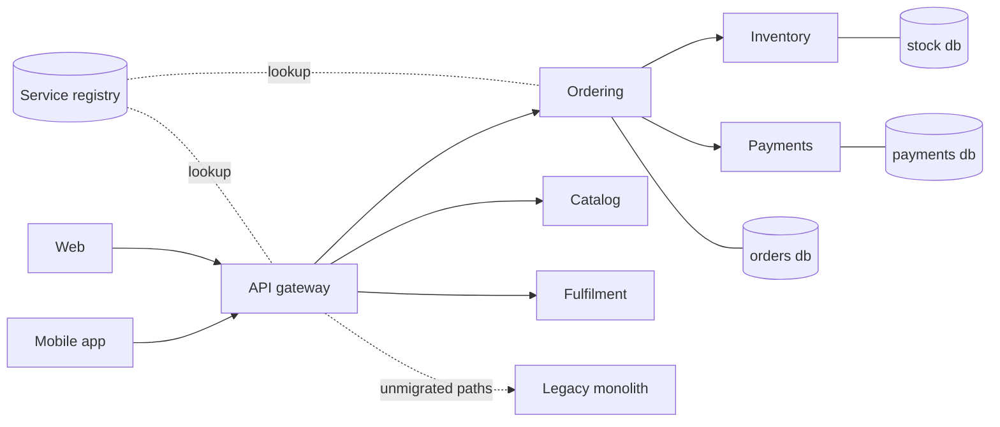
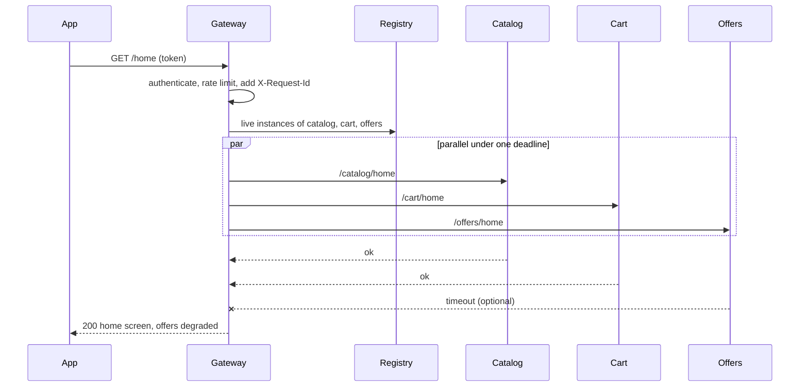

# Microservice Patterns

<span class="badge-l4">L4 🟠 Senior / Lead</span> · <span class="read-time">⏱ 40 min read</span> · Prerequisites: [Domain-Driven Design: Strategic Patterns](ddd-strategic.md), [Architectural Patterns](architectural-patterns.md)

!!! abstract "TL;DR"
    Microservices are independently deployable services, each owning one business capability and its data. **Decompose by capability or subdomain**, not by entity, so a use case touches few services. Give each service **its own database**; share data through APIs and events. Put an **API gateway** in front for routing, authentication, rate limits and request IDs. Use **service discovery** so callers find live instances. Migrate from a monolith with the **strangler fig**: route one slice at a time to new services, shadow-compare first, keep rollback cheap. Move cross-cutting network concerns (mTLS, retries, metrics) into a **sidecar** or service mesh. Microservices buy team autonomy and independent scaling at the price of distributed-systems complexity, so start from a modular monolith unless you have the teams and the need.

## 1. What It Is

**Plain English.** Instead of one big application, FreshCart runs several smaller ones (ordering, inventory, payments, fulfilment), each built and deployed by its own team, talking over the network. These patterns answer the questions that come up immediately: where to cut, who owns which data, how clients reach the services, how services find each other, how to get there from a monolith, and how to handle networking concerns consistently.

**Definition.**

| Pattern | Purpose |
|---------|---------|
| Decomposition by capability / subdomain | Draw service boundaries around business capabilities, not tables |
| Database per service | Each service owns its data; no shared tables |
| API gateway | Single entry point for clients: routing, auth, limits, aggregation |
| Service discovery | Registry of live instances; clients or load balancers look them up |
| Strangler fig | Incrementally replace a legacy system behind a routing facade |
| Sidecar | Helper process alongside each instance for cross-cutting concerns |

## 2. Why It Exists

A monolith worked on by 80 engineers becomes a coordination problem: one deploy pipeline, one release train, one database schema everybody changes, and one hot component forces scaling everything. Microservices let teams deploy independently and scale only what's hot. But the network is not a method call: it fails, it's slow, and data is no longer in one transaction. These patterns exist to get the autonomy without a **distributed monolith**: services that must be deployed together, share a database and call each other synchronously for every request.

## 3. Mental Model / Analogy

**Analogy.** A food court instead of one restaurant kitchen. Each stall (service) has its own cooks, fridge (database) and menu. A front desk (gateway) takes orders and sends them to the right stall. A board shows which stalls are open (discovery). When the old kitchen is replaced, stalls open one by one while the kitchen keeps serving the rest (strangler fig). Every stall gets the same standard card reader bolted on (sidecar), whatever it cooks.

**Technical model.** Services are small, deployable units aligned with bounded contexts, communicating over HTTP/gRPC or messaging, each with its own data store, run on a platform (Kubernetes) that provides discovery, scaling and often a mesh.

## 4. How It Works





## 5. Subtopics

### Decomposition by capability and subdomain

**Description.** Service boundaries follow **business capabilities** (what the business does: ordering, inventory, payments, fulfilment) or DDD **subdomains** and bounded contexts. The common mistake is decomposing by **entity** (CustomerService, ProductService, PriceService), which makes almost every use case a chain of network calls and every feature a multi-team change.

**Advantages / features.** Fewer cross-service calls per use case; a feature usually changes one service; services map to teams; boundaries are stable because capabilities change slowly.

```java title="DecompositionDemo.java"
--8<-- "examples/l4-senior/microservice-patterns/DecompositionDemo.java"
```

1. Four real use cases, each as the sequence of steps it needs.
2. A hop is counted whenever consecutive steps live in different services; each hop is latency and a partial-failure point.
3. Entity decomposition gives nine services; capability decomposition gives four with fewer hops.

**Run it:** `java DecompositionDemo.java`

```text
--8<-- "examples/l4-senior/microservice-patterns/DecompositionDemo.expected.txt"
```

| Boundary heuristic | Good sign | Bad sign |
|--------------------|-----------|----------|
| Business capability | Named with a verb-ish noun (Ordering, Fulfilment) | Named after a table (CustomerService) |
| Change locality | Most features change one service | Every feature changes three |
| Data ownership | Writes for a concept happen in one service | Two services update the same record |
| Team | One team owns it end to end | Ownership split across teams |
| Chattiness | Few synchronous calls per request | Call chains five deep |

**Use** capability decomposition aligned with bounded contexts. **Avoid** entity services and "nano-services" with one endpoint each.
**Real-world Java:** Spring Boot services per capability; Spring Modulith to validate boundaries inside a monolith first.
**Best practice:** prove boundaries as modules in a modular monolith, then extract. **Gotcha:** a wrong boundary is far more expensive to fix across services than across packages.

### Database per service

**Description.** Each service owns its schema or database; no other service reads or writes it directly. Other services get data through the owner's API or by subscribing to its events and keeping a **local copy** of the fields they need.

**Advantages / features.** Services change their schema freely; data store per need (Postgres for orders, Redis for carts, Elasticsearch for search); failures and load stay isolated.

```java title="DatabasePerServiceDemo.java"
--8<-- "examples/l4-senior/microservice-patterns/DatabasePerServiceDemo.java"
```

1. Customer publishes an event with only the data others need, in its published language.
2. Customer changes its internal schema; nobody else has to know.
3. Ordering keeps its own copy of the display name, so packing slips keep working.

**Run it:** `java DatabasePerServiceDemo.java`

```text
--8<-- "examples/l4-senior/microservice-patterns/DatabasePerServiceDemo.expected.txt"
```

| Need | Pattern |
|------|---------|
| Read another service's data occasionally | Call its API |
| Read it on every request | Local replica via events |
| Update data in two services together | Saga (see Distributed Data Patterns) |
| Publish changes reliably | Transactional outbox or CDC |
| Report across services | Analytics store fed by events |

**Use** a private schema per service from day one (even on a shared database server). **Avoid** cross-service joins and "just one read-only view".
**Real-world Java:** a Flyway migration folder per service; separate DB users with grants only on their own schema.
**Best practice:** enforce ownership with database permissions, not convention. **Gotcha:** local copies are eventually consistent; design UI and rules for staleness.

### API Gateway

**Description.** A single entry point between clients and services. It routes by path or host, terminates TLS, authenticates tokens, applies rate limits, adds request IDs and may aggregate several services into one response (a BFF is a gateway per client type).

**Advantages / features.** Clients see one stable API; services stay simpler; cross-cutting policies live in one place; internal topology can change without app releases.

```java title="ApiGatewayDemo.java"
--8<-- "examples/l4-senior/microservice-patterns/ApiGatewayDemo.java"
```

1. Authentication happens once, at the edge.
2. Per-client rate limits protect every service behind the gateway.
3. The gateway adds a request ID and client identity and strips the raw token before forwarding.

**Run it:** `java ApiGatewayDemo.java`

```text
--8<-- "examples/l4-senior/microservice-patterns/ApiGatewayDemo.expected.txt"
```

| Gateway responsibility | Keep in gateway? |
|------------------------|------------------|
| Routing, TLS, auth token validation | Yes |
| Rate limiting, request IDs, CORS | Yes |
| Response aggregation for one client | In a BFF |
| Business rules (discounts, stock checks) | No, belongs in services |
| Per-service authorisation decisions | No, services must still check |

**Use** a gateway for any externally exposed service set. **Avoid** turning it into a monolith of business logic owned by a central team.
**Real-world Java:** Spring Cloud Gateway, Netflix Zuul (legacy), Kong, Envoy, AWS API Gateway.
**Best practice:** one gateway (or BFF) per client type, owned close to that client's team. **Gotcha:** the gateway is a single point of failure; run it redundantly and keep it stateless.

### Service discovery

**Description.** Instances come and go (autoscaling, deploys, crashes). A **registry** tracks live instances via registration and heartbeats or health checks. In **client-side** discovery the caller queries the registry and load-balances; in **server-side** discovery a load balancer or the platform (Kubernetes Services, DNS) does it.

**Advantages / features.** No hardcoded addresses; dead instances drop out automatically; enables load balancing and zero-downtime deploys.

```java title="ServiceDiscoveryDemo.java"
--8<-- "examples/l4-senior/microservice-patterns/ServiceDiscoveryDemo.java"
```

1. The registry records the last heartbeat per instance.
2. An instance is live only while its heartbeat is within the TTL.
3. A client-side load balancer picks round-robin among live instances.

**Run it:** `java ServiceDiscoveryDemo.java`

```text
--8<-- "examples/l4-senior/microservice-patterns/ServiceDiscoveryDemo.expected.txt"
```

| Style | Example | Trade-off |
|-------|---------|-----------|
| Client-side | Eureka + Spring Cloud LoadBalancer | Smart clients, per-language libraries |
| Server-side | Kubernetes Service, AWS ALB | Simple clients, extra hop |
| DNS-based | Kubernetes DNS, Consul DNS | Universal; DNS caching delays updates |
| Mesh | Istio/Linkerd via sidecars | Rich routing; operational complexity |

**Use** the platform's discovery (Kubernetes Services) when you have it. **Avoid** running your own registry on Kubernetes without a reason.
**Real-world Java:** Spring Cloud Kubernetes, Netflix Eureka, Consul.
**Best practice:** combine discovery with readiness probes so instances only receive traffic when ready. **Gotcha:** the JVM caches DNS (`networkaddress.cache.ttl`); stale caches send traffic to dead IPs.

### Strangler fig

**Description.** Replace a legacy system incrementally: put a routing facade in front, move one capability at a time to new services, route its traffic there, and leave the rest on the legacy system until it can be switched off. Shadowing (calling both, comparing, serving the old answer) proves the new service before cut-over.

**Advantages / features.** Value delivered continuously; each step is small and reversible; no big-bang rewrite.

```java title="StranglerFigDemo.java"
--8<-- "examples/l4-senior/microservice-patterns/StranglerFigDemo.java"
```

1. Everything starts on the legacy monolith.
2. Migrating a slice is a routing change.
3. Unmigrated paths fall through to legacy, and rollback is just removing a route.

**Run it:** `java StranglerFigDemo.java`

```text
--8<-- "examples/l4-senior/microservice-patterns/StranglerFigDemo.expected.txt"
```

| Step | Technique |
|------|-----------|
| Intercept | Gateway, reverse proxy or facade in front of legacy |
| Choose slice | Edge capability with clear data, low coupling |
| Prove | Shadow traffic, compare results, dark launch |
| Cut over | Percentage rollout or feature flag; keep rollback |
| Retire | Delete legacy code and data for the slice |

**Use** for any significant legacy replacement. **Avoid** extracting the most tangled core first.
**Real-world Java:** Spring Cloud Gateway routes, Nginx/Envoy, feature flags (Unleash, LaunchDarkly), CDC to sync data during migration.
**Best practice:** track "percentage strangled" and actually delete legacy code. **Gotcha:** two systems writing the same data during migration need a clear owner per field.

### Sidecar

**Description.** A separate process (container) deployed with each service instance, sharing its network namespace, that handles cross-cutting concerns: mTLS, retries, timeouts, metrics, tracing, log shipping, config. A **service mesh** is sidecars everywhere plus a control plane.

**Advantages / features.** Consistent behaviour across languages; concerns upgraded without redeploying apps; app code stays focused on business logic.

```java title="SidecarDemo.java"
--8<-- "examples/l4-senior/microservice-patterns/SidecarDemo.java"
```

1. The application makes a plain call and knows nothing about identity or retries.
2. The sidecar wraps every outbound call.
3. It attaches a workload identity (like a SPIFFE ID in mTLS), retries and records metrics.

**Run it:** `java SidecarDemo.java`

```text
--8<-- "examples/l4-senior/microservice-patterns/SidecarDemo.expected.txt"
```

| Concern | Library in app | Sidecar / mesh |
|---------|----------------|----------------|
| Retries, timeouts | Resilience4j | Envoy retry policy |
| mTLS identity | Manual keystores | Automatic certificate rotation |
| Metrics, tracing | Micrometer, OpenTelemetry agent | Proxy-level metrics |
| Polyglot consistency | One library per language | Same for all |
| Debuggability | In process | Extra hop, more moving parts |

**Use** a mesh when you have many services, several languages or strict mTLS needs. **Avoid** stacking app-level and mesh retries without coordination.
**Real-world Java:** Istio/Envoy, Linkerd, Dapr sidecars; Kubernetes native sidecar containers (1.29+).
**Best practice:** decide per concern whether the app or the mesh owns it. **Gotcha:** retries in both the app and the sidecar multiply (3 x 3 = 9 attempts) during an outage.

## 6. Examples (exactly 3, progressively harder)

### Example 1: Minimal (L2)

**Scenario:** FreshCart's Ordering service needs prices from Pricing. Pricing's internal rules change weekly; Ordering must not care.

```java title="OrderPricingContractDemo.java"
--8<-- "examples/l4-senior/microservice-patterns/OrderPricingContractDemo.java"
```

1. The contract is a small versioned DTO, not Pricing's internal rule model.
2. Ordering depends only on the contract, so it can be tested with a stub.

**Run it:** `java OrderPricingContractDemo.java`

**Output:**

```text
--8<-- "examples/l4-senior/microservice-patterns/OrderPricingContractDemo.expected.txt"
```

**What to notice:**

- Pricing applied a 10% promo internally; Ordering only saw the final unit price.

### Example 2: Realistic (in FreshCart grocery delivery)

**Scenario:** FreshCart is extracting delivery-slot calculation from its monolith. Before switching traffic, the new service runs in shadow mode against real requests.

```java title="SlotsExtractionDemo.java"
--8<-- "examples/l4-senior/microservice-patterns/SlotsExtractionDemo.java"
```

1. Every request also goes to the new service, but its answer is only compared.
2. Customers still get the monolith's answer while the new service is unproven.
3. Cut-over needs enough samples and a mismatch rate under the threshold.

**Run it:** `java SlotsExtractionDemo.java`

**Output:**

```text
--8<-- "examples/l4-senior/microservice-patterns/SlotsExtractionDemo.expected.txt"
```

**What to notice:**

- v1 had a PIN-code bug that customers never saw; the mismatch list pointed straight at it.
- In production, shadow calls run asynchronously and must never have side effects (no writes, no notifications).

### Example 3: Production-grade

**Scenario:** the gateway's home-screen endpoint composes Catalog, Cart and Offers found through discovery. It has a 150 ms budget. Catalog and Cart are required; Offers is nice to have.

```java title="HomeScreenAggregatorDemo.java"
--8<-- "examples/l4-senior/microservice-patterns/HomeScreenAggregatorDemo.java"
```

1. Each dependency is marked required or optional up front.
2. Every downstream call carries the request ID and customer for tracing.
3. Discovery returning no instances is an outcome, not an exception.
4. Each call is classified: ok, timeout (past the deadline) or error.
5. Optional failures degrade the response; required failures return 503.

**Run it:** `java HomeScreenAggregatorDemo.java`

**Output:**

```text
--8<-- "examples/l4-senior/microservice-patterns/HomeScreenAggregatorDemo.expected.txt"
```

**What to notice:**

- When Offers slowed to 400 ms, the response still took only 150 ms and the home screen rendered without offers.
- Catalog alternated between instances (round-robin).
- The outcome log per request and dependency is exactly what a dashboard needs.
- In real code the calls run concurrently (`CompletableFuture.allOf` with `orTimeout`, or structured concurrency); the virtual clock keeps this demo deterministic.

## 7. Pros, Cons & Trade-offs

| Pattern | Pros | Cons |
|---------|------|------|
| Capability decomposition | Local changes, team autonomy | Needs domain understanding up front |
| Database per service | Independent schemas, isolated load | No cross-service transactions or joins |
| API gateway | One client entry point, central policies | Extra hop, potential bottleneck |
| Service discovery | Dynamic, self-healing routing | Another critical component; caching issues |
| Strangler fig | Incremental, reversible migration | Two systems run in parallel for a long time |
| Sidecar / mesh | Uniform cross-cutting concerns | Resource overhead, operational complexity |

## 8. When to Use / When NOT to Use

**Use microservices when:**

- several teams need to deploy independently;
- parts of the system have very different scaling or availability needs;
- you're replacing a legacy system incrementally.

**Don't when:**

- one or two teams own the whole product (a modular monolith is simpler);
- the domain isn't understood yet and boundaries would be guesses;
- you lack automated deployment, monitoring and on-call maturity.

## 9. Best Practices

1. **Decompose by business capability aligned with bounded contexts.** *(Consensus.)*
2. **Each service owns its data; enforce with permissions.** *(Consensus.)*
3. **Start with a modular monolith and extract when there's a reason.** *(Consensus, Fowler's "MonolithFirst".)*
4. **Keep the gateway free of business logic.** *(Consensus.)*
5. **Prefer asynchronous events between services; keep synchronous call chains short.** *(Consensus.)*
6. **Propagate request IDs and trace context everywhere.** *(Consensus.)*
7. **Shadow and compare before cutting over during migrations.** *(Widely used.)*

## 10. Pitfalls & Anti-Patterns

!!! danger "Cascading failure through a synchronous chain (production failure mode)"
    **Symptom:** during a sale, an Offers slowdown made the whole home screen time out; app ratings dropped.
    **Root cause:** the gateway waited for every dependency with no deadline and treated Offers as required; threads piled up.
    **Fix:** one deadline per request, required vs optional dependencies, degraded responses (Example 3), plus timeouts and circuit breakers (next page).

!!! danger "Distributed monolith"
    **Symptom:** five services must be released together; one schema change needs four teams.
    **Root cause:** entity decomposition and a shared database.
    **Fix:** redraw boundaries around capabilities; split schemas; communicate via contracts and events.

!!! danger "Shared database \"just for reads\""
    **Symptom:** a reporting service broke after Customer renamed a column.
    **Root cause:** direct reads of another service's tables.
    **Fix:** events into a reporting store, or a published read API.

!!! danger "Business logic in the gateway"
    **Symptom:** discount rules in gateway filters; every pricing change needs the platform team.
    **Root cause:** convenience; the gateway already "sees" every request.
    **Fix:** move rules to the owning service; keep the gateway to cross-cutting concerns.

## 11. Configuration & Tuning

| Setting | Default | What it does | When to change it | Risk of changing |
|---------|---------|--------------|-------------------|------------------|
| `spring.cloud.gateway.httpclient.response-timeout` | none | Gateway upstream timeout | Always set | Too low drops slow but valid calls |
| `networkaddress.cache.ttl` | 30 s (no security manager) | JVM DNS cache | Dynamic DNS discovery | Lower = more DNS load |
| `eureka.instance.lease-expiration-duration-in-seconds` | 90 | Registry TTL | Faster removal of dead instances | False evictions on GC pauses |
| Kubernetes `readinessProbe` | none | Traffic only when ready | Every service | Wrong probe blocks traffic |
| Istio `VirtualService` retries | 2 attempts | Mesh retries | Coordinate with app retries | Retry storms |

## 12. Security Considerations

- Validate tokens at the gateway, **and** authorise in each service (zero trust); never trust a header just because it came from inside.
- Strip client-supplied internal headers (`X-Client`, `X-User-Id`) at the edge so clients can't spoof them.
- Use mTLS between services; a mesh rotates certificates automatically.
- Separate database credentials per service with least privilege.
- Rate limit per client and per endpoint at the edge.

## 13. Performance & Scalability

Each network hop adds latency (often 1–5 ms in-cluster, more with TLS and serialisation) and a failure point. Aggregate calls in parallel and set a deadline; the request is as slow as its slowest required dependency. Scale services independently based on their own metrics. Sidecars add a little latency and memory per pod (Envoy typically tens of MB). Avoid chatty APIs: prefer coarse-grained calls and local replicas of hot reference data.

## 14. Testing It

Test the aggregator's degradation rules and propagation with a scripted transport:

```java title="HomeScreenAggregatorTest.java"
--8<-- "examples/l4-senior/microservice-patterns/HomeScreenAggregatorTest.java"
```

Across services, add consumer-driven contract tests (Pact, Spring Cloud Contract) and a small number of end-to-end smoke tests.

## 15. Observability & Operations

Distributed tracing (OpenTelemetry) is mandatory: one trace per request across gateway and services. Track RED metrics (rate, errors, duration) per service and per dependency, plus degraded-response counts. Keep a service catalog (Backstage) with owners, dependencies and runbooks. Correlate logs by request ID.

## 16. Version Notes

| Year | Change |
|------|--------|
| 2011–2014 | "Microservices" term coined; Lewis and Fowler's article (2014) |
| 2012–2015 | Netflix OSS: Eureka, Zuul, Hystrix, Ribbon |
| 2004 / 2019 | Fowler's Strangler Fig Application (2004), renamed 2019 |
| 2017 | Istio and Linkerd 2 popularise service meshes |
| 2018–2020 | Spring Cloud Gateway and LoadBalancer replace Zuul/Ribbon |
| 2023 | Spring Modulith GA; Kubernetes native sidecars (1.28 alpha, 1.29 beta) |

## 17. Expert Deep Dive

- **Conway's Law in reverse.** Design team structure to get the architecture you want; boundaries that cross teams decay.
- **Synchronous coupling budget.** Availability multiplies: five required services at 99.9% each give about 99.5%. Fewer synchronous dependencies per request matter more than faster ones.
- **Ambient mesh.** Istio ambient mode replaces per-pod sidecars with node-level proxies to cut overhead.
- **Cell-based architecture.** Whole stacks deployed per cell (region, customer shard) limit blast radius.
- **Modular monolith as the default.** Many teams have moved back from microservices; extract only where independent deployment or scaling pays.

!!! example "War story: the home screen that waited for offers"
    During a FreshCart festival sale, the Offers service slowed to two seconds under load. The gateway's home endpoint called Catalog, Cart and Offers sequentially without deadlines; gateway threads were exhausted in minutes and the app showed a blank screen to everyone, including customers who never looked at offers. **Fixes:** parallel calls with a 150 ms deadline, Offers marked optional with an empty-section fallback, per-dependency outcome metrics, and a bulkhead per downstream. During the next sale Offers degraded three times and nobody outside the team noticed. **Lesson:** decide up front which dependencies a response can live without.

## 18. Interview Corner

=== "🟢 L1–L2"

    1. **What's a microservice?** An **independently deployable service** owning one capability and its data.
    2. **What does an API gateway do?** **Single entry point**: routing, auth, rate limits.
    3. **Why database per service?** So services **change and scale independently**.
    4. **What's service discovery?** Finding **live instances** of a service dynamically.
    5. **What's the strangler fig?** **Incrementally replacing** a legacy system behind a facade.

=== "🟡 L3"

    1. **Entity vs capability decomposition?** Entities cause **chatty call chains**; capabilities keep use cases local.
    2. **How does a service get another service's data?** **API call, or a local copy via events**.
    3. **Client-side vs server-side discovery?** **Caller load-balances** vs **platform/LB does**.
    4. **What's a sidecar?** A **helper container** alongside the app for cross-cutting concerns.
    5. **What's a BFF?** A **gateway per client type** shaped for that client.

=== "🔴 L4–L5"

    1. **When would you not use microservices?** **Small team, unclear domain, immature ops**; use a modular monolith.
    2. **How do you prevent a distributed monolith?** **Capability boundaries, own data, async integration, contracts.**
    3. **How do you migrate a monolith safely?** **Strangler fig, shadow traffic, incremental cut-over, delete legacy.**
    4. **How do you design a composed endpoint for resilience?** **Parallel calls, one deadline, required vs optional, degraded responses.**
    5. **App retries vs mesh retries?** **One owner per concern**; avoid multiplying retries.

=== "💻 Hands-on"

    **Task:** Change `SlotsExtractionDemo` to cut over gradually: route a percentage of PIN codes to the new service based on a stable hash.

    ??? success "Solution"
        ```java
        int rolloutPercent = 10;
        String slotFor(String pin) {
            boolean inRollout = Math.floorMod(pin.hashCode(), 100) < rolloutPercent;
            return inRollout ? candidate.apply(pin) : MONOLITH.apply(pin);
        }
        // a stable hash keeps each customer on one side, so they don't see answers flip between requests
        ```

## 19. Practice

- [ ] List FreshCart's capabilities and draw candidate service boundaries.
    ??? tip "Hint"
        Start from the bounded contexts on the DDD Strategic page.
- [ ] Put Spring Cloud Gateway in front of two Spring Boot apps with a path route and a rate limiter.
    ??? tip "Hint"
        `RequestRateLimiter` filter with Redis.
- [ ] Add a TTL-based eviction test to `ServiceDiscoveryDemo`.
    ??? tip "Hint"
        Heartbeat at t=0, look up at t=ttl and t=ttl+1.
- [ ] Add an `error` case for Offers in `HomeScreenAggregatorDemo` and check it degrades.
    ??? tip "Hint"
        Return a body starting with `5`.

## 20. Quick Revision Card

!!! tip "Remember in 30 seconds"
    - Cut by capability/subdomain, not by entity.
    - Each service owns its data; others use APIs or event-fed copies.
    - Gateway: routing, auth, limits, request IDs; no business logic.
    - Discovery: heartbeats/health checks, TTL, load balancing.
    - Strangler fig: facade, shadow, cut over, delete legacy.
    - Sidecar/mesh: mTLS, retries, metrics; one owner per concern.

    ```java
    if (outcome.equals("ok")) sections.put(d.service(), reply.body());
    else if (d.required()) failed = true;
    else degraded.add(d.service());
    ```

## 21. Further Reading

- Sam Newman, *Building Microservices* (2nd ed., 2021) and *Monolith to Microservices* (2019).
- Chris Richardson, *Microservices Patterns* (2018) and [microservices.io](https://microservices.io/).
- Martin Fowler, [StranglerFigApplication](https://martinfowler.com/bliki/StranglerFigApplication.html) and [MonolithFirst](https://martinfowler.com/bliki/MonolithFirst.html).
- [Spring Cloud Gateway reference](https://docs.spring.io/spring-cloud-gateway/reference/).

---

[← Previous: Domain-Driven Design: Strategic Patterns](ddd-strategic.md) · [Next: Resilience Patterns →](resilience-patterns.md)
