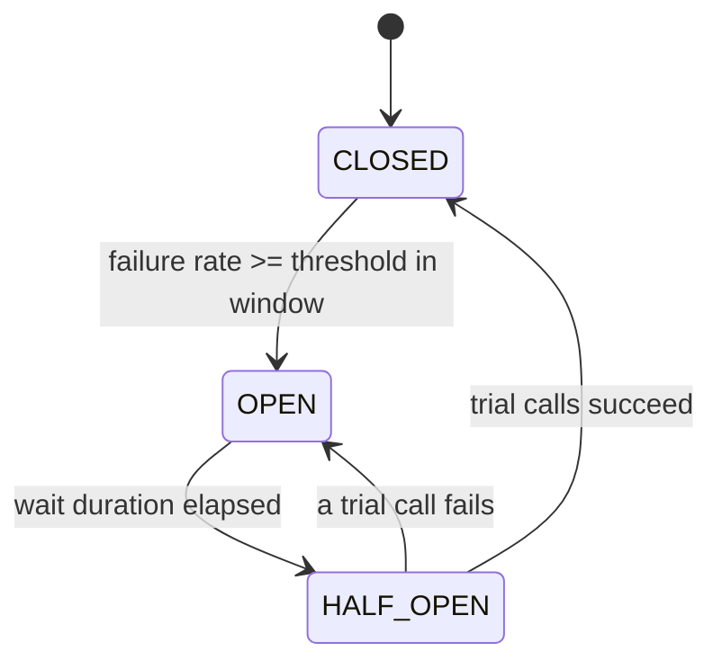
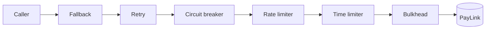

# Resilience Patterns

<span class="badge-l4">L4 🟠 Senior / Lead</span> · <span class="read-time">⏱ 35 min read</span> · Prerequisites: [Microservice Patterns](microservice-patterns.md), [Error Handling Patterns](../l3-professional/error-handling-patterns.md)

!!! abstract "TL;DR"
    Every remote dependency will be slow or down at some point; resilience patterns stop that from taking your service with it. A **timeout** bounds how long you wait. A **retry with exponential backoff and jitter** recovers from transient failures without a thundering herd, and only for idempotent operations. A **circuit breaker** stops calling a failing dependency and fails fast until it recovers. A **bulkhead** caps concurrency per dependency so one slow service can't use all your threads. A **rate limiter** keeps you within a quota or protects you from overload. A **fallback** returns something useful (cached, default, degraded) instead of an error. **Resilience4j** provides all of them as composable decorators; the order you compose them in matters.

## 1. What It Is

**Plain English.** When FreshCart calls PayLink, TextBlast or its own Inventory service, things go wrong: slow responses, errors, outages, quota limits. These patterns are small, well-known pieces of client-side logic that decide how long to wait, whether to try again, when to stop trying, how much to send at once, and what to return when the answer can't be had.

**Definition.**

| Pattern | Question it answers |
|---------|---------------------|
| Timeout | How long will I wait? |
| Retry with backoff and jitter | Should I try again, and when? |
| Circuit breaker | Should I even call it right now? |
| Bulkhead | How many concurrent calls may this dependency hold? |
| Rate limiter | How many calls per second may I make (or accept)? |
| Fallback | What do I return when the call fails? |

## 2. Why It Exists

In a distributed system, failure is partial and constant. Without timeouts, a hung dependency holds threads until the caller is also hung; without limits, retries from thousands of clients turn a blip into an outage; without isolation, one slow feature takes down unrelated ones. Michael Nygard's *Release It!* (2007) catalogued these "stability patterns" from real outages; Netflix's Hystrix (2012) made them a library, and Resilience4j is its modern, functional successor for Java.

## 3. Mental Model / Analogy

**Analogy.** A house's electrical system. A timeout is a kitchen timer: stop waiting after five minutes. Retry with jitter is redialling a busy number after a random pause, not all at the same second. A circuit breaker trips when there's a fault and is reset after a while. Bulkheads are separate circuits: a fault in the garage doesn't cut the fridge. A rate limiter is a water meter's flow cap. A fallback is the candle in the drawer.

**Technical model.** Each pattern wraps a call (`Supplier<T>`) and returns a decorated call; patterns are composed like decorators, with state (failure counts, permits, tokens) shared per dependency.

## 4. How It Works





The second diagram is Resilience4j's default aspect order: each retry attempt passes through the breaker (so failures are counted and an open breaker stops retries), and each attempt has its own timeout.

## 5. Subtopics

### Timeout

**Description.** Put an upper bound on every remote call: connect timeout, read timeout and an overall deadline per request. When it expires, the caller stops waiting and fails or falls back. Timeouts should be derived from the dependency's latency distribution (for example a little above its p99) and from the caller's own deadline.

**Advantages / features.** Bounded latency; threads and connections are returned; failures become visible instead of silent hangs.

```java title="TimeoutDemo.java"
--8<-- "examples/l4-senior/resilience-patterns/TimeoutDemo.java"
```

1. A dependency that hangs for two seconds.
2. `orTimeout` completes the future exceptionally after 200 ms.
3. The timeout is turned into a useful answer for the caller.

**Run it:** `java TimeoutDemo.java`

```text
--8<-- "examples/l4-senior/resilience-patterns/TimeoutDemo.expected.txt"
```

| Timeout | Where | Typical value |
|---------|-------|---------------|
| Connect | HTTP client | 1–2 s, or lower in-cluster |
| Read / response | HTTP client, JDBC `queryTimeout` | Slightly above dependency p99 |
| Request deadline | Gateway / caller | User-facing budget (e.g. 1–2 s) |
| Pool acquisition | Connection pool | Short: don't queue forever |

**Use** timeouts on every network call, including database and cache calls. **Avoid** library defaults: many HTTP clients wait forever by default.
**Real-world Java:** `HttpClient.newBuilder().connectTimeout(...)` and `HttpRequest.timeout(...)`, `CompletableFuture.orTimeout`, Resilience4j `TimeLimiter`, HikariCP `connectionTimeout`.
**Best practice:** propagate a deadline (remaining budget) to downstream calls. **Gotcha:** the last output line shows that `orTimeout` frees the caller but not the worker thread; the abandoned work still runs, so use clients with real I/O timeouts or cancel the task.

### Retry with backoff and jitter

**Description.** Retry transient failures (timeouts, 503, connection resets) a small number of times, waiting longer each time (exponential backoff) with randomness (jitter) so clients don't retry in sync. Never retry non-transient errors (400, 402) and only retry operations that are idempotent, or made idempotent with an idempotency key.

**Advantages / features.** Absorbs blips; spreads load during recovery; bounded total attempts.

```java title="RetryBackoffJitterDemo.java"
--8<-- "examples/l4-senior/resilience-patterns/RetryBackoffJitterDemo.java"
```

1. Exponential backoff with a cap: 100, 200, 400 ms and so on.
2. Full jitter: wait a random time between 0 and the backoff.
3. Retry only transient failures of idempotent operations, within the attempt limit.

**Run it:** `java RetryBackoffJitterDemo.java`

```text
--8<-- "examples/l4-senior/resilience-patterns/RetryBackoffJitterDemo.expected.txt"
```

| Jitter strategy | Formula | Notes |
|-----------------|---------|-------|
| None | base x 2^n | Synchronised retries |
| Full | random(0, base x 2^n) | Best spread (AWS recommendation) |
| Equal | half + random(0, half) | Guarantees a minimum wait |
| Decorrelated | random(base, prev x 3) | Smooth growth |

**Use** for idempotent reads and keyed writes. **Avoid** retrying at several layers (app, client library, mesh) at once.
**Real-world Java:** Resilience4j `Retry` with `IntervalFunction.ofExponentialRandomBackoff`, Spring Retry `@Retryable`, AWS SDK retry policies.
**Best practice:** limit retries with a budget (for example at most 10–20% extra traffic). **Gotcha:** 3 retries at each of 3 layers is 4 x 4 x 4 = 64 calls to the bottom service per user request.

### Circuit breaker

**Description.** Track recent call outcomes. When the failure (or slow-call) rate exceeds a threshold, the breaker **opens** and rejects calls immediately for a wait period. Then it goes **half-open**, letting a few trial calls through; success closes it, failure opens it again.

**Advantages / features.** Fail fast instead of waiting on a dead service; gives the dependency room to recover; makes outages visible as state changes.

```java title="CircuitBreakerDemo.java"
--8<-- "examples/l4-senior/resilience-patterns/CircuitBreakerDemo.java"
```

1. While open, calls are rejected without touching the network.
2. Half-open: trial calls decide whether to close or reopen.
3. The breaker opens when the failure rate over a full window reaches the threshold.

**Run it:** `java CircuitBreakerDemo.java`

```text
--8<-- "examples/l4-senior/resilience-patterns/CircuitBreakerDemo.expected.txt"
```

| Setting | Effect |
|---------|--------|
| Window (count or time based) | How much history decides |
| Minimum calls | Avoids opening on 1 failure out of 1 |
| Failure-rate threshold | How bad before opening |
| Slow-call threshold | Treat slow successes as failures |
| Wait in open state | Recovery time given to the dependency |
| Half-open permitted calls | How many trials before deciding |

**Use** around every remote dependency that can fail independently. **Avoid** counting business errors (declined card, 404) as failures.
**Real-world Java:** Resilience4j `CircuitBreaker`, Spring Cloud CircuitBreaker, Envoy outlier detection.
**Best practice:** one breaker per dependency (or per endpoint), never one global breaker. **Gotcha:** with a tiny window, a few unlucky calls open the breaker at low traffic; set a minimum number of calls.

### Bulkhead

**Description.** Limit concurrent calls per dependency (a semaphore or a dedicated thread pool). When the limit is reached, extra calls are rejected or wait briefly. A slow dependency then only exhausts its own compartment.

**Advantages / features.** Failure isolation between features; predictable resource use; protection for the dependency too.

```java title="BulkheadDemo.java"
--8<-- "examples/l4-senior/resilience-patterns/BulkheadDemo.java"
```

1. Each slot is busy until its call's latency has passed.
2. A full pool rejects the call instead of queueing it.
3. With bulkheads, slow Offers only rejects Offers calls; Payments is untouched.

**Run it:** `java BulkheadDemo.java`

```text
--8<-- "examples/l4-senior/resilience-patterns/BulkheadDemo.expected.txt"
```

| Bulkhead type | Mechanism | Trade-off |
|---------------|-----------|-----------|
| Semaphore | Limits concurrent callers | Cheap; no extra threads; timeout must be separate |
| Thread pool | Separate executor per dependency | Isolates blocking; costs threads |
| Connection pool | Max connections per host | Usually needed anyway |
| Deployment | Separate instances per client/tenant | Strongest isolation, highest cost |

**Use** for dependencies with different criticality or latency. **Avoid** a single shared pool for everything (the default in many apps).
**Real-world Java:** Resilience4j `Bulkhead` and `ThreadPoolBulkhead`, HikariCP pools per database, Tomcat connector limits.
**Best practice:** size bulkheads with Little's Law: concurrency = throughput x latency, plus headroom. **Gotcha:** virtual threads remove thread-pool limits; you still need a semaphore bulkhead to protect the dependency.

### Rate limiter

**Description.** Limit the number of calls per time window. A **token bucket** refills at a steady rate and allows bursts up to its capacity. Client-side, it keeps you inside a provider's quota; server-side, it protects your service from abusive or runaway clients.

**Advantages / features.** Predictable load; avoids 429s and bans from providers; fairness between clients.

```java title="RateLimiterDemo.java"
--8<-- "examples/l4-senior/resilience-patterns/RateLimiterDemo.java"
```

1. The bucket starts full: capacity is the allowed burst.
2. Tokens refill continuously at the steady rate, up to capacity.
3. No token: the caller waits, queues or gets a 429.

**Run it:** `java RateLimiterDemo.java`

```text
--8<-- "examples/l4-senior/resilience-patterns/RateLimiterDemo.expected.txt"
```

| Algorithm | Behaviour |
|-----------|-----------|
| Token bucket | Bursts up to capacity, then steady rate |
| Leaky bucket | Smooth constant output |
| Fixed window | Simple; 2x burst at window edges |
| Sliding window | Accurate; more state |
| Distributed (Redis) | Shared limit across instances |

**Use** client-side for third-party quotas; server-side per client at the edge. **Avoid** per-instance limits when the quota is global (10 instances x limit = 10x the quota).
**Real-world Java:** Resilience4j `RateLimiter`, Bucket4j (with Redis), Guava `RateLimiter`, Spring Cloud Gateway `RequestRateLimiter`.
**Best practice:** return `429` with `Retry-After` when you limit others; honour it when others limit you. **Gotcha:** Resilience4j's rate limiter blocks by default for up to `timeoutDuration`; set it to zero for fail-fast.

### Fallback

**Description.** When a call fails (after retries, or because the breaker is open), return a substitute: a cached last-known value marked as stale, a safe default, a degraded feature, or "accepted, will complete later". Choose fallbacks with the business, because each one is a product decision.

**Advantages / features.** Users keep a working experience; failures become graceful degradation.

```java title="FallbackDemo.java"
--8<-- "examples/l4-senior/resilience-patterns/FallbackDemo.java"
```

1. Business errors are not failures to hide; they propagate (here, a 404).
2. First choice: the last known value, labelled as possibly stale.
3. Last resort: a safe default the business agreed on.

**Run it:** `java FallbackDemo.java`

```text
--8<-- "examples/l4-senior/resilience-patterns/FallbackDemo.expected.txt"
```

| Fallback | Example | Risk |
|----------|---------|------|
| Cached value | Last ETA, yesterday's prices | Stale data shown as fresh |
| Default | "45 minutes", empty recommendations | Misleading if not labelled |
| Degrade feature | Hide offers banner | Hidden failures if unmonitored |
| Queue for later | Payment "pending" | Must actually be processed |
| Fail fast | Clear error message | User frustration, but honest |

**Use** for reads and non-critical features. **Avoid** faking writes (never pretend a payment succeeded).
**Real-world Java:** Resilience4j `Decorators.ofSupplier(...).withFallback(...)`, Spring Cloud CircuitBreaker fallbacks, Caffeine as last-known-value cache.
**Best practice:** count every fallback served as a metric and alert on it. **Gotcha:** a fallback that calls another remote service needs its own resilience; it can fail too.

### Resilience4j

**Description.** Resilience4j is a lightweight library with one module per pattern (`CircuitBreaker`, `Retry`, `Bulkhead`, `ThreadPoolBulkhead`, `RateLimiter`, `TimeLimiter`, `Cache`), each a functional decorator around `Supplier`, `Callable`, `CompletionStage` or reactive types. Spring Boot integration adds annotations, YAML configuration, Actuator health and Micrometer metrics.

**Advantages / features.** Small, modular, no thread pools unless you ask; event publishers and metrics for every component; Spring Boot and Reactor/RxJava support.

This example is a small Maven project using the real library: [`examples/l4-senior/resilience-patterns/resilience4j`](https://github.com/khiruashish/java-design-pattern-mobile-app/tree/claude/add-playbook-master-prompt/examples/l4-senior/resilience-patterns/resilience4j).

```java title="Resilience4jDemo.java"
--8<-- "examples/l4-senior/resilience-patterns/resilience4j/src/main/java/com/freshcart/resilience/Resilience4jDemo.java"
```

1. Count-based window of four calls; open at 50% failures; stay open for 30 s.
2. Retry only PayLink's transient error with exponential random backoff, and never retry a call the breaker rejected.
3. Retry wraps the breaker, which wraps the bulkhead: each attempt is counted by the breaker.
4. Fallbacks distinguish "we didn't call" from "we called and it failed".

**Run it:** `mvn -q compile exec:java -Dexec.mainClass=com.freshcart.resilience.Resilience4jDemo` (or `mvn verify`, which checks this output)

```text
--8<-- "examples/l4-senior/resilience-patterns/resilience4j/expected/Resilience4jDemo.expected.txt"
```

| Spring Boot property (`resilience4j.circuitbreaker.instances.paylink.*`) | Meaning |
|-------------------------------------------------------------------------|---------|
| `sliding-window-size`, `minimum-number-of-calls` | Window and minimum history |
| `failure-rate-threshold`, `slow-call-rate-threshold` | When to open |
| `wait-duration-in-open-state` | Time before half-open |
| `permitted-number-of-calls-in-half-open-state` | Trial calls |
| `ignore-exceptions` / `record-exceptions` | What counts as failure |

**Use** Resilience4j (directly or via Spring Cloud CircuitBreaker) for JVM services. **Avoid** Hystrix: it has been in maintenance mode since 2018.
**Real-world Java:** `@CircuitBreaker(name = "paylink", fallbackMethod = "pending")` with `resilience4j-spring-boot3`.
**Best practice:** configure per dependency in YAML and expose metrics via Micrometer. **Gotcha:** annotation-based decorators are Spring AOP proxies: self-invocation (`this.charge()`) bypasses them.

## 6. Examples (exactly 3, progressively harder)

### Example 1: Minimal (L2)

**Scenario:** FreshCart's add-to-cart button checks stock. If Inventory is slow, customers should still be able to add the item.

```java title="StockCheckDemo.java"
--8<-- "examples/l4-senior/resilience-patterns/StockCheckDemo.java"
```

1. The call has a time budget.
2. Over budget, the business-approved fallback lets the customer continue.

**Run it:** `java StockCheckDemo.java`

**Output:**

```text
--8<-- "examples/l4-senior/resilience-patterns/StockCheckDemo.expected.txt"
```

**What to notice:**

- The fallback is a product decision (confirm at packing), not a technical default.

### Example 2: Realistic (in FreshCart grocery delivery)

**Scenario:** login OTPs go through TextBlast. When FreshCart exceeds its quota, TextBlast answers 429 with `Retry-After`; when it's struggling, 503. An OTP is useless after a few seconds, so there's an overall deadline and a backup provider.

```java title="OtpSenderDemo.java"
--8<-- "examples/l4-senior/resilience-patterns/OtpSenderDemo.java"
```

1. On 429, wait exactly as long as the provider asks.
2. On 503, back off exponentially with full jitter.
3. When attempts or the deadline run out, fail over to the next provider.

**Run it:** `java OtpSenderDemo.java`

**Output:**

```text
--8<-- "examples/l4-senior/resilience-patterns/OtpSenderDemo.expected.txt"
```

**What to notice:**

- The waits after the 503s (292 ms, 599 ms, 557 ms) are random within growing ranges.
- A 400 (invalid number) returns immediately: retrying or failing over can't fix it.

### Example 3: Production-grade

**Scenario:** FreshCart's PayLink client must never double-charge, must not hammer PayLink during an outage, and must leave orders in a state that can be completed later.

```java title="PaymentClientDemo.java"
--8<-- "examples/l4-senior/resilience-patterns/PaymentClientDemo.java"
```

1. An open breaker rejects without calling PayLink; the order is queued for later.
2. One idempotency key per order: every retry of the same charge carries it.
3. A retry budget: retries are skipped when the budget is spent or the breaker opened.
4. Each attempt has its own timeout; a timeout counts as a failure.
5. When all else fails, the fallback is "pending", never a fake success.

**Run it:** `java PaymentClientDemo.java`

**Output:**

```text
--8<-- "examples/l4-senior/resilience-patterns/PaymentClientDemo.expected.txt"
```

**What to notice:**

- FC-3's first attempt timed out after PayLink had already charged; the retry with the same key didn't charge again.
- FC-2's decline wasn't retried and didn't count toward opening the breaker.
- During the outage, FC-4 got no retry (budget spent), and FC-7 and FC-8 made no remote calls at all.
- After 31 seconds a single trial call (FC-9) closed the breaker.

## 7. Pros, Cons & Trade-offs

| Pattern | Pros | Cons |
|---------|------|------|
| Timeout | Bounded waits | Too short: false failures; too long: no protection |
| Retry | Hides transient failures | Amplifies load; duplicates without idempotency |
| Circuit breaker | Fail fast, recovery room | Tuning; can reject during partial outages |
| Bulkhead | Isolation | Capacity planning; rejected calls |
| Rate limiter | Predictable load, quota safety | Rejections; distributed limits are harder |
| Fallback | Graceful degradation | Can hide failures; stale data |

## 8. When to Use / When NOT to Use

**Use them when:**

- calling anything over a network (services, databases, caches, third parties);
- one dependency's failure shouldn't affect unrelated features;
- a provider enforces quotas.

**Don't when:**

- the call is in-process and can't fail independently;
- retrying non-idempotent writes without keys;
- adding patterns without metrics to tell whether they fire.

## 9. Best Practices

1. **Every remote call has a timeout.** *(Consensus.)*
2. **Retry only transient errors on idempotent operations, with backoff, jitter and a budget.** *(Consensus.)*
3. **One breaker and one bulkhead per dependency.** *(Consensus.)*
4. **Retry in exactly one layer.** *(Consensus.)*
5. **Fallbacks are product decisions and are always measured.** *(Consensus.)*
6. **Test failure modes deliberately (fault injection, chaos experiments).** *(Consensus.)*
7. **Prefer Resilience4j over hand-rolled logic in production.** *(Widely used.)*

## 10. Pitfalls & Anti-Patterns

!!! danger "Retry storm after a blip (production failure mode)"
    **Symptom:** PayLink had a 20-second hiccup; FreshCart's traffic to it went up 9x and kept it down for 15 minutes.
    **Root cause:** three retries in the app plus mesh retries, no jitter, no budget, no breaker.
    **Fix:** retries in one layer, full jitter, a retry budget, a circuit breaker, and honouring `Retry-After`.

!!! danger "No timeout on a database or HTTP call"
    **Symptom:** all request threads stuck; health checks time out; pods restarted in a loop.
    **Root cause:** default infinite read timeout on a client.
    **Fix:** explicit connect/read timeouts and a request deadline.

!!! danger "Retrying a non-idempotent write"
    **Symptom:** customers charged twice after a timeout.
    **Root cause:** a POST retried without an idempotency key; the first attempt had succeeded.
    **Fix:** idempotency keys on every write that may be retried (Example 3).

!!! danger "Silent fallbacks"
    **Symptom:** recommendations were empty for two weeks; nobody noticed.
    **Root cause:** fallback to an empty list with no metric or alert.
    **Fix:** count fallbacks; alert when the rate exceeds a baseline.

## 11. Configuration & Tuning

| Setting (Resilience4j) | Default | What it does | When to change it | Risk of changing |
|------------------------|---------|--------------|-------------------|------------------|
| `circuitbreaker.slidingWindowSize` | 100 | Calls in the window | Low-traffic dependencies | Too small: flapping |
| `circuitbreaker.failureRateThreshold` | 50 | % failures to open | Critical vs optional deps | Too low: false opens |
| `circuitbreaker.waitDurationInOpenState` | 60 s | Time open before half-open | Faster recovery checks | Too short: hammering |
| `retry.maxAttempts` | 3 | Total attempts | Rarely higher | Load amplification |
| `bulkhead.maxConcurrentCalls` | 25 | Concurrent permits | Size by Little's Law | Too low: rejections |
| `ratelimiter.timeoutDuration` | 5 s | Wait for a permit | 0 for fail-fast | Blocked threads |
| `timelimiter.timeoutDuration` | 1 s | Async call timeout | Per dependency p99 | False timeouts |

## 12. Security Considerations

- Rate limiting at the edge is a first defence against credential stuffing and scraping; limit per account and per IP.
- Fallbacks must not bypass security checks (no "allow if the auth service is down" for sensitive actions; fail closed).
- Retries of authenticated calls must not log tokens.
- Circuit breakers around fraud checks need an explicit policy: fail closed for high-value orders.

## 13. Performance & Scalability

The patterns are cheap: a breaker or semaphore check costs nanoseconds. The real effects are systemic: timeouts free capacity, retries add load (budget them), breakers shed load from struggling dependencies, and bulkheads cap the blast radius. Size concurrency with Little's Law; for example 200 requests/s at 100 ms latency needs about 20 concurrent permits. With virtual threads (Java 21+), thread pools no longer limit concurrency, so explicit bulkheads matter more.

## 14. Testing It

Test resilience logic with a scripted dependency and a controllable clock:

```java title="PaymentClientTest.java"
--8<-- "examples/l4-senior/resilience-patterns/PaymentClientTest.java"
```

For integration tests, inject faults with Toxiproxy or WireMock (delays, resets, 503s), and run game days in staging.

## 15. Observability & Operations

Export breaker state, failure and slow-call rates, not-permitted calls, retry counts, bulkhead available permits, rate-limiter waiting threads and fallback counts (Resilience4j has Micrometer binders). Alert on breakers open for more than a few minutes and on fallback rates. Show breaker state on the service dashboard; on-call engineers need to see "PayLink breaker OPEN" before they read logs.

## 16. Version Notes

| Year | Change |
|------|--------|
| 2007 | Nygard's *Release It!* names stability patterns |
| 2012 | Netflix Hystrix |
| 2015 | AWS "Exponential Backoff and Jitter" article |
| 2016 | Resilience4j 0.x |
| 2018 | Hystrix enters maintenance mode |
| 2022 | Resilience4j 2.0 (Java 17 baseline) |
| 2023 | Java 21 virtual threads: thread pools stop acting as implicit bulkheads |

## 17. Expert Deep Dive

- **Adaptive concurrency limits.** Netflix's concurrency-limits library adjusts limits from observed latency (TCP-congestion-style) instead of fixed bulkhead sizes.
- **Load shedding and priorities.** Under overload, servers drop low-priority work first (Retry-After, 503) to keep critical paths alive.
- **Hedged requests.** Send a second request after the p95 latency and take the first reply; cuts tail latency at a small extra cost (idempotent reads only).
- **Deadline propagation.** gRPC propagates deadlines automatically; with HTTP, pass a remaining-budget header so downstream services don't work on requests the caller has abandoned.
- **Metastable failures.** Systems can stay down after the trigger is gone because retries keep load above capacity; budgets and breakers are what break the loop.

!!! example "War story: 20 seconds that became 15 minutes"
    PayLink had a 20-second network blip during FreshCart's evening peak. The checkout service retried three times, the HTTP client retried twice, and the mesh retried twice, all without jitter. When PayLink came back, it received about 9x normal traffic in synchronised waves and fell over again, repeatedly, for 15 minutes. **Fixes:** retries only in the application, with full jitter and a 10% retry budget; mesh retries disabled for PayLink; a circuit breaker with "payment pending" fallback and an async completion job; idempotency keys (already present, which is why nobody was double-charged). **Lesson:** retries are load; they need a budget like any other load.

## 18. Interview Corner

=== "🟢 L1–L2"

    1. **Why set timeouts?** So a **slow dependency can't hang the caller**.
    2. **What's exponential backoff?** **Waiting longer after each failed attempt**.
    3. **What's a circuit breaker?** **Stops calling a failing service** for a while.
    4. **What's a fallback?** A **substitute answer** when the call fails.
    5. **What does a rate limiter do?** **Caps calls per time unit**.

=== "🟡 L3"

    1. **Why jitter?** To **avoid synchronised retries** (thundering herd).
    2. **Which errors should be retried?** **Transient ones** (timeouts, 503, resets) on **idempotent** operations.
    3. **Circuit breaker states?** **Closed, open, half-open.**
    4. **Semaphore vs thread-pool bulkhead?** **Limit callers** vs **separate executor**.
    5. **Token bucket vs fixed window?** **Bursts with steady refill** vs **simple counters with edge bursts**.

=== "🔴 L4–L5"

    1. **Order of Resilience4j decorators?** **Retry(CircuitBreaker(RateLimiter(TimeLimiter(Bulkhead(call)))))**, so each attempt is counted and limited.
    2. **How do you prevent retry storms?** **One layer, jitter, budget, breaker, Retry-After.**
    3. **How do you make payment retries safe?** **Idempotency keys** deduplicated by the provider or your service.
    4. **Bulkheads with virtual threads?** **Still needed**: semaphores protect dependencies when threads are unlimited.
    5. **What's a metastable failure?** A system **stuck in overload after the trigger is gone**, sustained by retries.

=== "💻 Hands-on"

    **Task:** Add a slow-call rule to `CircuitBreakerDemo`: calls slower than 1 s count as failures.

    ??? success "Solution"
        ```java
        record Result(String body, long latencyMs) {}
        // in call(): measure latency (or take it from the reply) and record a failure if it's too slow
        boolean ok = threw == null && result.latencyMs() <= 1_000;
        // Resilience4j equivalent: slowCallDurationThreshold(Duration.ofSeconds(1)) and slowCallRateThreshold(50)
        ```

## 19. Practice

- [ ] Find every HTTP and JDBC client in a service you know and list its timeouts.
    ??? tip "Hint"
        Search for client builders; missing values usually mean "infinite".
- [ ] Add `ThreadPoolBulkhead` to the Resilience4j project and observe rejections.
    ??? tip "Hint"
        `maxThreadPoolSize(2)`, `queueCapacity(0)`.
- [ ] Simulate 1,000 clients with equal jitter and compare the busiest window with full jitter.
    ??? tip "Hint"
        Reuse `RetryBackoffJitterDemo`.
- [ ] Use Toxiproxy to add 2 s latency to a local Postgres and watch your service.
    ??? tip "Hint"
        `toxiproxy-cli toxic add -t latency -a latency=2000 postgres`.

## 20. Quick Revision Card

!!! tip "Remember in 30 seconds"
    - Timeout every remote call; propagate deadlines.
    - Retry transient errors on idempotent calls; backoff + full jitter + budget; one layer only.
    - Circuit breaker: closed, open (fail fast), half-open (trial calls).
    - Bulkhead per dependency; size with Little's Law.
    - Rate limiter: token bucket; honour Retry-After.
    - Fallbacks are product decisions; never fake writes; measure them.

    ```java
    Supplier<String> call = Retry.decorateSupplier(retry,
            CircuitBreaker.decorateSupplier(breaker, Bulkhead.decorateSupplier(bulkhead, paylink)));
    ```

## 21. Further Reading

- Michael T. Nygard, *Release It!* (2nd ed., 2018), "Stability Patterns".
- Marc Brooker, [Exponential Backoff And Jitter](https://aws.amazon.com/blogs/architecture/exponential-backoff-and-jitter/) (AWS Architecture Blog).
- [Resilience4j documentation](https://resilience4j.readme.io/).
- Google SRE book, chapters "Handling Overload" and "Addressing Cascading Failures".

---

[← Previous: Microservice Patterns](microservice-patterns.md) · [Next: Distributed Data Patterns →](distributed-data-patterns.md)
