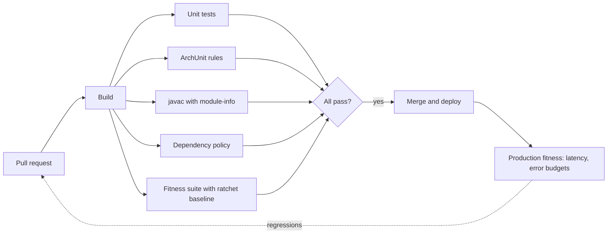
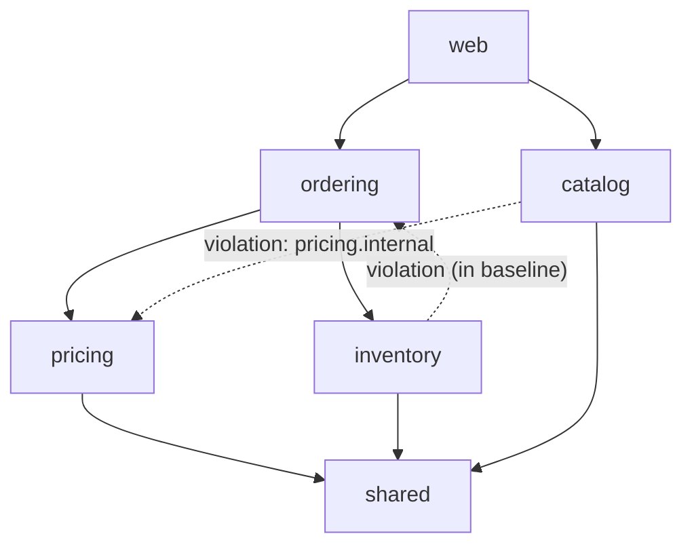

# Evolutionary Architecture

<span class="badge-l5">L5 🔴 Staff / Principal</span> · <span class="read-time">⏱ 30 min read</span> · Prerequisites: [Choosing Patterns and Trade-offs](pattern-selection.md), [Architectural Patterns](../l4-senior/architectural-patterns.md)

!!! abstract "TL;DR"
    Architecture decays one reasonable shortcut at a time unless something checks it. **Fitness functions** are executable checks of architectural characteristics (latency budgets, dependency rules, module size, cycles, dependency hygiene) that run in CI or production. **ArchUnit** expresses structural rules (layers, internal packages, cycles) as JUnit tests over compiled classes. **JPMS** (`module-info.java`) makes module boundaries a compiler-enforced fact rather than a convention. **Coupling metrics** (afferent/efferent coupling, instability, abstractness) show where change will hurt. Combine them with a **ratchet**: record today's violations as a baseline that may only shrink, so you can adopt rules on a legacy codebase without stopping delivery.

## 1. What It Is

**Plain English.** FreshCart's architecture diagram says "web calls ordering, ordering calls pricing, nobody touches pricing's internals". Two years later, it's only true if something checks it on every commit. Evolutionary architecture means designing for change and protecting the characteristics you care about with automated checks, the way tests protect behaviour.

**Definition.**

| Practice | Purpose |
|----------|---------|
| Fitness function | An objective, automated check of an architectural characteristic |
| ArchUnit rules | Structural constraints on Java code as unit tests |
| Modularity with JPMS | Compiler- and runtime-enforced module boundaries |
| Measuring coupling | Quantify dependencies to find fragile or rigid areas |

## 2. Why It Exists

Architecture documents describe intent; code describes reality, and the two drift. Code review catches some violations but not reliably across hundreds of PRs and many teams. Neal Ford, Rebecca Parsons and Patrick Kua's *Building Evolutionary Architectures* (2017) borrowed "fitness functions" from evolutionary computing: if a characteristic matters, measure it continuously and fail the build when it regresses. Tools like ArchUnit (2017) and the Java Platform Module System (Java 9, 2017) made this practical for Java.

## 3. Mental Model / Analogy

**Analogy.** A building's safety inspections. Instead of trusting that the builders followed the plan, inspectors check load limits, fire exits and wiring at defined points (fitness functions). Some rooms are locked from the corridor (JPMS: non-exported packages). A structural engineer measures which walls carry the most load (coupling metrics), because changing those is expensive. Old buildings get a list of known issues that must not grow (ratchet), rather than being condemned overnight.

**Technical model.** A set of automated checks over code structure (classes, packages, modules), build metadata (dependencies) and runtime metrics (latency, error rates), wired into CI and monitoring with thresholds and baselines.

## 4. How It Works





## 5. Subtopics

### Fitness functions

**Description.** A fitness function is any mechanism that objectively assesses an architectural characteristic: a test, a metric threshold, a static analysis rule, a production monitor. They can be **atomic** (one characteristic, e.g. no cycles) or **holistic** (a combination, e.g. p95 checkout latency under load), and **triggered** (run on commit or release) or **continual** (run in production).

**Advantages / features.** Architecture becomes testable; regressions surface on the PR that caused them; trade-offs become explicit thresholds.

```java title="FitnessFunctionsDemo.java"
--8<-- "examples/l5-staff-principal/evolutionary-architecture/FitnessFunctionsDemo.java"
```

1. Each fitness function has a name, a kind, an executable check and a stated threshold.
2. The suite evaluates every function against a snapshot of the system.
3. A failing function blocks the release, just like a failing unit test.

**Run it:** `java FitnessFunctionsDemo.java`

```text
--8<-- "examples/l5-staff-principal/evolutionary-architecture/FitnessFunctionsDemo.expected.txt"
```

| Characteristic | Example fitness function |
|----------------|--------------------------|
| Modularity | ArchUnit layer and cycle rules; module size limits |
| Performance | p95 latency under a load test in CI; production SLO alerts |
| Security | No critical CVEs (OWASP Dependency-Check); no secrets in repo |
| Resilience | Chaos experiment passes (instance kill, latency injection) |
| Evolvability | Dependency freshness; deprecated API usage trending down |
| Data | Schema changes are backward compatible (oasdiff, Avro compatibility) |

**Use** for characteristics the business actually depends on. **Avoid** dozens of vanity metrics nobody acts on.
**Real-world Java:** ArchUnit, jQAssistant, Gatling/JMH thresholds in CI, OWASP Dependency-Check, Sonar quality gates.
**Best practice:** every fitness function names an owner and a reason (link the ADR). **Gotcha:** flaky fitness functions (noisy performance tests) get disabled; make them robust or report "inconclusive".

### ArchUnit rules

**Description.** ArchUnit imports compiled classes and lets you assert structural rules in Java: layer dependencies, package access, naming, annotations, cycles between slices. Rules run as ordinary JUnit tests and print readable violations with source locations.

**Advantages / features.** Rules live next to the code, in Java, reviewed in PRs; violations are caught in seconds; supports freezing existing violations.

This example is a small Maven project using the real library: [`examples/l5-staff-principal/evolutionary-architecture/archunit`](https://github.com/khiruashish/java-design-pattern-mobile-app/tree/claude/add-playbook-master-prompt/examples/l5-staff-principal/evolutionary-architecture/archunit).

```java title="ArchUnitDemo.java"
--8<-- "examples/l5-staff-principal/evolutionary-architecture/archunit/src/main/java/com/freshcart/architecture/ArchUnitDemo.java"
```

1. Only the pricing module may use `pricing.internal`.
2. A layered architecture: each layer states who may access it.
3. Module slices must be free of cycles.
4. Rules are evaluated against the imported classes; in tests you'd call `rule.check(classes)`.

**Run it:** `mvn -q compile exec:java -Dexec.mainClass=com.freshcart.architecture.ArchUnitDemo` (or `mvn verify`, which runs the rules as tests)

```text
--8<-- "examples/l5-staff-principal/evolutionary-architecture/archunit/expected/ArchUnitDemo.expected.txt"
```

| ArchUnit feature | Use |
|------------------|-----|
| `layeredArchitecture()` | Layer access rules |
| `onionArchitecture()` | Hexagonal / clean architecture rules |
| `slices().should().beFreeOfCycles()` | No cycles between modules |
| `FreezingArchRule.freeze(rule)` | Ratchet existing violations |
| `@AnalyzeClasses` + `@ArchTest` | Declarative JUnit 5 integration |
| `GeneralCodingRules` | No field injection, no `System.out`, no generic exceptions |

**Use** ArchUnit for any codebase with more than one module or team. **Avoid** rules so strict that teams add exceptions everywhere.
**Real-world Java:** Spring Modulith's `ApplicationModules.verify()` builds on ArchUnit; many teams keep an `ArchitectureTest` per service.
**Best practice:** start with three rules (layers, internal packages, cycles) and freeze existing violations. **Gotcha:** rules only see classes you import; make sure the importer covers the right packages and excludes tests where intended.

### Modularity with JPMS

**Description.** The Java Platform Module System lets a JAR declare a module in `module-info.java`: its name, the packages it **exports** and the modules it **requires**. Non-exported packages are inaccessible to other modules, at compile time and run time (including reflection unless `opens`). It turns "please don't use internal packages" into a compiler error.

**Advantages / features.** Strong encapsulation; explicit dependencies; reliable configuration (missing modules fail at startup); smaller runtime images with `jlink`.

```java title="JpmsModulesDemo.java"
--8<-- "examples/l5-staff-principal/evolutionary-architecture/JpmsModulesDemo.java"
```

1. Pricing exports only its API package; `internal` stays private.
2. Ordering declares that it requires pricing.
3. javac rejects access to the non-exported package.

**Run it:** `java JpmsModulesDemo.java`

```text
--8<-- "examples/l5-staff-principal/evolutionary-architecture/JpmsModulesDemo.expected.txt"
```

| Directive | Meaning |
|-----------|---------|
| `exports p` | Other modules can use public types in `p` |
| `exports p to m` | Qualified export to specific modules |
| `requires m` / `requires transitive m` | Dependency; transitive re-exports it to your consumers |
| `opens p` | Deep reflection allowed (frameworks like Hibernate, Jackson) |
| `uses S` / `provides S with Impl` | ServiceLoader-based plugins |

**Use** JPMS for libraries and platforms where encapsulation matters across teams or releases. **Avoid** forcing it onto Spring Boot applications where frameworks need broad reflection and the payoff is small; Spring Modulith or ArchUnit give most of the benefit there.
**Real-world Java:** the JDK itself (since 9), libraries publishing `module-info` (Jackson, SLF4J 2, JUnit 5), `jlink` images.
**Best practice:** export API packages only; name modules like their root package. **Gotcha:** split packages (the same package in two modules) aren't allowed; legacy JARs often need to stay on the classpath as automatic or unnamed modules.

### Measuring coupling

**Description.** Robert C. Martin's package metrics: **Ca** (afferent coupling: how many modules depend on this one), **Ce** (efferent: how many this one depends on), **instability I = Ce / (Ca + Ce)** (0 = stable, 1 = unstable), **abstractness A** (abstract types / all types) and **distance D = |A + I - 1|** from the "main sequence". Stable modules should be abstract (easy to extend without changing); unstable ones can be concrete.

**Advantages / features.** Objective signals for where changes ripple; identifies "zone of pain" (stable and concrete) and "zone of uselessness" (unstable and abstract).

```java title="CouplingMetricsDemo.java"
--8<-- "examples/l5-staff-principal/evolutionary-architecture/CouplingMetricsDemo.java"
```

1. Afferent coupling is counted from everyone else's dependencies.
2. Instability: the share of a module's couplings that point outward.
3. Distance from the main sequence: far from 0 means the module is in a zone of pain or uselessness.

**Run it:** `java CouplingMetricsDemo.java`

```text
--8<-- "examples/l5-staff-principal/evolutionary-architecture/CouplingMetricsDemo.expected.txt"
```

| Metric | Watch for |
|--------|-----------|
| High Ca + concrete | Hard to change, many dependants (`util`, `common`) |
| High Ce | Fragile; breaks when dependencies change |
| D near 1 | Zone of pain or uselessness |
| Cycles | Modules that can't be built, tested or released separately |
| Change coupling (git) | Files that always change together across modules |

**Use** metrics to direct attention, then look at the code. **Avoid** turning metrics into targets that teams game.
**Real-world Java:** JDepend, jQAssistant, Structure101, Sonargraph, CodeScene (change coupling from git history).
**Best practice:** track trends per module over releases rather than absolute values. **Gotcha:** a stable "shared" module full of concrete helpers (`util`) quietly becomes the most expensive code to change.

## 6. Examples (exactly 3, progressively harder)

### Example 1: Minimal (L2)

**Scenario:** FreshCart's controllers should go through services; one controller called a repository directly to save time.

```java title="LayerRuleDemo.java"
--8<-- "examples/l5-staff-principal/evolutionary-architecture/LayerRuleDemo.java"
```

1. The rule: no controller calls a repository.
2. The check names the offender and what it called.

**Run it:** `java LayerRuleDemo.java`

**Output:**

```text
--8<-- "examples/l5-staff-principal/evolutionary-architecture/LayerRuleDemo.expected.txt"
```

**What to notice:**

- A one-line rule, run on every build, is worth more than a page of architecture guidelines.

### Example 2: Realistic (in FreshCart grocery delivery)

**Scenario:** FreshCart's checkout service build checks its dependencies: banned libraries, snapshots in releases and versions far behind the approved baseline.

```java title="DependencyPolicyDemo.java"
--8<-- "examples/l5-staff-principal/evolutionary-architecture/DependencyPolicyDemo.java"
```

1. Banned libraries carry the reason and the replacement.
2. Snapshot versions aren't reproducible, so they can't ship.
3. One major version behind warns; two or more fails.

**Run it:** `java DependencyPolicyDemo.java`

**Output:**

```text
--8<-- "examples/l5-staff-principal/evolutionary-architecture/DependencyPolicyDemo.expected.txt"
```

**What to notice:**

- Warnings give teams time to upgrade; failures stop the riskiest cases.
- In Maven, the same policy can be expressed with the Enforcer plugin (`bannedDependencies`, `requireReleaseDeps`).

### Example 3: Production-grade

**Scenario:** FreshCart's modular monolith has known violations from its early days. The team wants to enforce module rules now without fixing everything first: new violations fail the build, and fixed ones must be removed from the baseline.

```java title="ArchitectureFitnessSuiteDemo.java"
--8<-- "examples/l5-staff-principal/evolutionary-architecture/ArchitectureFitnessSuiteDemo.java"
```

1. The module graph is derived from source imports, so it's always current.
2. Imports of another module's `internal` packages are violations.
3. Each module's dependencies must be in the allowed list.
4. Cycle detection reports each cycle once.
5. The ratchet compares with the baseline: new violations fail; fixed ones are reported so the baseline shrinks.

**Run it:** `java ArchitectureFitnessSuiteDemo.java`

**Output:**

```text
--8<-- "examples/l5-staff-principal/evolutionary-architecture/ArchitectureFitnessSuiteDemo.expected.txt"
```

**What to notice:**

- The main branch passes with four known violations, so adopting the rules didn't stop delivery.
- The pull request fixed two violations but added a new dependency from pricing to catalog, and fails for that alone.
- ArchUnit's `FreezingArchRule` implements the same ratchet with a stored violation file.

## 7. Pros, Cons & Trade-offs

| Practice | Pros | Cons |
|----------|------|------|
| Fitness functions | Architecture is tested continuously | Need maintenance; can be noisy |
| ArchUnit | Fast, expressive, in Java | Only structural; needs good package conventions |
| JPMS | Compiler-enforced encapsulation | Framework friction; split packages; migration cost |
| Coupling metrics | Objective hotspots | Can be gamed; need interpretation |
| Ratchet baselines | Adoptable on legacy code | Baseline files need curation |

## 8. When to Use / When NOT to Use

**Use them when:**

- several teams work in one codebase or on shared libraries;
- architectural characteristics (latency, modularity) are business-critical;
- you're preventing a modular monolith from becoming a big ball of mud.

**Don't overdo them when:**

- a small team owns a small service and reviews every change together;
- rules would encode preferences rather than characteristics that matter;
- you can't act on a metric (don't measure it).

## 9. Best Practices

1. **Express key architecture rules as code that runs in CI.** *(Consensus.)*
2. **Start small: layers, internal packages, cycles.** *(Consensus.)*
3. **Ratchet existing violations instead of exempting them forever.** *(Consensus.)*
4. **Link each fitness function to its ADR and owner.** *(Widely used.)*
5. **Prefer trends over absolute metric targets.** *(Consensus.)*
6. **Use JPMS for libraries; ArchUnit or Spring Modulith for applications.** *(Widely used.)*
7. **Fail fast and clearly: name the rule, the offender and the fix.** *(Consensus.)*

## 10. Pitfalls & Anti-Patterns

!!! danger "Architecture by diagram only (production failure mode)"
    **Symptom:** a pricing change broke checkout, search and the warehouse app at once.
    **Root cause:** three modules had imported `pricing.internal` classes over two years; nothing enforced the boundary in the diagram.
    **Fix:** ArchUnit rule for internal packages, frozen baseline, then remove violations module by module.

!!! danger "Exemption creep"
    **Symptom:** the architecture test has 140 `@ArchIgnore` and allow-list entries.
    **Root cause:** rules added without a ratchet; every violation got a permanent exemption.
    **Fix:** replace exemptions with a frozen baseline that only shrinks; review its size monthly.

!!! danger "Metric targets"
    **Symptom:** instability numbers looked perfect while the code got worse.
    **Root cause:** teams split modules artificially to hit metric targets.
    **Fix:** use metrics to start conversations, not as goals.

!!! danger "Flaky performance gates"
    **Symptom:** the latency fitness function failed randomly; the team disabled it, and a real regression shipped.
    **Root cause:** single-run timing on shared CI runners.
    **Fix:** repeated measurements, robust statistics, an "inconclusive" outcome, and dedicated runners for performance checks.

## 11. Configuration & Tuning

| Setting | Default | What it does | When to change it | Risk of changing |
|---------|---------|--------------|-------------------|------------------|
| ArchUnit `archunit.properties` `freeze.store.default.allowStoreCreation` | false | Allows creating the frozen-violation store | true on first adoption | Accidental re-baselining |
| ArchUnit `freeze.refreeze` | false | Re-records all violations | Never in CI | Hides new violations |
| ArchUnit `ImportOption` | all classes | Which classes are analysed | Exclude tests, generated code | Missing violations |
| javac `--add-exports` / `--add-opens` | none | Breaks encapsulation selectively | Legacy frameworks | Silent coupling to internals |
| Maven Enforcer `requireReleaseDeps` | off | Bans snapshots | Release builds | Blocks dev builds if global |

## 12. Security Considerations

- Dependency fitness functions (CVE scanning, banned libraries) are a first line of supply-chain defence.
- JPMS strong encapsulation limits reflective access to internals, reducing some exploitation paths; `--add-opens` undoes it.
- Architecture rules can enforce security boundaries: only the `security` module may call the crypto library; controllers must have authorisation annotations.

## 13. Performance & Scalability

ArchUnit imports thousands of classes in seconds; cache the import across tests with `@AnalyzeClasses`. Fitness suites should run in minutes to stay in the PR loop; put slow holistic checks (load tests) on a schedule or pre-release stage. Coupling analysis over git history (change coupling) can be expensive on large repos; run nightly.

## 14. Testing It

Fitness tooling is code too; test its rules, cycle detection and ratchet:

```java title="ArchitectureFitnessSuiteTest.java"
--8<-- "examples/l5-staff-principal/evolutionary-architecture/ArchitectureFitnessSuiteTest.java"
```

## 15. Observability & Operations

Publish fitness results as metrics: violations per rule over time, baseline size, dependency age, CVE counts, latency budgets. Show them on an architecture dashboard per module, and review trends in architecture forums. Continual fitness functions in production (SLO burn rates, error budgets) feed back into design priorities.

## 16. Version Notes

| Year | Change |
|------|--------|
| 2002 | Robert C. Martin publishes package coupling metrics (*Agile Software Development*) |
| 2017 | Java 9: JPMS; ArchUnit first release; *Building Evolutionary Architectures* |
| 2019 | ArchUnit `FreezingArchRule` (0.x) |
| 2022 | ArchUnit 1.0; *Building Evolutionary Architectures* 2nd ed. |
| 2023 | Spring Modulith 1.0 (module verification built on ArchUnit) |

## 17. Expert Deep Dive

- **Architecture quanta.** Ford et al. define a quantum as an independently deployable unit with high functional cohesion; fitness functions can be scoped per quantum.
- **Change coupling.** Files that change together in git history reveal hidden dependencies static analysis misses (Adam Tornhill's *Your Code as a Crime Scene*).
- **Conway-aware rules.** Map modules to teams (CODEOWNERS) and flag dependencies that cross team boundaries without an agreed interface.
- **Runtime architecture checks.** Distributed tracing can verify allowed service-to-service calls in production.
- **jdeps.** The JDK's `jdeps` analyses class-level dependencies and JDK internal API use, useful before adopting JPMS.

!!! example "War story: the pricing change that broke three apps"
    FreshCart's pricing team renamed a method in `pricing.internal.DiscountTable`, expecting no impact outside their module. Checkout, search and the warehouse app had all imported it over two years, and the deploy broke all three. **Fixes:** an ArchUnit rule for internal packages with `FreezingArchRule` capturing the 23 existing violations; a public `PricingApi` for the legitimate needs; a monthly target to shrink the frozen store; after four months, zero violations and the freeze file deleted. **Lesson:** a boundary that isn't checked isn't a boundary.

## 18. Interview Corner

=== "🟢 L1–L2"

    1. **What's a fitness function?** An **automated check** of an architectural characteristic.
    2. **What's ArchUnit?** A library for **architecture rules as unit tests**.
    3. **What does `exports` do in module-info?** Makes a **package visible** to other modules.
    4. **What's coupling?** **How much modules depend on each other.**
    5. **Why avoid cycles between modules?** They **can't be changed or released independently**.

=== "🟡 L3"

    1. **Atomic vs holistic fitness functions?** **One characteristic** vs **a combination**.
    2. **How do you adopt rules on legacy code?** **Freeze existing violations; ratchet down.**
    3. **What's instability?** **Ce / (Ca + Ce).**
    4. **`requires transitive`?** **Re-exports a dependency** to your consumers.
    5. **ArchUnit vs JPMS?** **Test-time rules** vs **compiler/runtime enforcement**.

=== "🔴 L4–L5"

    1. **Zone of pain?** **Stable and concrete**: many dependants, hard to change.
    2. **How do you keep performance fitness functions reliable?** **Repeated runs, robust stats, inconclusive outcomes, dedicated runners.**
    3. **Why not JPMS for every Spring Boot app?** **Reflection-heavy frameworks, migration cost; ArchUnit/Modulith give most value.**
    4. **What's change coupling?** **Files that change together** in history.
    5. **How do fitness functions relate to ADRs?** **ADR records the decision; fitness function enforces it.**

=== "💻 Hands-on"

    **Task:** Add a rule to `ArchitectureFitnessSuiteDemo` that fails when any module has more than 3 outgoing dependencies.

    ??? success "Solution"
        ```java
        graph.forEach((module, deps) -> {
            if (deps.size() > 3) violations.add(new Violation("max-dependencies", module + " depends on " + deps.size() + " modules"));
        });
        ```

## 19. Practice

- [ ] Add ArchUnit to a service and write the three starter rules.
    ??? tip "Hint"
        Layers, internal packages, slices free of cycles.
- [ ] Freeze the current violations and remove one per week.
    ??? tip "Hint"
        `FreezingArchRule.freeze(rule)` and commit the store.
- [ ] Run `jdeps --jdk-internals` on a legacy JAR.
    ??? tip "Hint"
        It lists uses of JDK internal APIs that JPMS will block.
- [ ] Compute instability for your project's modules and discuss the outliers.
    ??? tip "Hint"
        Start with the module everyone calls `common`.

## 20. Quick Revision Card

!!! tip "Remember in 30 seconds"
    - If a characteristic matters, make it an automated fitness function.
    - ArchUnit: layers, internal packages, cycles; freeze legacy violations.
    - JPMS: `exports` the API only; internals are compile errors for others.
    - I = Ce / (Ca + Ce); D = |A + I - 1|; beware stable concrete `util`.
    - Ratchet: new violations fail, fixed ones leave the baseline.

    ```java
    noClasses().that().resideOutsideOfPackage("..pricing..")
            .should().dependOnClassesThat().resideInAPackage("..pricing.internal..");
    ```

## 21. Further Reading

- Neal Ford, Rebecca Parsons, Patrick Kua, Pramod Sadalage, *Building Evolutionary Architectures* (2nd ed., 2022).
- [ArchUnit User Guide](https://www.archunit.org/userguide/html/000_Index.html).
- Nicolai Parlog, *The Java Module System* (2019).
- Robert C. Martin, *Agile Software Development: Principles, Patterns, and Practices* (2002), package metrics.

---

[← Previous: Choosing Patterns and Trade-offs](pattern-selection.md) · [Next: Legacy Modernisation Patterns →](legacy-modernisation.md)
