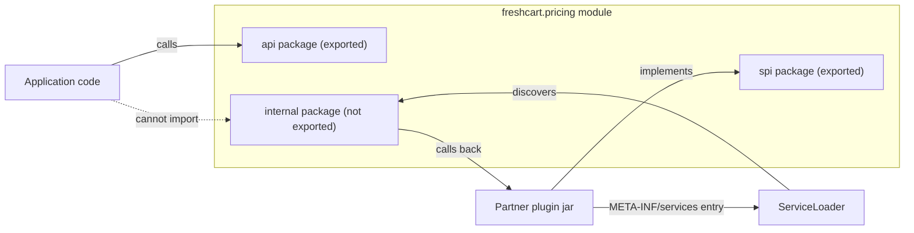
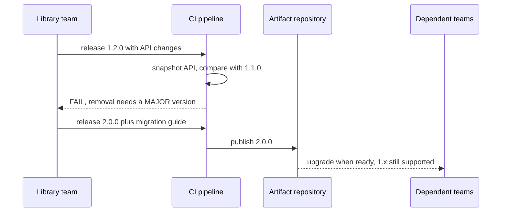

# Designing Frameworks and Libraries

<span class="badge-l5">L5 🔴 Staff / Principal</span> · <span class="read-time">⏱ 40 min read</span> · Prerequisites: [Dependency Injection](../l2-practitioner/dependency-injection.md), [JVM Internals Behind Patterns](jvm-internals-behind-patterns.md), [Evolutionary Architecture](evolutionary-architecture.md)

!!! abstract "TL;DR"
    A library's API is a promise other teams build on. Give them **extension points** (an SPI discovered with `ServiceLoader`, plugins with a versioned contract, annotations the framework scans) and let the framework own the flow (**inversion of control**). Keep everything else hidden behind interfaces, static factories and **JPMS exports**. Evolve without breaking anyone: add default methods and overloads, deprecate before removing, and remember that **source-compatible is not binary-compatible**. Automate the promise with an API compatibility check that enforces semantic versioning in CI.

## 1. What It Is

**Plain English.** Application code solves one product's problem. Framework and library code is used by many teams you may never meet, often in ways you didn't expect, and upgraded on their schedule rather than yours. Designing it means deciding what is public, how others extend it, and how it changes over time without breaking them.

**Definition.**

| Concern | Main tools |
|---------|------------|
| Extension | SPI + `ServiceLoader`, plugins, annotations, callbacks |
| Control flow | Inversion of control: the framework calls user code |
| Encapsulation | Interfaces, static factories, package-private, JPMS `exports` |
| Evolution | Default methods, overloads, deprecation, semantic versioning |
| Verification | Binary compatibility checks (japicmp, revapi), contract tests |

## 2. Why It Exists

At FreshCart, the pricing library is used by 14 services and two partners (QuickDrop and ParcelGo) through the Partner SDK. Every accidental public class becomes something someone depends on; every renamed method becomes a failed deploy in a team that didn't change anything. Libraries live much longer than the features that created them. Good framework design reduces coordination: teams extend without asking you, and you change internals without asking them.

## 3. Mental Model / Analogy

**Analogy.** A power socket. The socket's shape (the API) is fixed and standardised; any appliance (plugin) with the right plug works, and the electricity company can rebuild the power station (internals) without anyone changing their kettles. Changing the socket shape is a big event, announced years ahead, with adapters in between.

**Technical model.** Separate the **API** (what callers use), the **SPI** (what extenders implement) and the **implementation** (everything else). API and SPI are versioned contracts; the implementation is free to change.

## 4. How It Works





## 5. Subtopics

### Service Provider Interface and ServiceLoader

**Description.** An **SPI** is an interface the library defines for others to implement. Providers ship a file `META-INF/services/<interface name>` listing their implementation classes (or, in modules, `provides ... with ...`). `ServiceLoader.load(Interface.class)` finds and instantiates them at run time, so the library never depends on the providers at compile time. JDBC drivers, `java.time` zone providers, SLF4J bindings and Jackson modules all work this way.

**Advantages / features.** Zero compile-time coupling; add a capability by adding a jar; lazy discovery with `stream()` and `Provider::type`.

```java title="ServiceLoaderDemo.java"
--8<-- "examples/l5-staff-principal/framework-and-library-design/ServiceLoaderDemo.java"
```

1. The provider configuration file, one fully qualified class name per line, exactly as it sits in a jar.
2. `stream()` exposes provider **types** without instantiating them, useful for filtering by annotation.
3. A provider that fails to construct surfaces as `ServiceConfigurationError`; the loader keeps going.

**Run it:** `java ServiceLoaderDemo.java`

```text
--8<-- "examples/l5-staff-principal/framework-and-library-design/ServiceLoaderDemo.expected.txt"
```

| Aspect | ServiceLoader | DI container (Spring) |
|--------|---------------|-----------------------|
| Dependency | JDK only | Framework |
| Provider needs | Public no-arg constructor or `provider()` method | Bean definition |
| Ordering | Classpath order (unreliable) | `@Order`, `@Priority` |
| Config / injection | None | Full |
| Best for | Libraries, drivers, plugins | Applications |

**Use** an SPI when third parties add implementations you can't know at compile time. **Avoid** relying on classpath order for priority; add an explicit `priority()` to the SPI.
**Real-world Java:** JDBC 4 `DriverManager`, `java.nio.file.spi.FileSystemProvider`, SLF4J 2 providers, Micrometer and OpenTelemetry exporters.
**Best practice:** keep SPIs tiny and separate from the caller API. **Gotcha:** shading or fat-jar plugins that merge jars can overwrite `META-INF/services` files; use the merging transformer (Maven Shade `ServicesResourceTransformer`).

### Plugin architectures

**Description.** A plugin system adds a **host** with a lifecycle, named **extension points** (hooks), and a **contract version**. The host decides which plugins load, in what order, with which permissions, and how failures are contained. Discovery can be ServiceLoader, a folder of jars with separate class loaders, or configuration.

**Advantages / features.** Teams and partners ship features independently; the core stays small; features can be enabled per customer or region.

```java title="PluginArchitectureDemo.java"
--8<-- "examples/l5-staff-principal/framework-and-library-design/PluginArchitectureDemo.java"
```

1. Each plugin declares the API major version it was built against.
2. A plugin that fails to start is isolated; the host and other plugins keep running.
3. Plugins stop in reverse start order, so later plugins can depend on earlier ones.

**Run it:** `java PluginArchitectureDemo.java`

```text
--8<-- "examples/l5-staff-principal/framework-and-library-design/PluginArchitectureDemo.expected.txt"
```

| Decision | Options |
|----------|---------|
| Discovery | ServiceLoader, folder scan, config, registry service |
| Isolation | Same class loader, class loader per plugin, separate process |
| Contract | Interfaces + API version, manifest with capabilities |
| Failure handling | Fail host, skip plugin, disable after N errors |
| Ordering | Explicit priority, dependency graph |

**Use** plugins when extension is a product feature (many contributors, optional features). **Avoid** them for code one team owns and deploys together; plain modules are simpler.
**Real-world Java:** Jenkins, IntelliJ Platform, Eclipse (OSGi), Elasticsearch and Keycloak SPIs, Gradle plugins.
**Best practice:** version the plugin API independently and check compatibility at load time. **Gotcha:** sharing library classes between host and plugins with separate class loaders causes `ClassCastException` ("X cannot be cast to X") when both bundle the same library.

### Inversion of control in your own framework

**Description.** "Don't call us, we'll call you." The framework owns the main flow and calls user code at defined points: callbacks, template methods, annotated handlers, or dependency injection where the framework constructs objects and supplies their dependencies. The user declares *what*; the framework decides *when* and *how*.

**Advantages / features.** Consistent cross-cutting behaviour (transactions, metrics, retries) in one place; users write less wiring; the framework can change orchestration without user changes.

```java title="InversionOfControlDemo.java"
--8<-- "examples/l5-staff-principal/framework-and-library-design/InversionOfControlDemo.java"
```

1. Cycle detection reports the full path, which is what users need to fix it.
2. Constructor parameters declare dependencies; the container resolves them recursively.
3. Instances are cached, so every consumer shares one `PriceRepository` (singleton scope).

**Run it:** `java InversionOfControlDemo.java`

```text
--8<-- "examples/l5-staff-principal/framework-and-library-design/InversionOfControlDemo.expected.txt"
```

| IoC style | Example | Trade-off |
|-----------|---------|-----------|
| Callback / functional | `executor.submit(task)` | Simple, explicit |
| Template method | `AbstractController.handle()` | Inheritance coupling |
| Annotations + scanning | `@Step`, `@EventListener` | Magic; needs good errors |
| Dependency injection | Spring, Guice, Dagger | Startup cost (runtime DI) or build complexity (compile-time DI) |

**Use** IoC when the framework must guarantee ordering, lifecycle or cross-cutting concerns. **Avoid** writing your own DI container for applications; use an existing one and keep your framework DI-agnostic (accept objects, don't create them).
**Real-world Java:** Spring, Jakarta CDI, Micronaut and Dagger (compile-time DI), JUnit 5 extensions.
**Best practice:** make every framework decision observable (startup report, clear error messages with names). **Gotcha:** too much magic: when users can't predict which code runs, they stop trusting the framework.

### Hiding internals with modules

**Description.** Anything public is API by default, whether you meant it or not. Hide implementation with package-private classes, interfaces plus static factories, and, across jars, **JPMS**: `exports` only API packages, `exports ... to` for friend modules (test kits), `opens` only for packages that need reflection, and `provides ... with` to supply SPI implementations from hidden packages.

**Advantages / features.** Enforced by compiler and runtime; makes "internal" a fact rather than a naming convention.

```java title="ModuleEncapsulationDemo.java"
--8<-- "examples/l5-staff-principal/framework-and-library-design/ModuleEncapsulationDemo.java"
```

1. The library exports its API, exports internals only to a named friend module, and provides an SPI implementation from a hidden package.
2. A normal consumer that imports the internal package fails to compile.
3. The friend module named in the qualified export can use the internal package.

**Run it:** `java ModuleEncapsulationDemo.java`

```text
--8<-- "examples/l5-staff-principal/framework-and-library-design/ModuleEncapsulationDemo.expected.txt"
```

| Technique | Scope | Strength |
|-----------|-------|----------|
| Package-private | Within one package | Compiler-enforced |
| `internal` package naming | Convention | Weak (people import it anyway) |
| JPMS `exports` | Across modules | Compiler + runtime |
| `exports ... to` | Named friends | Compiler + runtime |
| `opens` | Reflection only | Runtime |
| ArchUnit rules | Classpath projects | Build-time |

**Use** JPMS for libraries with real external consumers; ArchUnit or package-private for classpath-only projects. **Avoid** exporting a package "temporarily"; someone will depend on it.
**Real-world Java:** the JDK itself since Java 9 (`jdk.internal.*` hidden), Jackson and Hibernate modules, Helidon.
**Best practice:** start with nothing exported and add exports deliberately. **Gotcha:** on the classpath (not module path), module rules aren't enforced; consumers of a modular jar on the classpath still see everything.

### API evolution and binary compatibility

**Description.** Callers usually upgrade a library through transitive dependencies, **without recompiling** their own code. So what matters is **binary compatibility** (JLS chapter 13): does already-compiled code still link? Adding methods, classes and default methods is safe. Removing or renaming anything, changing a parameter or return type (even widening `int` to `long`), adding an abstract method to an interface others implement, or making a class final breaks binaries, even if callers' source would still compile.

**Advantages / features.** Understanding the rules lets you ship minor versions safely and save breaking changes for planned major releases.

```java title="BinaryCompatibilityDemo.java"
--8<-- "examples/l5-staff-principal/framework-and-library-design/BinaryCompatibilityDemo.java"
```

1. Adding an overload is binary compatible; old call sites still link to the old method.
2. Widening `int` to `long` keeps callers' **source** valid but changes the method descriptor.
3. Recompiling fixes it, which is exactly what downstream users of a transitive dependency can't do.

**Run it:** `java BinaryCompatibilityDemo.java`

```text
--8<-- "examples/l5-staff-principal/framework-and-library-design/BinaryCompatibilityDemo.expected.txt"
```

| Change | Source compatible | Binary compatible |
|--------|-------------------|-------------------|
| Add a method / class / overload | Usually | Yes |
| Add a default method | Yes (rare conflicts) | Yes |
| Add an abstract method to an interface | No for implementers | No for implementers (`AbstractMethodError`) |
| Widen a parameter (int → long) | Yes for callers | **No** |
| Change return type | No | No |
| Remove or rename | No | No |
| Make a class or method final | No for subclasses | No (`VerifyError`/`IncompatibleClassChangeError`) |
| Change a `static final` constant | Yes | Old value stays inlined in callers |

**Use** semantic versioning: patch for fixes, minor for compatible additions, major for breaking changes. **Avoid** breaking changes in minor releases, even "tiny" ones.
**Real-world Java:** Guava's `@Beta` and deprecation policy, Jackson's 2.x compatibility, the JDK's `@Deprecated(forRemoval = true)` process.
**Best practice:** deprecate first, keep the old method delegating to the new one for at least one minor release, then remove in the next major. **Gotcha:** constants (`static final` primitives and strings) are inlined at compile time, so changing them in the library doesn't affect already-compiled callers.

## 6. Examples (exactly 3, progressively harder)

### Example 1: Minimal (L2)

**Scenario:** FreshCart's delivery-fee library exposes an interface and a factory, and later adds member pricing without breaking a partner's implementation.

```java title="DeliveryFeeApiDemo.java"
--8<-- "examples/l5-staff-principal/framework-and-library-design/DeliveryFeeApiDemo.java"
```

1. The static factory returns the interface, so the implementation class never appears in callers' code.
2. New behaviour as a default method: old implementations inherit it automatically.

**Run it:** `java DeliveryFeeApiDemo.java`

**Output:**

```text
--8<-- "examples/l5-staff-principal/framework-and-library-design/DeliveryFeeApiDemo.expected.txt"
```

**What to notice:**

- QuickDrop's plugin, written for 1.0, gets member pricing in 1.1 without a code change or recompilation.

### Example 2: Realistic (in FreshCart grocery delivery)

**Scenario:** five product teams add behaviour to checkout. Instead of editing one growing `CheckoutService`, they contribute annotated steps that FreshCart's internal framework discovers and runs.

```java title="CheckoutStepsFrameworkDemo.java"
--8<-- "examples/l5-staff-principal/framework-and-library-design/CheckoutStepsFrameworkDemo.java"
```

1. The annotation is the extension contract: order, owning team, and whether failure blocks checkout.
2. The framework, not the teams, decides execution order.
3. Failures carry the step name and owning team, so alerts route to the right people.

**Run it:** `java CheckoutStepsFrameworkDemo.java`

**Output:**

```text
--8<-- "examples/l5-staff-principal/framework-and-library-design/CheckoutStepsFrameworkDemo.expected.txt"
```

**What to notice:**

- Steps are declared out of order in the source but run by their `order` value.
- The optional loyalty step failed and the order still completed; a required step failing would stop checkout.
- In production the scan would come from a classpath index or Spring beans, not `getDeclaredClasses`.

### Example 3: Production-grade

**Scenario:** the FreshCart Partner SDK is used by QuickDrop and ParcelGo. A previous "minor" release broke a partner's integration. Now CI snapshots the public API, classifies changes and fails the build when the version number understates the change.

```java title="ApiCompatibilityCheckDemo.java"
--8<-- "examples/l5-staff-principal/framework-and-library-design/ApiCompatibilityCheckDemo.java"
```

1. The API snapshot: every public method with parameter and return types, and whether interface methods are abstract.
2. Removing or changing anything, or adding an abstract interface method, requires a MAJOR version.
3. Pure additions require a MINOR version.
4. The gate compares the proposed version bump with the required one.
5. Turning a default method into an abstract one breaks every partner that implements `Transport`.

**Run it:** `java ApiCompatibilityCheckDemo.java`

**Output:**

```text
--8<-- "examples/l5-staff-principal/framework-and-library-design/ApiCompatibilityCheckDemo.expected.txt"
```

**What to notice:**

- The `int` to `long` widening shows up as a removal plus an addition: binary breaking, as the Binary Compatibility demo proved.
- 1.2.0 fails the build; the same change released as 2.0.0 passes.
- Real projects use japicmp, revapi or the Gradle/Maven plugins built on them, which also check fields, constructors, class modifiers and generics.

## 7. Pros, Cons & Trade-offs

| Approach | Pros | Cons |
|----------|------|------|
| Small, closed API | Easy to evolve | Users ask for more extension points |
| Rich extension points (SPI, plugins) | Flexible, decoupled teams | Every hook is a promise to keep |
| IoC framework | Consistency, less boilerplate | Magic, harder debugging |
| JPMS encapsulation | Enforced boundaries | Tooling friction, classpath users unaffected |
| Strict semantic versioning | Predictable upgrades | Slower to remove mistakes |

## 8. When to Use / When NOT to Use

**Invest in framework design when:**

- several teams or external partners depend on the code;
- the code outlives individual features;
- consumers upgrade on their own schedule.

**Don't when:**

- one team owns all callers and deploys them together (just refactor);
- the "framework" has one user (build the application, extract later with the rule of three);
- an established library already does it.

## 9. Best Practices

1. **Minimise the public surface; everything public is forever.** *(Consensus; Bloch, "How to Design a Good API".)*
2. **Separate API, SPI and implementation packages.** *(Consensus.)*
3. **Prefer interfaces + static factories over public constructors.** *(Effective Java, items 1 and 64.)*
4. **Evolve with default methods and overloads; deprecate before removing.** *(Consensus.)*
5. **Enforce binary compatibility and semantic versioning in CI.** *(Widely used: japicmp, revapi.)*
6. **Give every extension point a version and a failure policy.** *(Consensus.)*
7. **Write the docs and examples before freezing an API.** *(Widely used.)*

## 10. Pitfalls & Anti-Patterns

!!! danger "Minor release, major outage (production failure mode)"
    **Symptom:** after a routine dependency bump, QuickDrop's integration fails at runtime with `NoSuchMethodError`; their code didn't change.
    **Root cause:** the SDK's 1.4 release widened a parameter from `int` to `long`; the partner's code was compiled against 1.3.
    **Fix:** restore the old method delegating to the new one, release 1.4.1, and add an API compatibility gate (Example 3).

!!! danger "Accidental API"
    **Symptom:** a refactor of an "internal" helper breaks three teams.
    **Root cause:** the helper was public, in an unexported-by-convention package, and teams used it.
    **Fix:** JPMS exports or ArchUnit rules; move helpers to package-private.

!!! danger "Framework that hides failures"
    **Symptom:** a plugin silently didn't load, and a discount wasn't applied for a week.
    **Root cause:** `ServiceConfigurationError` caught and ignored.
    **Fix:** log and expose loaded/rejected plugins in a startup report and a health endpoint.

!!! danger "Speculative framework"
    **Symptom:** a generic workflow engine used by one service, harder to change than the code it replaced.
    **Root cause:** extracted before there were real variations.
    **Fix:** wait for three real users; inline it back if they don't appear.

## 11. Configuration & Tuning

| Option | Default | What it does | When to change it | Risk of changing |
|--------|---------|--------------|-------------------|------------------|
| japicmp `breakBuildOnBinaryIncompatibleModifications` | false | Fails build on binary breaks | Always for published libraries | None |
| japicmp `breakBuildBasedOnSemanticVersioning` | false | Checks version bump vs change | Libraries using semver | None |
| Maven Shade `ServicesResourceTransformer` | off | Merges `META-INF/services` | Fat jars with SPIs | None |
| `@Deprecated(since, forRemoval)` | n/a | Signals removal plan | Before removing API | Warnings for users |
| `--add-opens` / `opens` | closed | Allows reflection into packages | Frameworks needing field access | Breaks encapsulation |
| Plugin API version | n/a | Load-time compatibility check | Each breaking SPI change | Rejects old plugins |

## 12. Security Considerations

- Plugins and ServiceLoader providers run with full privileges in your JVM; only load signed or allow-listed artifacts.
- Annotation scanning and reflection-driven frameworks must not instantiate classes named by untrusted input (deserialization-style gadget risk).
- Keep `opens` narrow; opening packages exposes private state to any reflective caller.
- Publish SBOMs and sign releases (Sigstore, Maven Central signing) so users can verify your library.

## 13. Performance & Scalability

Classpath scanning at startup is a common slow-start cause; prefer build-time indexes (Spring's AOT processing, Micronaut, Dagger, annotation processors). ServiceLoader instantiates providers lazily as you iterate; cache the results. Reflection-based IoC costs startup time and memory; compile-time DI (Dagger, Micronaut) and GraalVM native images move that cost to the build. Plugin class loaders each hold their own metaspace.

## 14. Testing It

Test the API contract, not only the implementation:

```java title="ApiCompatibilityCheckTest.java"
--8<-- "examples/l5-staff-principal/framework-and-library-design/ApiCompatibilityCheckTest.java"
```

Also: publish a **TCK** (technology compatibility kit), an abstract test class that every SPI implementer extends, so partners verify their providers the same way you do.

## 15. Observability & Operations

Log a startup report: framework version, loaded plugins with versions, rejected plugins with reasons, and detected SPI providers. Expose it on a health or info endpoint. Track library version adoption across services (from SBOMs or dependency reports) so you know when an old major can be retired.

## 16. Version Notes

| Year | Change |
|------|--------|
| 2006 | Java 6: public `java.util.ServiceLoader` |
| 2008 | Effective Java 2nd ed. and Bloch's API design talk popularise API design rules |
| 2013 | Semantic Versioning 2.0.0 |
| 2014 | Java 8: default and static interface methods enable API evolution |
| 2017 | Java 9: JPMS (`exports`, `opens`, `provides/uses`), `ServiceLoader.stream()` |
| 2021 | Java 17: strong encapsulation of JDK internals |
| 2022 | Spring Framework 6: AOT processing reduces runtime scanning |

## 17. Expert Deep Dive

- **API vs SPI evolution are opposite.** Adding a method to an API interface is safe for callers but breaks implementers; for SPIs, prefer abstract classes or default methods so you can add operations.
- **Tolerant readers and parameter objects.** Methods taking a request object (`QuoteRequest`) evolve by adding fields; long parameter lists can't.
- **Hyrum's law.** With enough users, every observable behaviour (ordering, timing, error messages) will be depended on; document what is guaranteed and randomise what isn't (like `Map.of` iteration order).
- **Multi-release jars and baselines.** Compile against the oldest supported Java (`--release`) and use multi-release jars for newer APIs.
- **Compile-time frameworks.** Annotation processors generate the wiring (Dagger, MapStruct, Micronaut), trading build complexity for startup speed and better errors.

!!! example "War story: the SDK patch that broke a partner on a Saturday"
    FreshCart's Partner SDK 1.4.0 changed `quote(String pincode, int weightGrams)` to take `long` "for bulk orders". All FreshCart services recompiled and passed tests. ParcelGo's integration pulled the new SDK transitively through another library, without recompiling, and failed at runtime with `NoSuchMethodError` during peak weekend deliveries. **Fixes:** 1.4.1 restored the `int` overload delegating to the `long` one; the `long` version moved to an additive method; japicmp now runs in CI with semver enforcement; partners get a 6-month notice and migration guide for every major. **Lesson:** your users' binaries are part of your API.

## 18. Interview Corner

=== "🟢 L1–L2"

    1. **What's an SPI?** An **interface for others to implement**, discovered at run time.
    2. **What does ServiceLoader read?** **`META-INF/services/<interface>`** files (or module `provides`).
    3. **What is inversion of control?** **The framework calls your code.**
    4. **Why use static factories?** **Hide the implementation class**, return interfaces.
    5. **What does semantic versioning encode?** **MAJOR breaking, MINOR additive, PATCH fixes.**

=== "🟡 L3"

    1. **API vs SPI?** **Callers use** the API; **extenders implement** the SPI.
    2. **Is adding a default method safe?** **Yes, binary compatible** (rare source conflicts).
    3. **What does `exports ... to` do?** **Exports a package only to named modules.**
    4. **Why do plugins declare an API version?** So the host can **reject incompatible plugins at load time**.
    5. **Why is classpath order a bad priority mechanism?** **It's not guaranteed**; add explicit priorities.

=== "🔴 L4–L5"

    1. **Source vs binary compatibility?** Whether callers **recompile** fine vs whether **compiled callers still link**.
    2. **Why does widening int to long break?** **The method descriptor changes**; old binaries look for the old one.
    3. **Why are changed constants dangerous?** **Inlined into callers at compile time.**
    4. **How do you evolve an SPI interface?** **Default methods, abstract base classes, or a new versioned interface.**
    5. **What's Hyrum's law?** **All observable behaviour gets depended on.**

=== "💻 Hands-on"

    **Task:** Make `ServiceLoaderDemo` choose the cheapest partner, with a deterministic tie-break, instead of relying on file order.

    ??? success "Solution"
        ```java
        DeliveryPartner best = null;
        for (var it = partners.iterator(); ; ) {
            try {
                if (!it.hasNext()) break;
                DeliveryPartner p = it.next();
                if (best == null
                        || p.quotePaise(5) < best.quotePaise(5)
                        || (p.quotePaise(5) == best.quotePaise(5) && p.name().compareTo(best.name()) < 0)) best = p;
            } catch (ServiceConfigurationError e) { /* log and skip */ }
        }
        System.out.println("cheapest: " + best.name());
        ```

## 19. Practice

- [ ] Package `ServiceLoaderDemo`'s providers as a real jar and load it with `java -cp`.
    ??? tip "Hint"
        Put the services file under `META-INF/services` inside the jar.
- [ ] Add japicmp to one of your libraries and compare it with the last release.
    ??? tip "Hint"
        `japicmp-maven-plugin` with `oldVersion` set to the previous release.
- [ ] Add a startup report to `PluginArchitectureDemo` listing loaded and rejected plugins.
    ??? tip "Hint"
        Record each outcome in the host and print it after installation.
- [ ] Write a TCK abstract test class for `DeliveryPartner` implementations.
    ??? tip "Hint"
        An abstract `createPartner()` method plus shared tests for non-negative quotes.

## 20. Quick Revision Card

!!! tip "Remember in 30 seconds"
    - API (callers), SPI (implementers), implementation (hidden).
    - ServiceLoader: `META-INF/services` or `provides`; handle `ServiceConfigurationError`.
    - Plugins: versioned contract, isolation, explicit order, startup report.
    - IoC: the framework owns the flow; errors must name the user's code.
    - Binary compatibility: adding is safe; changing or removing anything is MAJOR.

    ```java
    ServiceLoader.load(DeliveryPartner.class).stream()
        .map(ServiceLoader.Provider::get)
        .forEach(p -> System.out.println(p.name()));
    ```

## 21. Further Reading

- Joshua Bloch, *Effective Java*, 3rd ed. (2018), items 1, 15–17, 20–21, 64.
- Jaroslav Tulach, *Practical API Design: Confessions of a Java Framework Architect* (2008).
- *The Java Language Specification*, chapter 13 "Binary Compatibility".
- [Semantic Versioning 2.0.0](https://semver.org/) and [japicmp](https://siom79.github.io/japicmp/).

---

[← Previous: JVM Internals Behind Patterns](jvm-internals-behind-patterns.md) · [Next: Governing Patterns Across an Organisation →](governing-patterns-at-scale.md)
