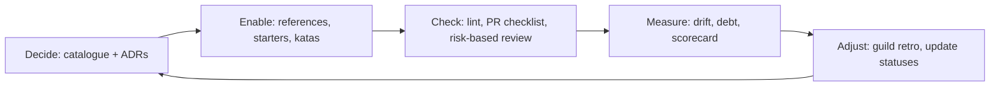
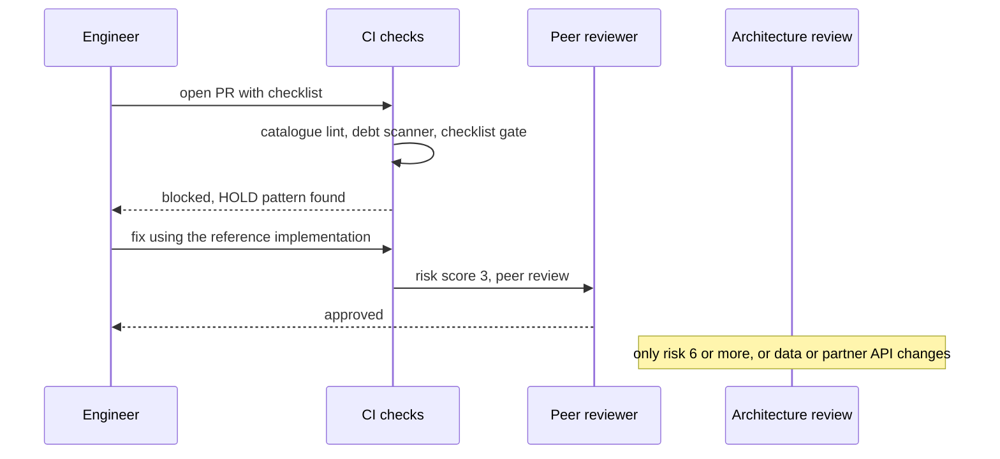

# Governing Patterns Across an Organisation

<span class="badge-l5">L5 🔴 Staff / Principal</span> · <span class="read-time">⏱ 35 min read</span> · Prerequisites: [Pattern Selection](pattern-selection.md), [Evolutionary Architecture](evolutionary-architecture.md), [Anti-Patterns and Code Smells](../l3-professional/anti-patterns-and-code-smells.md)

!!! abstract "TL;DR"
    With 50 engineers, patterns stop being individual choices and become organisational habits. Govern them with **light, automated, help-oriented** tools: a **pattern catalogue** with ADOPT/TRIAL/HOLD status enforced by lint; **risk-based design reviews** so small changes move fast; **reference implementations** that show the golden path and measure drift; a **technical debt strategy** that budgets capacity by payback; and **deliberate teaching** through skills matrices, pairing and katas. Measure health, but guard against gamed metrics, and use results to offer help, not to rank teams.

## 1. What It Is

**Plain English.** Governance is how an engineering organisation makes good design the easy default: what patterns we use, how designs get reviewed, where the examples live, how we pay down debt, and how people learn. Done well, it feels like paved roads; done badly, it feels like a committee.

**Definition.**

| Practice | Question it answers |
|----------|---------------------|
| Coding standards and pattern catalogues | Which patterns do we use here, and which do we avoid? |
| Design review checklists | How much review does this change need? |
| Reference implementations | What does "good" look like, concretely? |
| Technical debt strategy | What do we fix, when, and with whose time? |
| Teaching patterns to teams | How do people learn the above? |

## 2. Why It Exists

At FreshCart, eight teams solved retries in eight ways, two services used a service locator, and one team adopted event sourcing for a CRUD feature. None of these were bad engineers; there was simply no shared memory of decisions. Without governance, quality depends on who happens to review a PR. With heavy governance, teams route around it. Staff engineers design the middle path: decisions recorded once, enforced by tools, explained by examples, and changed when they stop serving the teams.

## 3. Mental Model / Analogy

**Analogy.** City planning. You don't approve every house; you publish building codes (catalogue), require inspections only for big or risky buildings (risk-based review), build model homes people can copy (reference implementations), budget for road repairs every year (debt strategy), and run apprenticeships (teaching). Codes evolve as materials improve.

**Technical model.** Governance is a feedback loop: **decide** (catalogue, ADRs) → **enable** (references, starters, teaching) → **check** (lint, review, fitness functions) → **measure** (scorecard) → **adjust** the decisions.

## 4. How It Works





## 5. Subtopics

### Coding standards and pattern catalogues

**Description.** A pattern catalogue lists the patterns an organisation uses, with a **status** (ADOPT: default; TRIAL: allowed with review; HOLD: don't start new uses; RETIRE: actively remove), an **owner**, a **rationale**, and a link to the reference implementation. Standards that matter are encoded as **lint rules** (Checkstyle, PMD, Error Prone, ArchUnit, OpenRewrite recipes) so they're checked on every PR, not remembered.

**Advantages / features.** Consistent solutions across teams; fewer bikeshedding debates; easier movement of engineers between teams.

```java title="PatternCatalogueDemo.java"
--8<-- "examples/l5-staff-principal/governing-patterns-at-scale/PatternCatalogueDemo.java"
```

1. Each catalogue entry is data: status, owner and guidance, so it can drive tooling.
2. A HOLD entry carries a detector, here a regex; real projects use ArchUnit or Error Prone.
3. The lint message tells developers what to use instead and whom to ask.

**Run it:** `java PatternCatalogueDemo.java`

```text
--8<-- "examples/l5-staff-principal/governing-patterns-at-scale/PatternCatalogueDemo.expected.txt"
```

| Status | Meaning | Enforcement |
|--------|---------|-------------|
| ADOPT | Default choice | Starters and templates use it |
| TRIAL | Allowed with design review | Review checklist question |
| HOLD | No new uses | Lint warning or error on new code |
| RETIRE | Remove existing uses | Migration tracked as debt |

**Use** a catalogue once several teams share a codebase or platform. **Avoid** catalogues without owners or rationale; they rot into rules nobody can explain.
**Real-world Java:** ThoughtWorks Technology Radar format, Google's Java style guide plus Error Prone, Spotify's golden paths.
**Best practice:** every entry links to an ADR and a reference example. **Gotcha:** HOLD rules applied to existing code create thousands of warnings; ratchet (fail only on new violations) as in [Evolutionary Architecture](evolutionary-architecture.md).

### Design review checklists

**Description.** A design review checklist turns senior judgement into questions anyone can answer: does this change data ownership, touch money, change a partner API, introduce a TRIAL pattern, make rollback hard? Answers produce a **risk score** that routes the design to self-serve, peer review, or architecture review. Unanswered questions count as risk.

**Advantages / features.** Fast path for low-risk work; senior attention reserved for decisions that are hard to reverse; consistent questions regardless of reviewer.

```java title="DesignReviewChecklistDemo.java"
--8<-- "examples/l5-staff-principal/governing-patterns-at-scale/DesignReviewChecklistDemo.java"
```

1. Each question has a weight, and some answers escalate regardless of total score.
2. An unanswered question is treated as a "yes", which encourages people to answer.
3. The score and escalations choose the review level.

**Run it:** `java DesignReviewChecklistDemo.java`

```text
--8<-- "examples/l5-staff-principal/governing-patterns-at-scale/DesignReviewChecklistDemo.expected.txt"
```

| Review level | Typical trigger | Turnaround |
|--------------|-----------------|------------|
| Self-serve | Low risk, reversible | Immediate |
| Peer review | Moderate risk | 1 to 2 days |
| Architecture review | One-way doors: data ownership, partner APIs, money | Weekly forum |

**Use** checklists for design docs and PR templates. **Avoid** making every change go through the architecture forum; it becomes a queue and people stop writing designs.
**Real-world Java:** RFC processes at Uber and Spotify, Google design docs, AWS operational readiness reviews.
**Best practice:** review the checklist itself every quarter using incidents as input. **Gotcha:** checklists become box-ticking; keep them short and ask "why" in reviews.

### Reference implementations

**Description.** A **reference implementation** is a real, running, tested service that shows the approved way to combine patterns: health checks, structured logging, timeouts and retries, outbox, contract tests, feature flags. It's paired with a project template or starter (Spring Boot starter, Backstage software template). Comparing services with the reference gives a **drift** measure.

**Advantages / features.** Examples teach better than rules; new services start correct; upgrades are demonstrated once and copied.

```java title="ReferenceImplementationDemo.java"
--8<-- "examples/l5-staff-principal/governing-patterns-at-scale/ReferenceImplementationDemo.java"
```

1. The reference capabilities, versioned so improvements (structured logging v2) are visible.
2. Drift is the share of reference capabilities a service lacks or has in an older version.
3. Services are ranked so the platform team helps the most drifted first.

**Run it:** `java ReferenceImplementationDemo.java`

```text
--8<-- "examples/l5-staff-principal/governing-patterns-at-scale/ReferenceImplementationDemo.expected.txt"
```

| Form | Strength | Weakness |
|------|----------|----------|
| Reference service | Real, runnable, tested | Must be maintained like product code |
| Project template | Fast start | Drifts after generation |
| Shared starter library | Upgrades centrally | Coupling, version management |
| Docs only | Cheap | Goes stale fastest |

**Use** a reference service plus a starter library for cross-cutting concerns. **Avoid** a reference nobody runs in production; it drifts from reality.
**Real-world Java:** Spring Boot starters, Backstage software templates, internal "golden path" services.
**Best practice:** run the reference in production with real traffic (an internal tool). **Gotcha:** templates are copied once; fixes don't propagate, so put shared behaviour in libraries.

### Technical debt strategy

**Description.** Treat debt like a loan: **principal** is the effort to fix it, **interest** is the time lost every month while it stays (slow reviews, incidents, workarounds). Rank items by payback period (principal ÷ interest) and fund them from a fixed share of capacity (commonly 15 to 25%), rather than "when we have time". Keep unfunded items visible with their running cost.

**Advantages / features.** Debt becomes a business conversation with numbers; teams stop asking permission for each fix; the most expensive debt gets paid first.

```java title="TechDebtStrategyDemo.java"
--8<-- "examples/l5-staff-principal/governing-patterns-at-scale/TechDebtStrategyDemo.java"
```

1. Each item records principal and interest, estimated roughly; rough numbers beat none.
2. A fixed share of quarterly capacity funds debt work.
3. Items with the shortest payback are funded first; the rest stay on the register.

**Run it:** `java TechDebtStrategyDemo.java`

```text
--8<-- "examples/l5-staff-principal/governing-patterns-at-scale/TechDebtStrategyDemo.expected.txt"
```

| Strategy | When it fits |
|----------|--------------|
| Fixed capacity share (15–25%) | Steady product teams |
| Boy scout rule | Small, local cleanups |
| Debt sprints / fix-it weeks | Cross-team or tooling debt |
| Tie debt to feature work | Debt in code about to change anyway |
| Strangler migration | Large legacy systems |

**Use** a register with interest estimates for anything bigger than a day. **Avoid** "debt sprints" as the only mechanism; debt grows continuously.
**Real-world Java:** Martin Fowler's technical debt quadrant, Google's fix-it weeks, SonarQube debt estimates (as one input).
**Best practice:** prioritise debt in code that changes often (hotspots: churn × complexity). **Gotcha:** tool-estimated debt (lint counts) ignores interest; old ugly code that never changes costs little.

### Teaching patterns to teams

**Description.** Patterns spread through people, not documents. Use a **skills matrix** (self-rated 0–4 per area) to find gaps, **pair** learners with mentors, assign **katas** (small practice problems), run **guilds** or communities of practice, and do **design walkthroughs** of real code. Areas with no mentor are an organisational risk to fix with hiring or external training.

**Advantages / features.** Reduces bus factor; makes standards understood rather than obeyed; grows the next staff engineers.

```java title="TeachingPatternsDemo.java"
--8<-- "examples/l5-staff-principal/governing-patterns-at-scale/TeachingPatternsDemo.java"
```

1. The skills matrix: one row per engineer, one column per pattern area.
2. An area with no mentor is reported as a risk instead of silently skipped.
3. Mentors are chosen by current load, then by name, so nobody gets every learner.

**Run it:** `java TeachingPatternsDemo.java`

```text
--8<-- "examples/l5-staff-principal/governing-patterns-at-scale/TeachingPatternsDemo.expected.txt"
```

| Technique | Good for | Cost |
|-----------|----------|------|
| Pair programming | Tacit knowledge | Two people's time |
| Katas | Practising a pattern safely | Prep time |
| Guild / community of practice | Cross-team consistency | Regular time slot |
| Design walkthroughs | Applying patterns to real systems | Senior time |
| Playbooks like this one | Self-study reference | Maintenance |

**Use** a mix: playbook for reference, katas for practice, pairing for transfer. **Avoid** one-off training days with no follow-up.
**Real-world Java:** Spotify guilds, internal "Java university" programmes, code retreats.
**Best practice:** teach with your own code and incidents, not textbook examples. **Gotcha:** self-ratings drift (people under- or over-rate); calibrate with short practical exercises.

## 6. Examples (exactly 3, progressively harder)

### Example 1: Minimal (L2)

**Scenario:** FreshCart's PR template has a checklist; CI blocks merging while required items are unchecked.

```java title="PrChecklistGateDemo.java"
--8<-- "examples/l5-staff-principal/governing-patterns-at-scale/PrChecklistGateDemo.java"
```

1. Markdown checkboxes are parsed from the PR description.
2. Only required items block the merge; optional ones stay reminders.

**Run it:** `java PrChecklistGateDemo.java`

**Output:**

```text
--8<-- "examples/l5-staff-principal/governing-patterns-at-scale/PrChecklistGateDemo.expected.txt"
```

**What to notice:**

- The gate checks that someone made a conscious statement; the lint rules check the code itself.

### Example 2: Realistic (in FreshCart grocery delivery)

**Scenario:** anonymous TODOs pile up and nobody owns them. FreshCart replaces them with structured debt comments that have an owner and an expiry date, and a CI scanner reports them per team.

```java title="DebtCommentScannerDemo.java"
--8<-- "examples/l5-staff-principal/governing-patterns-at-scale/DebtCommentScannerDemo.java"
```

1. The structured format: owner team, expiry date and description.
2. A fixed date keeps the output deterministic; CI would use the build date.
3. A per-team summary feeds the debt register and the scorecard.

**Run it:** `java DebtCommentScannerDemo.java`

**Output:**

```text
--8<-- "examples/l5-staff-principal/governing-patterns-at-scale/DebtCommentScannerDemo.expected.txt"
```

**What to notice:**

- Expired items are reported, not blocked: the team decides to fix, extend with a reason, or accept.
- Untracked TODOs get a nudge to add an owner, so debt stops being anonymous.

### Example 3: Production-grade

**Scenario:** each quarter, FreshCart's staff engineers review engineering health across teams. The scorecard combines signals from the other tools, compares with last quarter, detects a gamed metric, and proposes supportive actions.

```java title="GovernanceScorecardDemo.java"
--8<-- "examples/l5-staff-principal/governing-patterns-at-scale/GovernanceScorecardDemo.java"
```

1. Weights are explicit and published, so teams know what matters.
2. Each signal is normalised to 0–100, higher is better, and clamped at zero.
3. A Goodhart guard: 100% review coverage with 1.5-minute median reviews is flagged and capped.
4. The trend versus last quarter matters as much as the absolute score.
5. Results map to offers of help, never to rankings or penalties.

**Run it:** `java GovernanceScorecardDemo.java`

**Output:**

```text
--8<-- "examples/l5-staff-principal/governing-patterns-at-scale/GovernanceScorecardDemo.expected.txt"
```

**What to notice:**

- Catalogue has a decent score but dropped 12 points, so it gets a conversation rather than a lecture.
- Loyalty's perfect review coverage was not real; the guard prevented a misleadingly good score.
- If scores were used for performance ratings, teams would optimise the numbers instead of the systems.

## 7. Pros, Cons & Trade-offs

| Practice | Pros | Cons |
|----------|------|------|
| Pattern catalogue + lint | Consistency, fast feedback | Needs owners; can ossify |
| Risk-based review | Fast path for most work | Calibration effort |
| Reference implementations | Teaches by example | Maintenance cost |
| Debt budget | Predictable paydown | Estimates are rough |
| Teaching programmes | Lasting capability | Slow, needs senior time |
| Scorecards | Visibility across teams | Gaming and fear if misused |

## 8. When to Use / When NOT to Use

**Formalise governance when:**

- several teams share platforms, data or partners;
- incidents repeat across teams for the same reason;
- onboarding takes months because "every service is different".

**Don't when:**

- one small team can agree in a conversation;
- the organisation is still searching for product fit and code is short-lived;
- the process would be enforced by people instead of tools.

## 9. Best Practices

1. **Automate standards; humans review what tools can't.** *(Consensus.)*
2. **Every rule has an owner, a rationale and an example.** *(Consensus.)*
3. **Scale review effort with risk and reversibility.** *(Widely used.)*
4. **Make the golden path the easiest path (templates, starters).** *(Widely used; platform engineering.)*
5. **Budget debt work as a fixed share of capacity.** *(Widely used.)*
6. **Measure to help, not to rank; watch for Goodhart's law.** *(Consensus.)*
7. **Revisit the catalogue regularly and retire stale rules.** *(Consensus.)*

## 10. Pitfalls & Anti-Patterns

!!! danger "Architecture review as a bottleneck (production failure mode)"
    **Symptom:** a critical fix for a payment timeout waited nine days for the weekly architecture forum; meanwhile checkout errors continued.
    **Root cause:** every design went to the same forum regardless of risk; the queue was weeks long.
    **Fix:** risk-based routing (Design review checklists), an emergency path with retrospective review, and forum time only for one-way doors.

!!! danger "Ivory tower standards"
    **Symptom:** teams ignore the standards wiki.
    **Root cause:** rules written by people who don't ship, without examples or tooling.
    **Fix:** reference implementations maintained by practising engineers; rules as lint with clear messages.

!!! danger "Metric gaming"
    **Symptom:** review coverage jumps to 100% while incidents rise.
    **Root cause:** coverage became a target, so reviews became rubber stamps.
    **Fix:** combine metrics, add guards (review time), and use results for conversations.

!!! danger "Frozen catalogue"
    **Symptom:** a HOLD on a pattern the JDK now supports well (for example virtual threads instead of reactive for simple I/O) blocks good designs.
    **Root cause:** nobody reviews old decisions.
    **Fix:** each entry has a review date and an owner; quarterly guild review.

## 11. Configuration & Tuning

| Option | Typical default | What it does | When to change it | Risk of changing |
|--------|-----------------|--------------|-------------------|------------------|
| Debt capacity share | 20% | Funds debt work | Raise after incidents, lower in crunch for one quarter | Debt grows if cut repeatedly |
| Review escalation threshold | Risk 6 | Routes to architecture review | Tune with incident data | Too low: queue; too high: missed risks |
| HOLD rule severity | Warning on old, error on new | Enforces catalogue | When migration is funded | Noise if too strict |
| Debt comment max expiry | 6 months | Keeps debt items fresh | Longer for large migrations | Stale items |
| Scorecard weights | Published per quarter | Signals what matters | When priorities change | Confusing if changed often |
| Guild cadence | Every 2 weeks | Knowledge sharing | Fewer when stable | Loss of momentum |

## 12. Security Considerations

- Put security patterns in the catalogue (parameterised queries, secret handling, authn/authz libraries) and enforce them with SAST rules (Semgrep, CodeQL).
- The design review checklist should include data classification and threat modelling triggers.
- Reference implementations must include secure defaults (TLS, dependency scanning, least privilege), since teams copy them.
- Governance tools themselves need access control: who can change a HOLD rule or a scorecard weight.

## 13. Performance & Scalability

Governance must scale with the organisation: automated checks scale linearly, human review doesn't. Keep CI checks fast (seconds) or they get disabled. A federated model (guild owners per area, platform team for tooling) scales better than a single architecture group. Measure the process too: review lead time, percentage of designs needing architecture review, time from new rule to tooling.

## 14. Testing It

Governance tools are code; test them like code:

```java title="GovernanceScorecardTest.java"
--8<-- "examples/l5-staff-principal/governing-patterns-at-scale/GovernanceScorecardTest.java"
```

Also test lint rules with known-good and known-bad samples, and run the debt scanner on a fixture repository in CI.

## 15. Observability & Operations

Publish a governance dashboard: catalogue violations by team (new vs existing), reference drift, debt register size and interest, review lead times, and architecture review queue length. Track trends, not snapshots. Hold a short quarterly review with team leads to decide catalogue changes and help offers.

## 16. Version Notes

| Year | Change |
|------|--------|
| 1992 | Ward Cunningham coins "technical debt" |
| 2010 | ThoughtWorks Technology Radar first published |
| 2011 | Michael Nygard's ADR format |
| 2012 | Spotify's squads, tribes, chapters and guilds paper |
| 2017 | *Building Evolutionary Architectures* (fitness functions) |
| 2019 | *Team Topologies* (platform and enabling teams) |
| 2020 | Backstage open-sourced by Spotify (software templates) |
| 2023 | Platform engineering and golden paths go mainstream |

## 17. Expert Deep Dive

- **Paved roads, not gates.** Netflix's model: the supported path is so convenient that most teams choose it; leaving it is allowed but you own the consequences.
- **Enabling teams.** From *Team Topologies*: a small team that helps others adopt practices for a limited time, then moves on, instead of owning the practice forever.
- **Inverse Conway manoeuvre.** Shape team boundaries to get the architecture you want; governance that fights the org chart loses.
- **Decision records at scale.** ADRs per service plus organisation-level ADRs for catalogue changes, linked from lint messages.
- **Hotspot analysis.** Combine git churn with complexity (Adam Tornhill's *Your Code as a Crime Scene*) to find where debt actually costs.

!!! example "War story: the forum that slowed everything down"
    FreshCart's architecture forum met every Tuesday and reviewed every design. As the company grew to 12 teams, the queue reached three weeks, so teams stopped writing designs and shipped directly, including a change that moved loyalty data into a new database without a migration plan. **Fixes:** the risk-based checklist sent 80% of designs to self-serve or peer review; the forum focused on one-way doors; staff engineers held office hours; HOLD patterns moved into lint. Design docs went up, not down, because writing one no longer meant waiting. **Lesson:** governance that slows people down gets bypassed; make the right path the fast path.

## 18. Interview Corner

=== "🟢 L1–L2"

    1. **What's a pattern catalogue?** A **list of approved and avoided patterns** with guidance.
    2. **What's a reference implementation?** A **working example of the approved way**.
    3. **What's technical debt?** **Shortcuts whose cost grows over time.**
    4. **Why use a PR checklist?** To make **required steps explicit and checkable**.
    5. **What's a guild?** A **cross-team community** around a skill.

=== "🟡 L3"

    1. **ADOPT vs TRIAL vs HOLD?** **Default** vs **allowed with review** vs **no new uses**.
    2. **Why risk-based review?** **Fast path for safe changes**, attention for risky ones.
    3. **Principal vs interest?** **Cost to fix** vs **ongoing cost of not fixing**.
    4. **How do you roll out a new lint rule on old code?** **Ratchet: fail only new violations.**
    5. **Why do templates drift?** **Copied once**; fixes don't propagate.

=== "🔴 L4–L5"

    1. **How do you avoid governance becoming a bottleneck?** **Automate, route by risk, federate ownership.**
    2. **How do you prioritise debt?** **Payback period, hotspots, fixed capacity share.**
    3. **What's Goodhart's law here?** **Targeted metrics get gamed**; combine and guard them.
    4. **Paved road vs gate?** **Make the right way easiest** instead of blocking alternatives.
    5. **How do you retire a standard?** **Owner review, ADR superseding it, update lint and references.**

=== "💻 Hands-on"

    **Task:** Extend `TechDebtStrategyDemo` so items in hotspot files (changed more than 20 times last quarter) get their interest doubled before ranking.

    ??? success "Solution"
        ```java
        record Debt(String item, int principalDays, double interestDaysPerMonth, int changesLastQuarter) {
            double effectiveInterest() { return changesLastQuarter > 20 ? interestDaysPerMonth * 2 : interestDaysPerMonth; }
            double paybackMonths() { return principalDays / effectiveInterest(); }
        }
        // the God class with 35 changes now ranks above the retry loops
        ```

## 19. Practice

- [ ] Write a five-entry pattern catalogue for your team with status, owner and rationale.
    ??? tip "Hint"
        Start with patterns you argued about in the last month of reviews.
- [ ] Turn one HOLD entry into an ArchUnit rule with a ratchet baseline.
    ??? tip "Hint"
        Reuse the approach from the Evolutionary Architecture page.
- [ ] Estimate principal and interest for your three biggest debt items.
    ??? tip "Hint"
        Interest: ask "how many hours did this cost us last month?"
- [ ] Run a one-hour kata session using a practice item from this playbook.
    ??? tip "Hint"
        Pair people across skill levels and review solutions together.

## 20. Quick Revision Card

!!! tip "Remember in 30 seconds"
    - Decide → enable → check → measure → adjust.
    - Catalogue with ADOPT/TRIAL/HOLD, owners, and lint enforcement.
    - Risk-based review: one-way doors get senior eyes.
    - Reference implementations teach; drift shows where they didn't land.
    - Debt = principal + interest; fund by payback from fixed capacity.
    - Teach with pairing, katas and guilds; measure to help, not rank.

    ```java
    Level level = escalate || risk >= 6 ? ARCHITECTURE_REVIEW : risk >= 3 ? PEER_REVIEW : SELF_SERVE;
    ```

## 21. Further Reading

- Matthew Skelton and Manuel Pais, *Team Topologies* (2019).
- Neal Ford, Rebecca Parsons, Patrick Kua and Pramod Sadalage, *Building Evolutionary Architectures*, 2nd ed. (2022).
- Adam Tornhill, *Your Code as a Crime Scene*, 2nd ed. (2024).
- Martin Fowler, [Technical Debt Quadrant](https://martinfowler.com/bliki/TechnicalDebtQuadrant.html).
- Tanya Reilly, *The Staff Engineer's Path* (2022).

---

[← Previous: Designing Frameworks and Libraries](framework-and-library-design.md)
