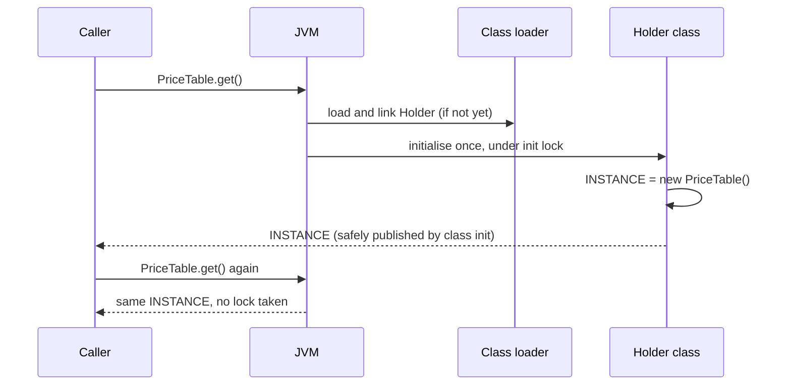
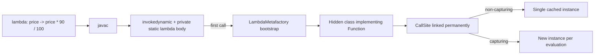

# JVM Internals Behind Patterns

<span class="badge-l5">L5 🔴 Staff / Principal</span> · <span class="read-time">⏱ 40 min read</span> · Prerequisites: [Singleton](../l1-foundations/singleton.md), [Proxy](../l2-practitioner/proxy.md), [Concurrency Patterns](../l3-professional/concurrency-patterns.md)

!!! abstract "TL;DR"
    Many patterns rely on JVM guarantees you rarely see. **Class initialisation** runs once per class loader under a lock, which makes the holder idiom and enum singletons safe and lazy, and also means two class loaders mean two singletons. **Dynamic proxies** and bytecode generation (CGLIB, ByteBuddy) power Spring AOP, transactions and mocks, with limits: no self-invocation interception and no final methods. **invokedynamic** with `LambdaMetafactory` turns lambdas into hidden classes at first use, caching non-capturing ones. **MethodHandles** and **VarHandles** are the fast, typed successors to reflection and `Unsafe`. The **Java Memory Model** defines when writes become visible across threads; safe publication (final fields, volatile, locks, static init, concurrent collections) is what makes immutable objects and lazy singletons correct.

## 1. What It Is

**Plain English.** When you write a Singleton, a Proxy, a lambda-based Strategy or an immutable value object, the JVM does a lot of work to make it correct and fast. This page opens that box: how classes get loaded and initialised, how proxies are generated, how lambdas are linked, how reflective access works, and what the memory model promises between threads.

**Definition.**

| Mechanism | Patterns that depend on it |
|-----------|----------------------------|
| Class loading and initialisation | Singleton (holder, enum), Registry, plugin systems |
| Dynamic proxies and bytecode generation | Proxy, Decorator, AOP, mocks, ORMs (lazy loading) |
| invokedynamic and LambdaMetafactory | Strategy/Command as lambdas, Stream pipelines |
| Reflection, MethodHandles, VarHandles | DI containers, serializers, atomics, frameworks |
| Java Memory Model, safe publication | Immutable objects, lazy init, Observer across threads |

## 2. Why It Exists

At staff level you debug the cases where patterns break: a "singleton" created twice in an app server, a `@Transactional` method that silently isn't transactional, a cache that publishes half-built objects, a lambda allocation in a hot loop, a framework that fails on Java 17 because of strong encapsulation. Understanding the mechanism turns these from mysteries into predictable consequences, and lets you design libraries that work with the JVM rather than against it.

## 3. Mental Model / Analogy

**Analogy.** A theatre. Class loaders are separate stages; an actor (class) on one stage is a different actor from the same-named one on another. A proxy is an understudy who stands in for the actor and can do extra things before and after each line, but if the actor talks to themselves, the understudy isn't involved. invokedynamic is a script line that says "the director will decide how to perform this on opening night", and the decision is then fixed for every performance. The memory model is the rule about when the audience in the back row is guaranteed to see what happened on stage.

**Technical model.** The JVM links symbolic references lazily, initialises classes on first active use, generates classes at runtime (proxies, lambda forms, hidden classes), and executes under a memory model defined by happens-before relationships.

## 4. How It Works





## 5. Subtopics

### Class loading and singleton guarantees

**Description.** A class is initialised on its first active use (static method call, static field access, instantiation), exactly once per class loader, and the JVM holds an initialisation lock while it runs (JLS 12.4.2). The **holder idiom** puts the instance in a nested class, so it's created only when `get()` first touches the holder. Enum singletons rely on the same mechanism. A class's identity is its name **plus** its defining class loader.

**Advantages / features.** Lazy, thread-safe initialisation without explicit locking; no synchronisation cost after initialisation.

```java title="ClassLoadingSingletonDemo.java"
--8<-- "examples/l5-staff-principal/jvm-internals-behind-patterns/ClassLoadingSingletonDemo.java"
```

1. The holder class is initialised only when `get()` first reads `Holder.INSTANCE`.
2. Calling another static method initialised `PriceTable`, but the instance was created only at `get()`.
3. A second class loader defines a separate `PriceTable` class, with its own statics and its own "singleton".

**Run it:** `java ClassLoadingSingletonDemo.java`

```text
--8<-- "examples/l5-staff-principal/jvm-internals-behind-patterns/ClassLoadingSingletonDemo.expected.txt"
```

| Trigger | Initialises the class? |
|---------|------------------------|
| `new`, static method call, non-constant static field | Yes |
| Reading a compile-time constant (`static final int X = 5`) | No (inlined) |
| `Class.forName(name)` | Yes (by default) |
| `ClassLoader.loadClass(name)` | No (loads only) |
| Subclass initialisation | Superclass first |

**Use** the holder idiom or an enum for lazy singletons. **Avoid** relying on singletons across class loaders (app servers, plugins, hot reload).
**Real-world Java:** servlet containers and OSGi give each app or bundle its own loader; Spring Boot devtools uses a restart class loader.
**Best practice:** keep static initialisers small and side-effect free. **Gotcha:** an exception in a static initialiser leaves the class unusable (`NoClassDefFoundError` on every later use).

### Dynamic proxies and bytecode generation

**Description.** `java.lang.reflect.Proxy` generates, at runtime, a class implementing given interfaces whose methods all delegate to an `InvocationHandler`. Class-based proxies (CGLIB, ByteBuddy) generate a **subclass** and override methods. Spring uses these for `@Transactional`, `@Cacheable`, `@Async` and security; Hibernate for lazy loading; Mockito for mocks.

**Advantages / features.** Cross-cutting behaviour without changing classes; one handler for many methods and interfaces.

```java title="DynamicProxyDemo.java"
--8<-- "examples/l5-staff-principal/jvm-internals-behind-patterns/DynamicProxyDemo.java"
```

1. The handler sees every call: method, arguments, and decides what to do around it.
2. The JDK generates the proxy class at runtime for the requested interfaces.
3. The proxy implements the interface but isn't an instance of the target class.

**Run it:** `java DynamicProxyDemo.java`

```text
--8<-- "examples/l5-staff-principal/jvm-internals-behind-patterns/DynamicProxyDemo.expected.txt"
```

| | JDK dynamic proxy | Subclass proxy (CGLIB/ByteBuddy) |
|-|-------------------|----------------------------------|
| Requires | An interface | Non-final class, non-final methods |
| Type | Implements interfaces only | `instanceof` target class |
| Spring default | When `proxyTargetClass=false` and interfaces exist | Spring Boot default (`proxyTargetClass=true`) |
| Self-invocation | Not intercepted | Not intercepted |
| Final / private methods | n/a | Not intercepted |

**Use** proxies for cross-cutting concerns with clear boundaries. **Avoid** depending on interception for calls inside the same object.
**Real-world Java:** Spring AOP, Spring Data repository interfaces, Retrofit and Feign clients, Mockito (ByteBuddy).
**Best practice:** put intercepted methods on a separate bean when self-invocation would be needed. **Gotcha:** `@Transactional` on a private method, or called from the same class, silently does nothing.

### invokedynamic and lambda metafactory

**Description.** For a lambda, javac compiles the body into a private method and emits an `invokedynamic` instruction. On first execution, the bootstrap method `LambdaMetafactory.metafactory` generates a **hidden class** implementing the functional interface and links the call site permanently. Non-capturing lambdas typically link to a constant (one shared instance); capturing lambdas create a new instance with the captured values each time. String concatenation (`StringConcatFactory`, Java 9+), records' `toString/equals/hashCode` (`ObjectMethods`) and pattern-matching `switch` (`SwitchBootstraps`, Java 21) also use invokedynamic.

**Advantages / features.** No class file per lambda; linking strategy can improve in new JDKs without recompiling; non-capturing lambdas are effectively free.

```java title="LambdaMetafactoryDemo.java"
--8<-- "examples/l5-staff-principal/jvm-internals-behind-patterns/LambdaMetafactoryDemo.java"
```

1. A non-capturing lambda: the same instance is returned every time.
2. A capturing lambda: each evaluation creates an instance holding the captured `percent`.
3. The implementation is a hidden class, not an anonymous inner class.

**Run it:** `java LambdaMetafactoryDemo.java`

```text
--8<-- "examples/l5-staff-principal/jvm-internals-behind-patterns/LambdaMetafactoryDemo.expected.txt"
```

| Construct | Bootstrap |
|-----------|-----------|
| Lambda, method reference | `LambdaMetafactory` |
| `"a" + b` (Java 9+) | `StringConcatFactory` |
| Record `equals/hashCode/toString` | `ObjectMethods` |
| Pattern `switch` on types (Java 21) | `SwitchBootstraps` |
| Dynamic languages on the JVM | Their own bootstraps |

**Use** lambdas freely for Strategy and Command; non-capturing ones cost nothing after linking. **Avoid** relying on lambda identity (`==`) or on capturing-lambda allocation in extremely hot loops without measuring (escape analysis often removes it).
**Real-world Java:** every `Stream` pipeline, `Comparator.comparing`, Spring's functional bean registration.
**Best practice:** prefer method references and non-capturing lambdas for constants (`static final Comparator`). **Gotcha:** the first call of each lambda call site pays a linking cost; it shows up in startup time, which is why CDS and AOT caches (Java 24+) help.

### Reflection, MethodHandles and VarHandles

**Description.** **Reflection** (`Method.invoke`) looks up members by name and checks access per call (since JDK 18 it's implemented on method handles internally). A **MethodHandle** is a typed reference to a method, constructor or field, access-checked once at lookup; `invokeExact` calls with an exact signature and can be inlined by the JIT when the handle is constant. A **VarHandle** (Java 9) gives field and array access with explicit memory ordering: plain, opaque, acquire/release, volatile, compare-and-set; it replaced most uses of `sun.misc.Unsafe`.

**Advantages / features.** Frameworks get fast dynamic invocation; atomics without `Unsafe`; works with strong encapsulation via `MethodHandles.privateLookupIn` when modules allow it.

```java title="MethodHandlesDemo.java"
--8<-- "examples/l5-staff-principal/jvm-internals-behind-patterns/MethodHandlesDemo.java"
```

1. Reflection: look up by name, invoke with boxing and access checks.
2. A method handle: exact type `(Stock,int)int`, checked once at lookup.
3. A VarHandle compare-and-set loop: 20 concurrent buyers never oversell 10 units.

**Run it:** `java MethodHandlesDemo.java`

```text
--8<-- "examples/l5-staff-principal/jvm-internals-behind-patterns/MethodHandlesDemo.expected.txt"
```

| API | Strength | Cost |
|-----|----------|------|
| Reflection | Simple, discoverable | Boxing, per-call checks (less since JDK 18) |
| MethodHandle | Typed, inlinable when constant | More ceremony |
| VarHandle | Memory-ordering modes, CAS | Low-level; easy to misuse |
| Generated code (annotation processors) | Fastest, no reflection | Build-time complexity |

**Use** MethodHandles in frameworks and libraries; VarHandles for lock-free structures. **Avoid** reflection in hot paths, and `setAccessible(true)` on JDK internals (blocked since Java 16/17).
**Real-world Java:** Jackson and Hibernate use method handles or generated accessors; `AtomicInteger`, `ConcurrentHashMap` and `ForkJoinPool` use VarHandles or `Unsafe` internally.
**Best practice:** store method handles in `static final` fields so the JIT treats them as constants. **Gotcha:** `invokeExact` requires the exact static type at the call site, including the return cast; mismatches throw `WrongMethodTypeException`.

### Java Memory Model and safe publication

**Description.** The JMM defines when a write by one thread is guaranteed visible to a read in another: only when a **happens-before** relationship connects them. Without one, another thread can see a non-null reference to an object whose fields still look unset. **Safe publication** idioms: initialise from a static initialiser; store into a `volatile` field or `AtomicReference`; store under a lock that readers also take; put it into a concurrent collection; or make the object **immutable with final fields** (JLS 17.5 guarantees their values are visible once the constructor completes, if `this` didn't escape).

**Advantages / features.** Correct lock-free reads of shared configuration and caches; immutable objects can be shared freely.

```java title="SafePublicationDemo.java"
--8<-- "examples/l5-staff-principal/jvm-internals-behind-patterns/SafePublicationDemo.java"
```

1. An immutable value with final fields and a defensive copy: safe to share once constructed.
2. `volatile` makes publishing the reference a happens-before edge for readers.
3. Double-checked locking is correct only because the field is `volatile`.

**Run it:** `java SafePublicationDemo.java`

```text
--8<-- "examples/l5-staff-principal/jvm-internals-behind-patterns/SafePublicationDemo.expected.txt"
```

| Happens-before source | Example |
|-----------------------|---------|
| Program order within a thread | Statements in sequence |
| Monitor unlock → later lock | `synchronized` blocks |
| Volatile write → later read | `volatile` fields, `AtomicReference` |
| Thread start / join | `t.start()`, `t.join()` |
| Class initialisation | Static initialisers, holder idiom |
| Final field freeze | Immutable objects |

**Use** immutable snapshots published via volatile or atomics for shared, read-mostly state. **Avoid** double-checked locking without volatile, and leaking `this` from constructors (listener registration in constructors).
**Real-world Java:** `String`, records and `Map.copyOf` rely on final-field semantics; Spring singletons are published safely by the container's locking during startup.
**Best practice:** make shared objects immutable; publish new versions by replacing the reference. **Gotcha:** "it works on my machine" means little: x86 hides many reorderings that ARM (Graviton, Apple silicon) exposes.

## 6. Examples (exactly 3, progressively harder)

### Example 1: Minimal (L2)

**Scenario:** FreshCart's registry must exist exactly once, even if some code tries reflection.

```java title="EnumSingletonDemo.java"
--8<-- "examples/l5-staff-principal/jvm-internals-behind-patterns/EnumSingletonDemo.java"
```

1. The enum singleton: one constant, created during class initialisation.
2. The JVM refuses to construct enum instances reflectively.

**Run it:** `java EnumSingletonDemo.java`

**Output:**

```text
--8<-- "examples/l5-staff-principal/jvm-internals-behind-patterns/EnumSingletonDemo.expected.txt"
```

**What to notice:**

- Enums are also safe against serialization creating copies; a classic singleton needs `readResolve` for that.

### Example 2: Realistic (in FreshCart grocery delivery)

**Scenario:** every admin action on prices must be audited with the operator's name. The team wraps admin services in a dynamic proxy instead of editing each method.

```java title="AuditProxyDemo.java"
--8<-- "examples/l5-staff-principal/jvm-internals-behind-patterns/AuditProxyDemo.java"
```

1. `bulkDiscount` calls `setPrice` on `this`, not on the proxy.
2. Reflection wraps the target's exceptions in `InvocationTargetException`.
3. The proxy unwraps and rethrows the original exception so callers see the real error.

**Run it:** `java AuditProxyDemo.java`

**Output:**

```text
--8<-- "examples/l5-staff-principal/jvm-internals-behind-patterns/AuditProxyDemo.expected.txt"
```

**What to notice:**

- The bulk discount changed two prices, but only the outer call was audited. This is the same reason `@Transactional` doesn't apply to self-invoked methods in Spring.
- Without unwrapping, callers would get an `UndeclaredThrowableException` instead of the `IllegalArgumentException`.

### Example 3: Production-grade

**Scenario:** FreshCart's pricing service reloads its configuration every few minutes while handling thousands of requests per second. A request must never combine the milk price from one version with the delivery fee from another.

```java title="ConfigReloadDemo.java"
--8<-- "examples/l5-staff-principal/jvm-internals-behind-patterns/ConfigReloadDemo.java"
```

1. Each configuration is an immutable record with validation in its constructor.
2. An `AtomicReference` publishes snapshots safely (volatile semantics).
3. Invalid configurations are rejected before publication; the old one keeps serving.
4. Compare-and-set prevents two concurrent reloads from overwriting each other out of order.
5. A request reads the reference once and uses only that snapshot.

**Run it:** `java ConfigReloadDemo.java`

**Output:**

```text
--8<-- "examples/l5-staff-principal/jvm-internals-behind-patterns/ConfigReloadDemo.expected.txt"
```

**What to notice:**

- Four reader threads kept reading (the read count goes to stderr) while 199 versions were published, and no total mixed two versions.
- Readers take no locks: one volatile read per request.
- If the code had kept two separate volatile fields (price map and fee), readers could combine values from different versions.

## 7. Pros, Cons & Trade-offs

| Mechanism | Pros | Cons |
|-----------|------|------|
| Class-init singletons | Lazy, thread-safe, lock-free afterwards | Per class loader; init failures are permanent |
| Dynamic proxies | Cross-cutting without code changes | Self-invocation gap; harder debugging |
| invokedynamic lambdas | Compact, fast after linking | First-call linking cost |
| MethodHandles / VarHandles | Fast, typed, precise memory ordering | Complex APIs, easy to misuse |
| Immutable + safe publication | Simple, lock-free sharing | Copying on change |

## 8. When to Use / When NOT to Use

**Go this deep when:**

- writing frameworks, libraries or concurrency utilities;
- debugging proxies, class loaders or visibility bugs;
- tuning startup or hot paths with evidence.

**Don't when:**

- application code works with standard idioms (enum singletons, immutable records, `java.util.concurrent`);
- a higher-level API exists (`AtomicInteger` instead of a VarHandle);
- you'd be guessing without measurement.

## 9. Best Practices

1. **Use enums or the holder idiom for singletons; avoid hand-rolled locking.** *(Consensus.)*
2. **Share immutable objects; publish replacements through volatile or atomics.** *(Consensus.)*
3. **Don't leak `this` from constructors.** *(Consensus.)*
4. **Keep intercepted methods public and called through the proxy.** *(Consensus.)*
5. **Store MethodHandles and VarHandles in static final fields.** *(Consensus.)*
6. **Prefer `java.util.concurrent` over low-level primitives.** *(Consensus.)*
7. **Test concurrency on ARM as well as x86, and with stress tools (jcstress).** *(Widely used.)*

## 10. Pitfalls & Anti-Patterns

!!! danger "Half-built object seen by another thread (production failure mode)"
    **Symptom:** rare `NullPointerException`s reading prices right after a config reload, only on the new ARM instances.
    **Root cause:** a mutable `PriceConfig` was filled after being assigned to a non-volatile shared field; readers saw the reference before the map contents.
    **Fix:** immutable snapshot built fully, then published through an `AtomicReference` (Example 3).

!!! danger "Transactional method that isn't"
    **Symptom:** partial writes after failures, despite `@Transactional`.
    **Root cause:** the annotated method was called from another method in the same class, bypassing the proxy.
    **Fix:** move it to another bean, or use `TransactionTemplate` explicitly.

!!! danger "Two singletons in one JVM"
    **Symptom:** a "global" rate limiter allowed twice the limit.
    **Root cause:** two web apps in one container each loaded the class with their own class loader.
    **Fix:** move shared state out of statics (a shared service, or a parent-loader library deliberately).

!!! danger "Broken double-checked locking"
    **Symptom:** occasional use of a partly initialised object.
    **Root cause:** DCL with a non-volatile field.
    **Fix:** volatile field, or the holder idiom.

## 11. Configuration & Tuning

| Option | Default | What it does | When to change it | Risk of changing |
|--------|---------|--------------|-------------------|------------------|
| `-Xlog:class+load` | off | Logs class loading with source | Debugging duplicates and loaders | Verbose |
| `-Djdk.proxy.debug` / ByteBuddy dump | off | Inspect generated proxies | Debugging AOP | Disk output |
| `-Djdk.invoke.MethodHandle.dumpMethodHandleInternals` | off | Dumps lambda forms | JVM-level debugging only | Very verbose |
| `-XX:+AutoCreateSharedArchive -XX:SharedArchiveFile=app.jsa` | off | CDS archive of loaded classes | Faster startup | Archive per build |
| `--add-opens module/package=ALL-UNNAMED` | none | Allows deep reflection | Legacy frameworks | Breaks encapsulation |
| `spring.aop.proxy-target-class` | true (Boot) | Subclass vs interface proxies | Rarely | Final classes fail |

## 12. Security Considerations

- Strong encapsulation (Java 16/17) blocks reflective access to JDK internals; `--add-opens` reopens it and should be justified and tracked.
- Custom class loaders loading untrusted code don't sandbox it (the Security Manager is deprecated for removal since Java 17); isolate untrusted code in separate processes.
- Deserialization can instantiate classes without constructors; prefer enum singletons and serialization filters (`jdk.serialFilter`).
- Proxies and generated code are still code: audit what frameworks generate around security-sensitive methods.

## 13. Performance & Scalability

Class loading and lambda linking cost startup time; CDS/AppCDS and the Java 24+ AOT cache (JEP 483) reduce it. Proxies add a small per-call overhead that the JIT usually inlines for monomorphic sites. Reflection is slower than method handles in hot paths; generated accessors are fastest. Volatile reads are cheap on x86 (a plain load) and slightly more expensive on ARM; contended CAS loops degrade under heavy contention (consider `LongAdder`).

## 14. Testing It

Test the behaviour that depends on JVM guarantees, including concurrent invariants:

```java title="ConfigReloadTest.java"
--8<-- "examples/l5-staff-principal/jvm-internals-behind-patterns/ConfigReloadTest.java"
```

For real memory-model testing, use OpenJDK's jcstress, which runs millions of racing iterations and reports observed outcomes.

## 15. Observability & Operations

Use `jcmd <pid> VM.classloaders` and `VM.class_hierarchy` to find duplicate classes and loader leaks; JFR events for class loading and safepoints; heap dumps to find which loader holds a "singleton". For proxies, log bean types at startup (`AopUtils.isAopProxy`). Metaspace growth after redeploys usually means a class loader leak.

## 16. Version Notes

| Year | Change |
|------|--------|
| 2000 | Java 1.3: `java.lang.reflect.Proxy` |
| 2004 | Java 5: JSR-133 memory model (fixes final and volatile semantics) |
| 2011 | Java 7: invokedynamic, MethodHandles |
| 2014 | Java 8: lambdas via LambdaMetafactory |
| 2017 | Java 9: VarHandles, StringConcatFactory, JPMS |
| 2020 | Java 15: hidden classes (JEP 371) |
| 2021 | Java 17: strong encapsulation of JDK internals by default |
| 2022 | Java 18: core reflection reimplemented with method handles (JEP 416) |
| 2025 | Java 24: ahead-of-time class loading and linking cache (JEP 483) |

## 17. Expert Deep Dive

- **Constant folding of handles.** `static final` MethodHandles and VarHandles are treated as constants by the JIT, enabling full inlining through them.
- **Hidden classes.** Unnamed, non-discoverable classes defined via `Lookup.defineHiddenClass`; used for lambdas and by frameworks for generated proxies, and unloadable independently.
- **Class loader leaks.** A single static reference from a parent loader (a JDBC driver, a ThreadLocal) keeps a whole web app's loader and metaspace alive after redeploy.
- **Final field semantics caveats.** Guarantees hold only if `this` doesn't escape during construction; reflection can modify finals (with consequences the JIT may not respect).
- **Project Leyden.** Ongoing work to shift class loading, linking and profiling earlier (AOT caches) without changing the programming model.

!!! example "War story: the NullPointerException that only ARM could see"
    FreshCart moved its pricing service to ARM-based instances to save cost. Within a day, a handful of requests per hour failed with `NullPointerException` right after config reloads. The reload code created a `PriceConfig`, assigned it to a plain static field, and then filled its map. On x86 the reordering never showed; on ARM, readers occasionally saw the new object with an empty map. **Fixes:** the config became an immutable record built completely before publication through an `AtomicReference`; a jcstress test reproduced the original race; ARM runners were added to CI. **Lesson:** "works on x86" is not a proof of correct publication; follow the memory model, not your hardware.

## 18. Interview Corner

=== "🟢 L1–L2"

    1. **When is a class initialised?** On **first active use**, once per class loader.
    2. **What's a dynamic proxy?** A **runtime-generated class** routing calls to a handler.
    3. **Is a lambda an inner class?** **No**; it's linked via **invokedynamic** to a hidden class.
    4. **What does volatile guarantee?** **Visibility and ordering** of reads and writes to that field.
    5. **Why are immutable objects thread-safe?** **State can't change after safe construction.**

=== "🟡 L3"

    1. **Why is the holder idiom thread-safe?** **Class initialisation is locked and happens once.**
    2. **JDK proxy vs CGLIB?** **Interfaces** vs **subclass**; final methods can't be proxied by subclassing.
    3. **Why doesn't @Transactional work on self-invocation?** **The call doesn't go through the proxy.**
    4. **MethodHandle vs reflection?** **Typed, checked once, inlinable** vs **checked per call**.
    5. **Why does DCL need volatile?** Without it, **another thread can see a partly constructed object**.

=== "🔴 L4–L5"

    1. **How can there be two singletons?** **Two class loaders.**
    2. **What does JLS 17.5 guarantee?** **Final fields visible after construction**, if `this` didn't escape.
    3. **What's a hidden class?** A **non-discoverable class** defined at runtime, e.g. for lambdas.
    4. **What do VarHandles add over volatile?** **Per-access memory modes and CAS** on fields and arrays.
    5. **How do you diagnose a class loader leak?** **Metaspace growth, heap dump GC roots of the loader, jcmd VM.classloaders.**

=== "💻 Hands-on"

    **Task:** Make `AuditProxyDemo` audit the inner `setPrice` calls too, without changing the proxy.

    ??? success "Solution"
        ```java
        // Give the service a reference to its own proxy and call through it:
        static final class PriceAdminService implements PriceAdmin {
            PriceAdmin self = this;                 // replaced with the proxy after creation
            public void bulkDiscount(List<String> skus, int percent) {
                for (String s : skus) self.setPrice(s, prices.get(s) * (100 - percent) / 100);
            }
        }
        service.self = admin;   // now inner calls are audited (Spring: inject the bean into itself or split beans)
        ```

## 19. Practice

- [ ] Run a demo with `-Xlog:class+load` and find when the holder class loads.
    ??? tip "Hint"
        `java -Xlog:class+load ClassLoadingSingletonDemo.java | grep Holder`.
- [ ] Use `javap -c -p` on a class with a lambda and find the `invokedynamic`.
    ??? tip "Hint"
        Compile first with `javac`, then look for `lambda$` methods.
- [ ] Write a jcstress test for unsafe publication of a mutable object.
    ??? tip "Hint"
        Start from jcstress's `UnsafePublication` sample.
- [ ] Replace a reflective call in a hot path with a static final MethodHandle and benchmark it with JMH.
    ??? tip "Hint"
        Use `invokeExact` with exact casts.

## 20. Quick Revision Card

!!! tip "Remember in 30 seconds"
    - Class init: once per loader, locked; holder idiom and enums are safe lazy singletons.
    - Proxies: JDK for interfaces, subclasses otherwise; self-calls and finals aren't intercepted.
    - Lambdas: invokedynamic + LambdaMetafactory → hidden class; non-capturing cached.
    - MethodHandles: typed, fast if static final; VarHandles: memory modes + CAS.
    - JMM: no happens-before, no visibility; publish immutable snapshots via volatile/atomics.

    ```java
    private static final class Holder { static final PriceTable INSTANCE = new PriceTable(); }
    static PriceTable get() { return Holder.INSTANCE; }
    ```

## 21. Further Reading

- *The Java Language Specification*, chapters 12.4 (initialisation) and 17 (threads and locks).
- Brian Goetz et al., *Java Concurrency in Practice* (2006), chapter 3 "Sharing Objects".
- Aleksey Shipilëv, [JMM Pragmatics](https://shipilev.net/blog/2014/jmm-pragmatics/) and the jcstress samples.
- JEP 371 (Hidden Classes), JEP 416 (Reimplement Core Reflection with Method Handles), JEP 483 (AOT Class Loading & Linking).

---

[← Previous: Legacy Modernisation Patterns](legacy-modernisation.md) · [Next: Designing Frameworks and Libraries →](framework-and-library-design.md)
