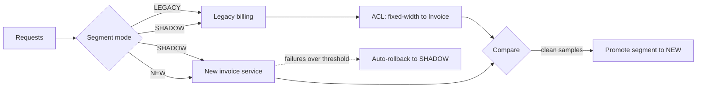
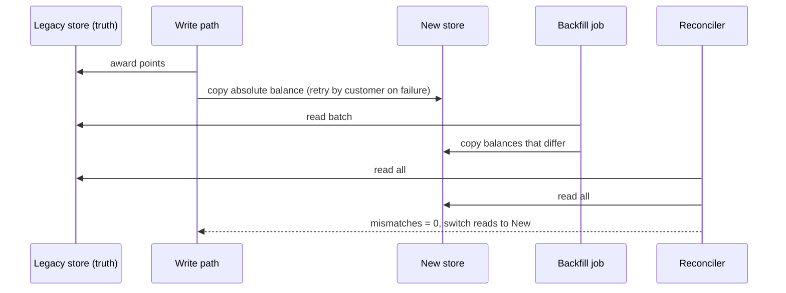

# Legacy Modernisation Patterns

<span class="badge-l5">L5 🔴 Staff / Principal</span> · <span class="read-time">⏱ 35 min read</span> · Prerequisites: [Microservice Patterns](../l4-senior/microservice-patterns.md), [DDD Strategic Patterns](../l4-senior/ddd-strategic.md)

!!! abstract "TL;DR"
    Big-bang rewrites of working systems usually run late and often fail; incremental modernisation keeps delivering while the old system shrinks. The **strangler fig** moves one capability at a time and is only finished when the new side owns the data and the legacy path is deleted. **Branch by abstraction** replaces a component on trunk behind an interface, with no long-lived branch. A **parallel run** executes old and new on real inputs, serves the old result and classifies differences until the new one is trusted. An **anti-corruption layer** keeps legacy formats and quirks out of new code. **Feature toggles** control rollout per segment and give an instant way back. Combine them with idempotent data migration (copy absolute values, backfill, reconcile) and automatic rollback.

## 1. What It Is

**Plain English.** FreshCart still runs parts of its business on a 2012 monolith and a billing mainframe. These patterns replace them piece by piece while customers keep ordering: route some traffic to new code, compare results, translate old data formats, and keep a switch to go back.

**Definition.**

| Pattern | Purpose |
|---------|---------|
| Strangler fig | Replace a system capability by capability behind a router |
| Branch by abstraction | Swap an internal component on trunk behind an abstraction |
| Parallel run | Run old and new side by side on real inputs and compare |
| Anti-corruption layer | Translate legacy models and formats at the boundary |
| Feature toggles | Control who gets new behaviour, without a deploy |

## 2. Why It Exists

Legacy systems hold years of business rules nobody fully remembers, and they keep earning money. A rewrite has to rediscover all of those rules while the business keeps changing, so it chases a moving target and delivers nothing until the end. Incremental approaches (Fowler's Strangler Fig, 2004; Paul Hammant's Branch by Abstraction, 2007; parallel runs from banking and mainframe migrations) deliver value early, reduce risk per step, and allow stopping halfway with a better system than before.

## 3. Mental Model / Analogy

**Analogy.** Renovating a hotel while it stays open. Floors are closed and rebuilt one at a time (strangler fig). Plumbing is swapped behind the wall panels without guests noticing (branch by abstraction). For the first week, the new kitchen cooks every dish alongside the old one, and only the old kitchen's food is served until the chefs agree they match (parallel run). The new booking system reads the old paper ledger through a translator (ACL). The manager can reopen the old wing with one call if something goes wrong (toggle).

**Technical model.** A routing layer and toggles decide which implementation handles each request; comparison and reconciliation provide evidence; data ownership moves explicitly; legacy code is deleted as the last step of each slice.

## 4. How It Works





## 5. Subtopics

### Strangler fig in practice

**Description.** In practice, a strangler migration is a portfolio of capabilities at different stages: not started, canary, reads migrated, data ownership moved, legacy deleted. Track it by traffic share **and** by deleted legacy code; the classic failure is a migration that stalls at "mostly on the new system" with both systems running forever.

**Advantages / features.** Visible progress; risk limited to one capability; the business can reprioritise between slices.

```java title="StranglerInPracticeDemo.java"
--8<-- "examples/l5-staff-principal/legacy-modernisation/StranglerInPracticeDemo.java"
```

1. Each capability's stage follows from traffic share, data ownership and deletion.
2. Traffic share looks great early, because the busiest capabilities are often the easiest.
3. The honest metric: capabilities whose legacy code is gone.

**Run it:** `java StranglerInPracticeDemo.java`

```text
--8<-- "examples/l5-staff-principal/legacy-modernisation/StranglerInPracticeDemo.expected.txt"
```

| Stage | Exit criterion |
|-------|----------------|
| Canary | Error rate and latency match legacy at small percentage |
| Reads migrated | 100% reads; data synced from legacy (CDC) |
| Data ownership moved | New service is the writer; legacy reads via sync back or stops |
| Legacy deleted | Code, tables and jobs removed; route removed |

**Use** for any system too large or risky to replace at once. **Avoid** starting with the most entangled core; start at the edges.
**Real-world Java:** Spring Cloud Gateway or Nginx routing, Debezium for data sync, feature flags for canaries.
**Best practice:** budget the deletion step in every slice's plan. **Gotcha:** two writers for the same data during migration need a clear owner per field, or you get lost updates.

### Branch by abstraction

**Description.** To replace a component inside a codebase: introduce an abstraction in front of the old implementation, move all callers to the abstraction, build the new implementation behind it (merged to trunk continuously, switched off), switch over with a toggle, then delete the old implementation (and the abstraction if it isn't needed any more).

**Advantages / features.** No long-lived branches or painful merges; the system is releasable at every step; switch-over is reversible.

```java title="BranchByAbstractionDemo.java"
--8<-- "examples/l5-staff-principal/legacy-modernisation/BranchByAbstractionDemo.java"
```

1. The abstraction is introduced first, with the legacy implementation behind it.
2. A toggle chooses the implementation at runtime.
3. Callers only know the abstraction, so they don't change when the implementation does.

**Run it:** `java BranchByAbstractionDemo.java`

```text
--8<-- "examples/l5-staff-principal/legacy-modernisation/BranchByAbstractionDemo.expected.txt"
```

| Step | Releasable? |
|------|-------------|
| 1. Add abstraction over old code | Yes, no behaviour change |
| 2. Move callers to abstraction | Yes, one caller at a time |
| 3. Build new implementation, toggled off | Yes, dark code |
| 4. Toggle on (gradually) | Yes, reversible |
| 5. Delete old implementation and toggle | Yes |

**Use** for replacing frameworks, ORMs, tax engines or clients inside one codebase. **Avoid** leaving the toggle and the old implementation in place after the switch.
**Real-world Java:** replacing Hibernate 5 queries with jOOQ behind repository interfaces; swapping an HTTP client behind a port.
**Best practice:** run the new implementation in parallel (shadow) before toggling on. **Gotcha:** a "temporary" abstraction with two implementations for years doubles maintenance.

### Parallel run

**Description.** Feed the same real inputs to old and new implementations, serve the old result, and compare. Classify every difference: match, known and accepted (the new code fixes a legacy bug, or rounding differs within tolerance), or unexplained (investigate). Promote when unexplained differences reach zero over enough samples.

**Advantages / features.** Evidence from production traffic instead of hand-written test cases; legacy behaviour becomes a test oracle; customers are unaffected while differences are found.

```java title="ParallelRunDemo.java"
--8<-- "examples/l5-staff-principal/legacy-modernisation/ParallelRunDemo.java"
```

1. The legacy result is served; the new one is only compared.
2. Known differences are classified explicitly, so they don't hide new ones.
3. Unexplained differences are what the team investigates.

**Run it:** `java ParallelRunDemo.java`

```text
--8<-- "examples/l5-staff-principal/legacy-modernisation/ParallelRunDemo.expected.txt"
```

| Concern | Approach |
|---------|----------|
| Side effects | New path must not write, send or charge (dry-run mode) |
| Cost | Sample traffic; run asynchronously off the request path |
| Non-determinism | Normalise timestamps, IDs, ordering before comparing |
| Volume of diffs | Group by category and field |
| Exit criteria | N samples, zero unexplained, all segments covered |

**Use** when correctness matters more than speed (billing, pricing, tax). **Avoid** comparing raw outputs with timestamps or random IDs without normalising.
**Real-world Java:** GitHub's Scientist pattern (ports exist for Java), async comparison via `CompletableFuture` off the request thread.
**Best practice:** store diffs with inputs so engineers can replay them. **Gotcha:** an off-by-one at a boundary (≥ vs >) shows up only for exact boundary values; make sure traffic covers them.

### Anti-corruption layers for legacy

**Description.** Legacy systems speak in fixed-width records, cryptic codes, implied decimals, two-digit years and overloaded fields. An ACL at the boundary translates them into clean domain types, validates them, and quarantines what it can't interpret. New code never sees legacy formats.

**Advantages / features.** New models stay clean; legacy quirks are documented in one place; replacing the legacy system later changes only the ACL.

```java title="LegacyAclDemo.java"
--8<-- "examples/l5-staff-principal/legacy-modernisation/LegacyAclDemo.java"
```

1. Fixed-width fields are cut by position and trimmed.
2. Two-digit years need a pivot rule; this one is an explicit decision, not an accident.
3. Legacy identifiers are mapped to the new format.

**Run it:** `java LegacyAclDemo.java`

```text
--8<-- "examples/l5-staff-principal/legacy-modernisation/LegacyAclDemo.expected.txt"
```

| Legacy quirk | ACL handling |
|--------------|--------------|
| Implied decimals | Convert to explicit units (paise) |
| Two-digit years | Pivot year, documented |
| Codes (Y/N, 01/02) | Map to enums; reject unknowns |
| Padded and overloaded fields | Trim, split, validate |
| EBCDIC / legacy encodings | Decode at the edge |

**Use** wherever new code consumes legacy data or APIs. **Avoid** "temporary" direct reads of legacy tables from new services.
**Real-world Java:** Spring Batch `FixedLengthTokenizer`, BeanIO, custom mappers with property-based tests.
**Best practice:** build the ACL's test suite from real legacy samples, including the weird ones. **Gotcha:** legacy systems often encode business rules in data quirks (a special customer number range); find them before translating them away.

### Feature toggles

**Description.** Toggles switch behaviour at runtime. Types: **release** (hide unfinished work; short-lived), **ops** (kill switches; long-lived), **experiment** (A/B tests), **permission** (by user group). Percentage rollouts hash a stable key so each customer consistently gets one variant. Each toggle has an owner and an expiry.

**Advantages / features.** Deploy and release are decoupled; instant rollback; gradual exposure.

```java title="FeatureTogglesDemo.java"
--8<-- "examples/l5-staff-principal/legacy-modernisation/FeatureTogglesDemo.java"
```

1. A kill switch overrides everything.
2. Stable hashing of toggle name and customer puts each customer in a fixed bucket.
3. Expired toggles are reported, because forgotten toggles become hidden branches.

**Run it:** `java FeatureTogglesDemo.java`

```text
--8<-- "examples/l5-staff-principal/legacy-modernisation/FeatureTogglesDemo.expected.txt"
```

| Toggle type | Lifetime | Typical owner |
|-------------|----------|---------------|
| Release | Days to weeks | Feature team |
| Ops / kill switch | Long | Service owners / SRE |
| Experiment | Weeks | Product / growth |
| Permission | Long | Product |

**Use** toggles for risky releases and migrations. **Avoid** nesting toggles or using them as permanent configuration without types and owners.
**Real-world Java:** Unleash, LaunchDarkly, FF4j, Togglz, OpenFeature Java SDK.
**Best practice:** remove release toggles within a sprint or two of full rollout. **Gotcha:** combinations of toggles create untested paths; test the states you actually ship.

## 6. Examples (exactly 3, progressively harder)

### Example 1: Minimal (L2)

**Scenario:** a 2009 class calls the old stock database through a static method, so nothing around it can be unit-tested.

```java title="LegacySeamDemo.java"
--8<-- "examples/l5-staff-principal/legacy-modernisation/LegacySeamDemo.java"
```

1. Production keeps calling the legacy static method by default.
2. Tests pass a stub through the new constructor: a seam.

**Run it:** `java LegacySeamDemo.java`

**Output:**

```text
--8<-- "examples/l5-staff-principal/legacy-modernisation/LegacySeamDemo.expected.txt"
```

**What to notice:**

- This is the first step of branch by abstraction: the seam is where a new implementation will later plug in.

### Example 2: Realistic (in FreshCart grocery delivery)

**Scenario:** loyalty points move from the legacy database to the new Loyalty service while customers keep earning points.

```java title="LoyaltyMigrationDemo.java"
--8<-- "examples/l5-staff-principal/legacy-modernisation/LoyaltyMigrationDemo.java"
```

1. Writes update legacy (the source of truth) and copy the absolute balance to the new store; failures are queued by customer.
2. Backfill copies balances that differ, in batches, and can be rerun safely.
3. Reconciliation compares both stores before reads switch.

**Run it:** `java LoyaltyMigrationDemo.java`

**Output:**

```text
--8<-- "examples/l5-staff-principal/legacy-modernisation/LoyaltyMigrationDemo.expected.txt"
```

**What to notice:**

- Copying absolute values made the dual write, the backfill and the retry all idempotent; copying deltas (`+20`) would have double-counted when steps overlapped.
- Reconciliation caught the missed copy for C-6 before anyone read from the new store.

### Example 3: Production-grade

**Scenario:** invoice generation moves off the billing mainframe one segment at a time. B2C goes first; B2B has different GST rules.

```java title="InvoiceModernisationDemo.java"
--8<-- "examples/l5-staff-principal/legacy-modernisation/InvoiceModernisationDemo.java"
```

1. The ACL turns legacy fixed-width output into the same `Invoice` type the new service produces.
2. Each segment has its own mode, controlled like a toggle.
3. In shadow mode, differences beyond one paisa of rounding count as unexplained.
4. Promotion requires enough samples and zero unexplained differences.
5. In new mode, failures fall back to legacy, and too many failures roll the segment back automatically.

**Run it:** `java InvoiceModernisationDemo.java`

**Output:**

```text
--8<-- "examples/l5-staff-principal/legacy-modernisation/InvoiceModernisationDemo.expected.txt"
```

**What to notice:**

- B2B was blocked from promotion by a wrong GST slab that no customer ever saw.
- When the new service failed after B2C's promotion, customers still got legacy invoices, and the segment went back to shadow without anyone being paged first.
- The legacy truncation vs new rounding difference (at most one paisa) was accepted explicitly, not silently.

## 7. Pros, Cons & Trade-offs

| Pattern | Pros | Cons |
|---------|------|------|
| Strangler fig | Incremental value, reversible steps | Two systems for a long time |
| Branch by abstraction | Trunk-based, always releasable | Temporary duplication |
| Parallel run | Production evidence, no customer impact | Extra compute; diff triage effort |
| Legacy ACL | Clean new models | Translation code to maintain |
| Feature toggles | Instant rollback, gradual rollout | Toggle debt; combinatorial states |

## 8. When to Use / When NOT to Use

**Use them when:**

- the legacy system works and earns money but blocks change;
- correctness must be demonstrated (billing, tax, payments);
- the business can't pause feature work for a rewrite.

**Consider a rewrite only when:**

- the system is small, well understood and its behaviour is fully specified;
- the old platform can't be run or routed around at all;
- the business genuinely needs different behaviour, not a copy.

## 9. Best Practices

1. **Migrate capability by capability; plan the deletion step.** *(Consensus.)*
2. **Prove new behaviour with parallel runs on real traffic.** *(Consensus.)*
3. **Keep legacy formats behind an ACL.** *(Consensus.)*
4. **Make data migration idempotent: absolute values, backfill, reconcile.** *(Consensus.)*
5. **Toggles have types, owners and expiry dates.** *(Consensus.)*
6. **Automate rollback criteria before promoting.** *(Widely used.)*
7. **Characterise legacy behaviour with tests before changing it.** *(Consensus, Feathers.)*

## 10. Pitfalls & Anti-Patterns

!!! danger "The stalled strangler (production failure mode)"
    **Symptom:** after three years, 90% of traffic was on new services, but the monolith still ran checkout writes, nightly jobs and reports; both platforms needed on-call, and incidents involved both.
    **Root cause:** slices were declared done at traffic cut-over; deletion and data ownership were never scheduled.
    **Fix:** track "capabilities with legacy deleted" as the primary metric; every slice ends with deletion.

!!! danger "Big-bang rewrite"
    **Symptom:** an 18-month rewrite launched with 40 missing business rules found by customers.
    **Root cause:** rules hidden in legacy code were never discovered because nothing compared old and new.
    **Fix:** parallel runs per capability; legacy as test oracle.

!!! danger "Delta-based dual writes"
    **Symptom:** loyalty balances in the new service were higher than legacy for thousands of customers.
    **Root cause:** dual writes copied increments while backfill copied totals; overlapping steps double-counted.
    **Fix:** copy absolute values from the source of truth; reconcile before switching reads.

!!! danger "Toggle graveyard"
    **Symptom:** 300 toggles, nobody knows which are safe to remove; a stale toggle re-enabled old code in an incident.
    **Root cause:** no owners or expiry; release toggles never cleaned up.
    **Fix:** toggle registry with type, owner and expiry; CI warns on expired toggles.

## 11. Configuration & Tuning

| Setting | Typical value | What it does | When to change it | Risk of changing |
|---------|---------------|--------------|-------------------|------------------|
| Canary percentage steps | 1, 5, 25, 50, 100% | Gradual exposure | Higher-risk changes: smaller steps | Slower rollout |
| Parallel-run sample rate | 1–100% | Comparison volume | Lower for expensive calls | Rare cases missed |
| Promotion minimum samples | Thousands, per segment | Evidence threshold | Rare segments need longer windows | False confidence |
| Rollback failure threshold | e.g. >10% over 5 min | Automatic rollback trigger | Critical paths: lower | Flapping |
| Toggle expiry (release) | 2–6 weeks | Forces cleanup | Long migrations: per-phase toggles | Toggle debt |

## 12. Security Considerations

- Parallel runs duplicate sensitive data flows; the new path needs the same access controls, masking and audit as legacy.
- ACLs must validate legacy data; old systems often lack input validation, and injection payloads can be stored in them.
- Toggle services are powerful: protect them with authentication, audit logs and change approvals for ops toggles.
- Decommissioned legacy systems must have data retained or deleted according to policy, and credentials revoked.

## 13. Performance & Scalability

Parallel runs roughly double the compute for compared requests; run the new path asynchronously and sample. Routing layers add a hop; keep them simple. Backfills should be throttled to protect legacy databases (batch sizes, off-peak windows). CDC-based sync keeps read models fresh without loading legacy with polling.

## 14. Testing It

Test migration machinery like production code: translation, comparison tolerance, promotion gates and rollback:

```java title="InvoiceModernisationTest.java"
--8<-- "examples/l5-staff-principal/legacy-modernisation/InvoiceModernisationTest.java"
```

Add characterisation (golden master) tests around legacy code before changing it.

## 15. Observability & Operations

Dashboards per capability: traffic split, mode per segment, comparison results by category, unexplained diff rate, fallback and rollback events, reconciliation mismatches, and backfill progress. Alert on unexplained diffs and automatic rollbacks. Keep a migration runbook per slice: how to roll back, who decides, and how to verify.

## 16. Version Notes

| Year | Change |
|------|--------|
| 2004 | Fowler, "Strangler Fig Application" (renamed from Strangler Application in 2019) |
| 2004 | Michael Feathers, *Working Effectively with Legacy Code* (seams, characterisation tests) |
| 2007 | Paul Hammant names Branch by Abstraction |
| 2010 | Fowler's "FeatureToggle" note; toggles spread with continuous delivery |
| 2016 | GitHub Scientist for parallel experiments |
| 2023 | OpenFeature (vendor-neutral toggle API) moves to CNCF incubating |

## 17. Expert Deep Dive

- **Event interception.** Capture legacy events (CDC, message taps) to feed new services before any traffic moves.
- **Transitional architecture.** Temporary code (routers, syncs, comparers) is a legitimate investment; plan its removal like any other slice.
- **Legacy as oracle.** Golden-master and parallel-run approaches treat existing behaviour as the specification until the business decides otherwise.
- **Dark launching.** New code runs on production traffic without user-visible effects, the same idea as shadow mode.
- **Socio-technical migration.** Assign each slice to the team that will own the new capability; migrations stall when the legacy team owns everything.

!!! example "War story: three years at ninety percent"
    FreshCart's monolith migration reported 90% of traffic on new services after 18 months, and the board considered it nearly done. Three years in, the monolith still handled checkout writes, invoicing and 40 nightly jobs; both stacks had on-call rotations, and the worst incident of the year involved a sync job between them. **Fixes:** the migration dashboard switched its headline metric to "capabilities with legacy code deleted" (2 of 14 at the time), invoicing moved with a segment-by-segment parallel run like Example 3, nightly jobs got owners and were migrated or deleted, and each slice's definition of done included deleting the legacy path. The monolith was switched off 14 months later. **Lesson:** a migration isn't done when traffic moves; it's done when the old code is gone.

## 18. Interview Corner

=== "🟢 L1–L2"

    1. **Why avoid big-bang rewrites?** **High risk, late value, missed rules.**
    2. **What's the strangler fig?** **Replace a system piece by piece** behind a router.
    3. **What's a feature toggle?** A **runtime switch** for behaviour.
    4. **What's a seam?** A place to **change behaviour without editing the code there**.
    5. **What's a parallel run?** **Old and new on the same inputs**, compared.

=== "🟡 L3"

    1. **Branch by abstraction steps?** **Abstraction, move callers, new impl, switch, delete.**
    2. **Why serve the legacy result in a parallel run?** **It's trusted; the new one isn't yet.**
    3. **What does a legacy ACL handle?** **Formats, codes, implied decimals, dates, validation.**
    4. **Toggle types?** **Release, ops, experiment, permission.**
    5. **Why stable hashing for rollouts?** **Each customer stays in one variant.**

=== "🔴 L4–L5"

    1. **How do you migrate data with no downtime?** **Source of truth, idempotent copy, backfill, reconcile, switch reads, switch writes.**
    2. **When is a strangler slice done?** **New side owns data and the legacy path is deleted.**
    3. **How do you decide promotion?** **Sample size, zero unexplained diffs, segment coverage, rollback criteria.**
    4. **How do you prevent toggle debt?** **Types, owners, expiry, CI checks.**
    5. **What's transitional architecture?** **Temporary routing and sync code** with planned removal.

=== "💻 Hands-on"

    **Task:** In `ParallelRunDemo`, normalise before comparing: treat any difference of at most 100 paise on subscriber orders as accepted, and report the maximum accepted difference.

    ??? success "Solution"
        ```java
        long maxAccepted = 0;
        long diff = Math.abs(served - candidate);
        if (o.subscriber() && diff <= 100) { category = "accepted"; maxAccepted = Math.max(maxAccepted, diff); }
        System.out.println("largest accepted difference: " + maxAccepted + " paise");
        ```

## 19. Practice

- [ ] Draw your legacy system's capabilities and mark each with a strangler stage.
    ??? tip "Hint"
        Include data ownership, not just traffic.
- [ ] Add a seam to one untestable legacy class and write its first unit test.
    ??? tip "Hint"
        Constructor injection with the legacy call as the default.
- [ ] Build a parallel-run comparator for one endpoint with normalisation of IDs and timestamps.
    ??? tip "Hint"
        Compare parsed objects, not raw strings.
- [ ] Audit your feature toggles: type, owner, expiry.
    ??? tip "Hint"
        Delete any release toggle at 100% for over a month.

## 20. Quick Revision Card

!!! tip "Remember in 30 seconds"
    - Strangle by capability; done means data owned and legacy deleted.
    - Branch by abstraction: abstraction, callers, new impl, toggle, delete.
    - Parallel run: serve old, compare, classify, promote on evidence.
    - ACL keeps legacy formats out; quarantine what you can't read.
    - Toggles: typed, owned, expiring; stable hashing; kill switches.
    - Data: absolute values, backfill, reconcile, then switch.

    ```java
    if (compared >= minSamples && unexplained == 0) modes.put(segment, Mode.NEW);
    ```

## 21. Further Reading

- Martin Fowler, [StranglerFigApplication](https://martinfowler.com/bliki/StranglerFigApplication.html) and [BranchByAbstraction](https://martinfowler.com/bliki/BranchByAbstraction.html).
- Michael Feathers, *Working Effectively with Legacy Code* (2004).
- Sam Newman, *Monolith to Microservices* (2019).
- Pete Hodgson, [Feature Toggles (aka Feature Flags)](https://martinfowler.com/articles/feature-toggles.html).

---

[← Previous: Evolutionary Architecture](evolutionary-architecture.md) · [Next: JVM Internals Behind Patterns →](jvm-internals-behind-patterns.md)
