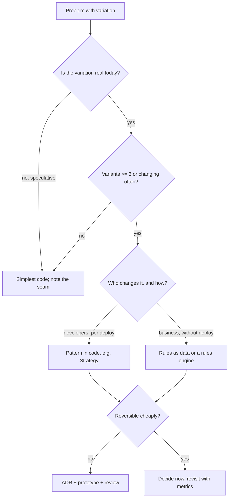
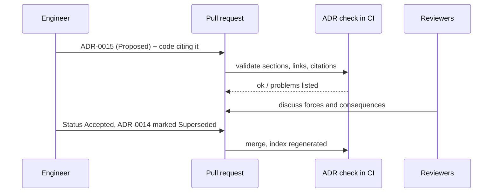

# Choosing Patterns and Trade-offs

<span class="badge-l5">L5 🔴 Staff / Principal</span> · <span class="read-time">⏱ 30 min read</span> · Prerequisites: [Anti-Patterns and Code Smells](../l3-professional/anti-patterns-and-code-smells.md), [Architectural Patterns](../l4-senior/architectural-patterns.md)

!!! abstract "TL;DR"
    At staff level the question is rarely "how does this pattern work?" and usually "is it worth it here, and how will we know if we were wrong?" Every pattern adds **indirection**: more types and more jumps for every future reader, paid daily, in exchange for flexibility that may never be used. Make the trade-off explicit with **decision frameworks**: name the forces (variants, change rate, teams, runtime needs), apply thresholds, and check how sensitive the outcome is. Record significant decisions as **Architecture Decision Records** so the reasoning survives the people. Spend most care on **irreversible** decisions (one-way doors) and decide reversible ones quickly, buying reversibility with seams where it's cheap.

## 1. What It Is

**Plain English.** Knowing 40 patterns makes it tempting to use them. This page is about restraint and judgement: estimating what a pattern costs, deciding with the team in a way you can explain later, writing the decision down, and keeping the option to change your mind.

**Definition.**

| Practice | Purpose |
|----------|---------|
| Cost of indirection | Weigh reader and maintenance cost against flexibility gained |
| Decision frameworks | Make forces and thresholds explicit; test sensitivity |
| Architecture Decision Records (ADRs) | Short, immutable records of significant decisions and their context |
| Reversibility | Classify decisions by cost to undo; add seams where undoing matters |

## 2. Why It Exists

Overengineering and underengineering both cost money, but overengineering is harder to see: a Strategy-Factory-Registry for one rule looks professional and slows every change for years. Meanwhile, important decisions get made in meetings, and two years later nobody remembers why the system uses a rules engine or which constraints have since changed. Practices such as ADRs (Michael Nygard, 2011), the rule of three (Don Roberts, via Fowler's *Refactoring*), and "one-way vs two-way doors" (Amazon) exist to make judgement repeatable and visible.

## 3. Mental Model / Analogy

**Analogy.** Building a house. Adding a door between two rooms (indirection) is useful if people walk through it, but each door is also a draught and a thing to maintain. Load-bearing walls and foundations (one-way doors) deserve an architect and a written plan; paint colours (two-way doors) don't. The plan's margin notes ("we put the kitchen here because the gas line is on this side") are ADRs: they stop the next owner from moving the kitchen without knowing why.

**Technical model.** A decision is a choice under forces with consequences. Make the forces explicit, prefer the simplest option that satisfies them, estimate the cost of reversing it, and record it where code reviewers will find it.

## 4. How It Works





## 5. Subtopics

### Cost of indirection

**Description.** Each abstraction (interface, factory, registry, proxy) adds types and navigation steps between a reader and the behaviour they're looking for. The runtime cost is usually negligible; the **cognitive** cost is paid every time someone reads, debugs or changes the code. A pattern earns its keep when the variation it enables is real and frequent.

**Advantages / features.** Thinking about cost makes designs proportionate: direct code where things are stable, patterns where change concentrates.

```java title="IndirectionCostDemo.java"
--8<-- "examples/l5-staff-principal/pattern-selection/IndirectionCostDemo.java"
```

1. The direct version: the rule is where you'd look for it.
2. The patterned version routes through a service, a lookup, a registry and a strategy.
3. The benefit appears only when variants are added: a new class instead of editing a method.

**Run it:** `java IndirectionCostDemo.java`

```text
--8<-- "examples/l5-staff-principal/pattern-selection/IndirectionCostDemo.expected.txt"
```

| Indirection pays off when | It doesn't when |
|---------------------------|-----------------|
| Several variants exist now | "We might need it one day" |
| Variants change independently, often | The code changes once a year |
| Different teams own variants | One person owns all of it |
| Variants need isolated tests | A single table test covers everything |
| A seam is needed for a volatile dependency | The dependency is stable (the JDK) |

**Use** patterns where change concentrates. **Avoid** speculative generality ("YAGNI").
**Real-world Java:** Spring's own code is heavily layered because it's a framework with thousands of extension needs; your application usually isn't.
**Best practice:** state the variation a pattern absorbs in its Javadoc or ADR. **Gotcha:** removing a pattern later is also a cost; prefer adding it late over adding it early.

### Decision frameworks

**Description.** Structured ways to choose: list options, agree the criteria and their weights with the team before scoring, score, and then test **sensitivity** (does a small weight change flip the result?). For recurring decisions, write explicit thresholds (e.g. "three or more variants changing monthly → Strategy").

**Advantages / features.** Disagreements move from taste to forces and weights; close calls are visible as close; decisions are explainable later.

```java title="DecisionMatrixDemo.java"
--8<-- "examples/l5-staff-principal/pattern-selection/DecisionMatrixDemo.java"
```

1. Each option's score is the weighted sum over the agreed criteria.
2. Weights are agreed before scoring, so they can't be tuned to a favourite.
3. Nudging each weight shows which criterion the decision hinges on.

**Run it:** `java DecisionMatrixDemo.java`

```text
--8<-- "examples/l5-staff-principal/pattern-selection/DecisionMatrixDemo.expected.txt"
```

| Framework | Good for |
|-----------|----------|
| Weighted decision matrix | Comparing 2–5 options on several criteria |
| Explicit thresholds / heuristics | Recurring choices (when to extract a Strategy) |
| ATAM-style quality scenarios | Architecture-level trade-offs (latency vs consistency) |
| Cost of delay / reversibility | How long to spend deciding |
| Spike / prototype | When scores are guesses |

**Use** for decisions with several plausible options and real consequences. **Avoid** false precision: scores are opinions; the value is in the discussion and the sensitivity check.
**Real-world Java:** choosing between Spring Data JPA, jOOQ and plain JDBC; between Kafka and RabbitMQ; between Strategy beans and a rules engine.
**Best practice:** write the losing options and why they lost into the ADR. **Gotcha:** a decision that flips on one weight isn't decided by the matrix; it's decided by whoever sets that weight, so discuss that criterion explicitly.

### Architecture Decision Records

**Description.** An ADR is a short markdown file in the repository: number, title, status (Proposed, Accepted, Deprecated, Superseded), context (forces), decision, consequences (good and bad). ADRs are immutable once accepted; when a decision changes, a new ADR supersedes the old one, and both remain.

**Advantages / features.** New team members learn why, not just what; decisions are reviewed like code; superseding preserves history.

```java title="AdrDemo.java"
--8<-- "examples/l5-staff-principal/pattern-selection/AdrDemo.java"
```

1. Nygard's template: title, status, context, decision, consequences.
2. Changing a decision means a new ADR and a status change on the old one, never editing it.
3. The log shows the whole history at a glance.

**Run it:** `java AdrDemo.java`

```text
--8<-- "examples/l5-staff-principal/pattern-selection/AdrDemo.expected.txt"
```

| ADR practice | Why |
|--------------|-----|
| One decision per ADR | Easy to supersede precisely |
| Keep in the repo (`docs/adr/`) | Reviewed in PRs; versioned with code |
| Consequences include the downsides | Honest trade-offs build trust |
| Optional `Review-by` date | Forces a revisit when assumptions may expire |
| Cite ADR numbers in code comments | Readers find the reasoning |

**Use** for decisions that are costly to reverse, cross team boundaries, or will surprise future readers. **Avoid** ADRs for every library bump; that buries the important ones.
**Real-world Java:** adr-tools, Log4brains, MADR template; ADR folders in many open-source Java projects.
**Best practice:** write the ADR before or with the code change, in the same PR. **Gotcha:** editing an accepted ADR rewrites history; supersede it instead.

### Reversibility

**Description.** Estimate how expensive it would be to undo a decision: code touched, teams involved, data migrations, external contracts. **Two-way doors** (cheap to reverse) should be decided quickly and revisited with data; **one-way doors** (published schemas, data models, vendor lock-in) deserve prototypes, ADRs and review. Seams (ports, adapters, feature flags) convert some one-way doors into two-way ones at small cost.

**Advantages / features.** Effort goes where mistakes are expensive; teams move fast on everything else.

```java title="ReversibilityDemo.java"
--8<-- "examples/l5-staff-principal/pattern-selection/ReversibilityDemo.java"
```

1. A rough reversal-cost model: files, teams, data migration and external contracts multiply.
2. A port concentrates the vendor dependency in one adapter.
3. The same choice (PayLink) is a one-way door when spread through the code and a two-way door behind a port.

**Run it:** `java ReversibilityDemo.java`

```text
--8<-- "examples/l5-staff-principal/pattern-selection/ReversibilityDemo.expected.txt"
```

| Usually one-way | Usually two-way |
|-----------------|-----------------|
| Published API and event schemas | Internal class structure |
| Database schema with data | In-process library choice behind a facade |
| Choice of primary datastore | Cache provider |
| Public URLs, identifiers | Feature implementations behind flags |
| Contracts with vendors | Build tooling |

**Use** reversibility to decide how much process a decision needs. **Avoid** treating everything as one-way (paralysis) or everything as two-way (expensive surprises).
**Real-world Java:** hexagonal ports for payment and messaging providers, feature flags, expand-and-contract schema migrations.
**Best practice:** for one-way doors, look for a way to make them two-way first. **Gotcha:** seams have a cost too; don't wrap stable dependencies just in case.

## 6. Examples (exactly 3, progressively harder)

### Example 1: Minimal (L2)

**Scenario:** FreshCart's delivery-fee rules grew one at a time over a year.

```java title="RuleOfThreeDemo.java"
--8<-- "examples/l5-staff-principal/pattern-selection/RuleOfThreeDemo.java"
```

1. One case: no abstraction.
2. The third variant is the signal that the variation is real.

**Run it:** `java RuleOfThreeDemo.java`

**Output:**

```text
--8<-- "examples/l5-staff-principal/pattern-selection/RuleOfThreeDemo.expected.txt"
```

**What to notice:**

- Extracting at the third case means the abstraction is shaped by three real examples, not one guess.

### Example 2: Realistic (in FreshCart grocery delivery)

**Scenario:** the same delivery-fee design was reviewed three times as the business grew. The reviewer recorded forces, not opinions.

```java title="DeliveryFeeReviewDemo.java"
--8<-- "examples/l5-staff-principal/pattern-selection/DeliveryFeeReviewDemo.java"
```

1. Who changes the rules, and whether they need a deploy, is checked first: it changes the whole category of solution.
2. Thresholds for moving to Strategy: enough variants and enough change or ownership spread.
3. Below the thresholds, the simple design stays, with a stated trigger to revisit.

**Run it:** `java DeliveryFeeReviewDemo.java`

**Output:**

```text
--8<-- "examples/l5-staff-principal/pattern-selection/DeliveryFeeReviewDemo.expected.txt"
```

**What to notice:**

- The right answer changed twice, and each answer was right at its time.
- The reasons print in a form that drops straight into an ADR's Context section.

### Example 3: Production-grade

**Scenario:** FreshCart keeps ADRs in `docs/adr/`. A CI step keeps them trustworthy: valid structure, valid links, reviews not forgotten, and no code citing decisions that have been replaced.

```java title="AdrLogDemo.java"
--8<-- "examples/l5-staff-principal/pattern-selection/AdrLogDemo.java"
```

1. Parse each ADR file and check required sections and a known status.
2. A superseded ADR must point to an ADR that exists.
3. Accepted decisions with a passed review date are flagged.
4. Code comments citing superseded or unknown ADRs are flagged with the replacement.
5. An index of all decisions and statuses is printed for the docs site.

**Run it:** `java AdrLogDemo.java`

**Output:**

```text
--8<-- "examples/l5-staff-principal/pattern-selection/AdrLogDemo.expected.txt"
```

**What to notice:**

- `DeliveryFeeCalculator` still claims to follow ADR-0007, which was replaced; the check tells the reader where the current decision is.
- The outbox decision's review date passed in June; the check prompts a revisit rather than letting assumptions silently expire.
- In CI, a non-empty problem list fails the build (or posts a warning, for review dates).

## 7. Pros, Cons & Trade-offs

| Practice | Pros | Cons |
|----------|------|------|
| Counting indirection cost | Proportionate designs | Hard to quantify precisely |
| Decision matrices | Explicit trade-offs, sensitivity | False precision if misused |
| Explicit thresholds | Fast, consistent recurring decisions | Thresholds need revisiting |
| ADRs | Durable reasoning, onboarding | Writing discipline; can become bureaucracy |
| Reversibility analysis | Effort where it matters | Estimates are rough |

## 8. When to Use / When NOT to Use

**Use these practices when:**

- a decision affects several teams or is expensive to reverse;
- the team disagrees and needs a shared basis;
- you're reviewing designs for many teams.

**Don't when:**

- the decision is cheap to reverse and local (just decide);
- the matrix would be built to justify a decision already made;
- ADRs would document trivia.

## 9. Best Practices

1. **Prefer the simplest design that handles today's real variation.** *(Consensus.)*
2. **Extract patterns at the third real variant (rule of three).** *(Widely used heuristic.)*
3. **Agree criteria and weights before scoring options.** *(Consensus.)*
4. **Record significant decisions as ADRs in the repo, with downsides.** *(Consensus.)*
5. **Supersede, don't edit, accepted ADRs.** *(Consensus.)*
6. **Match process to reversibility.** *(Consensus.)*
7. **Add seams around volatile external dependencies, not stable ones.** *(Consensus.)*

## 10. Pitfalls & Anti-Patterns

!!! danger "Pattern-driven design (production failure mode)"
    **Symptom:** a simple delivery-fee change took a week and touched 9 files; incident fixes were slow because nobody could find the rule.
    **Root cause:** Strategy, Factory, Registry and Decorator layers added for a rule set that had one variant and changed once a year.
    **Fix:** inline the abstraction, keep one seam at the module boundary, and set thresholds for when to reintroduce patterns.

!!! danger "Decisions without records"
    **Symptom:** a team removed a "pointless" outbox table and lost events in production.
    **Root cause:** the reason for the outbox lived only in a departed engineer's head.
    **Fix:** ADRs cited from code; CI flags citations of superseded or unknown ADRs.

!!! danger "Matrix theatre"
    **Symptom:** every evaluation recommends the architect's favourite technology.
    **Root cause:** weights adjusted after scoring.
    **Fix:** fix weights first, publish the sensitivity check, include dissent in the ADR.

!!! danger "Everything is a one-way door"
    **Symptom:** months of design reviews for a cache library choice.
    **Root cause:** no distinction between reversible and irreversible decisions.
    **Fix:** time-box two-way doors; reserve heavy process for one-way doors.

## 11. Configuration & Tuning

| Setting | Typical value | What it does | When to change it | Risk of changing |
|---------|---------------|--------------|-------------------|------------------|
| ADR folder | `docs/adr/` | Where ADRs live | Monorepos: per service | Hard to find if scattered |
| ADR template | Nygard or MADR | Required sections | Add "Options considered" | Longer ADRs get skipped |
| Review-by period | 12–24 months | Prompts a revisit | Fast-moving areas: shorter | Review fatigue |
| Extraction threshold | 3 variants | When to introduce Strategy | Higher for stable domains | Duplication lingers |
| Reversal-cost threshold | Team-defined | One-way door process | Calibrate with past incidents | Too low: paralysis |

## 12. Security Considerations

- Security-relevant decisions (crypto choices, auth flows, data retention) should always get ADRs with explicit threat assumptions and review dates.
- ADRs must not contain secrets, internal hostnames or vulnerability details that shouldn't be in the repo.
- Reversibility matters for security: a hard-coded crypto algorithm is a one-way door; design for crypto agility.

## 13. Performance & Scalability

Indirection rarely matters for runtime performance (the JIT inlines monomorphic calls), but it matters for team throughput: time to understand, change and debug. Decision practices scale an organisation: explicit thresholds and ADRs let many teams make consistent choices without a central bottleneck.

## 14. Testing It

Test decision tooling like any other code, especially when it runs in CI:

```java title="AdrLogTest.java"
--8<-- "examples/l5-staff-principal/pattern-selection/AdrLogTest.java"
```

## 15. Observability & Operations

Track ADRs by status and age, overdue reviews, and code citations of superseded ADRs. Watch delivery metrics (lead time for changes, change failure rate) for areas with heavy abstraction; slow changes in a module are a signal to revisit its patterns.

## 16. Version Notes

| Year | Change |
|------|--------|
| 1999 | Fowler's *Refactoring*: rule of three, speculative generality smell |
| 2000 | SEI's ATAM for architecture trade-off analysis |
| 2011 | Michael Nygard, "Documenting Architecture Decisions" |
| 2016 | Bezos letter: "Type 1 and Type 2 decisions" (one-way and two-way doors) |
| 2017 | MADR (Markdown ADR) template |
| 2020s | ADRs adopted by many engineering orgs; tooling like Log4brains |

## 17. Expert Deep Dive

- **Options thinking.** Some abstractions are options: you pay a small premium (a seam) for the right to change later. Value them by volatility and cost of change.
- **Last responsible moment.** Delay decisions until the cost of not deciding exceeds the value of waiting for more information.
- **Architecture as a set of decisions.** Kruchten and Bosch framed architecture as decisions plus rationale; ADRs operationalise that view.
- **Socio-technical forces.** Team boundaries and ownership often decide patterns more than technical forces do (Conway).
- **Kill criteria.** For experiments, decide upfront what result would make you reverse the decision.

!!! example "War story: the nine-file fee change"
    A well-meaning FreshCart engineer designed delivery fees with Strategy, Abstract Factory, a registry and a decorator chain "for future flexibility" when there was one fee rule. Two years later the rule had changed twice, both times by people unfamiliar with the design, and each change took a week. During a pricing incident, on-call engineers needed 40 minutes to find where the fee was actually computed. **Fixes:** the layers were collapsed into a single calculator with a table test; an ADR recorded the thresholds for reintroducing Strategy; when the third and fourth rules arrived a year later, the team extracted Strategy in a day, shaped by real cases. **Lesson:** flexibility you don't use is pure cost; add it when the variation shows up.

## 18. Interview Corner

=== "🟢 L1–L2"

    1. **Is using more patterns better?** **No**; each adds cost.
    2. **What's YAGNI?** **"You aren't gonna need it"**: don't build for speculative needs.
    3. **What's an ADR?** A **short record of a decision** and its reasons.
    4. **What's the rule of three?** **Abstract at the third occurrence.**
    5. **What's a trade-off?** **Gaining one quality at the cost of another.**

=== "🟡 L3"

    1. **How do you decide whether to introduce Strategy?** **Variants, change frequency, ownership, testing needs.**
    2. **What goes in an ADR?** **Context, decision, consequences, status.**
    3. **How do you change an accepted ADR?** **Supersede it with a new one.**
    4. **What's a decision matrix's main risk?** **False precision; tuned weights.**
    5. **Runtime cost of indirection?** **Usually negligible**; cognitive cost dominates.

=== "🔴 L4–L5"

    1. **One-way vs two-way doors?** **Irreversible vs cheap to reverse**; match process to reversibility.
    2. **How do you make a one-way door two-way?** **Seams, flags, expand-and-contract, abstractions at volatile boundaries.**
    3. **How do you keep ADRs useful at scale?** **In repo, cited from code, validated in CI, review dates.**
    4. **How do you handle a close decision?** **Find the criterion it hinges on; discuss that; prototype.**
    5. **When do you remove a pattern?** **When its variation never materialised and it slows change.**

=== "💻 Hands-on"

    **Task:** Extend `AdrLogDemo` to flag two Accepted ADRs whose titles both start with "Delivery fees" (likely conflicting decisions).

    ??? success "Solution"
        ```java
        Map<String, List<Integer>> byTopic = new TreeMap<>();
        for (Adr a : index.values())
            if (a.status().equals("Accepted"))
                byTopic.computeIfAbsent(a.title().split(" as ")[0], k -> new ArrayList<>()).add(a.number());
        byTopic.forEach((topic, ids) -> { if (ids.size() > 1) problems.add("possible conflict on '" + topic + "': " + ids); });
        ```

## 19. Practice

- [ ] Find one abstraction in your codebase with a single implementation and decide whether it's a seam worth keeping.
    ??? tip "Hint"
        Is the dependency behind it volatile or external?
- [ ] Write an ADR for a decision your team made last month.
    ??? tip "Hint"
        Include the options you rejected and the downsides you accepted.
- [ ] Run a decision matrix with your team and do the sensitivity check together.
    ??? tip "Hint"
        Agree weights before anyone scores.
- [ ] Classify your last five architecture decisions as one-way or two-way doors.
    ??? tip "Hint"
        Count teams, data and external contracts affected.

## 20. Quick Revision Card

!!! tip "Remember in 30 seconds"
    - Patterns cost readers every day; use them where variation is real.
    - Rule of three; no speculative generality.
    - Agree criteria and weights first; check sensitivity.
    - ADRs: context, decision, consequences, status; supersede, don't edit; cite from code.
    - One-way doors get care; two-way doors get speed; seams make doors two-way.

    ```java
    if (variants >= 3 && (changesPerMonth >= 2 || teamsEditing > 1)) return "Strategy";
    return "keep it simple; revisit at the next variant";
    ```

## 21. Further Reading

- Michael Nygard, [Documenting Architecture Decisions](https://cognitect.com/blog/2011/11/15/documenting-architecture-decisions) (2011).
- Neal Ford, Mark Richards, Pramod Sadalage, Zhamak Dehghani, *Software Architecture: The Hard Parts* (2021).
- Martin Fowler, *Refactoring* (2nd ed., 2018), "Speculative Generality".
- [MADR: Markdown Architectural Decision Records](https://adr.github.io/madr/).

---

[← Previous: L5 Staff / Principal](index.md) · [Next: Evolutionary Architecture →](evolutionary-architecture.md)
