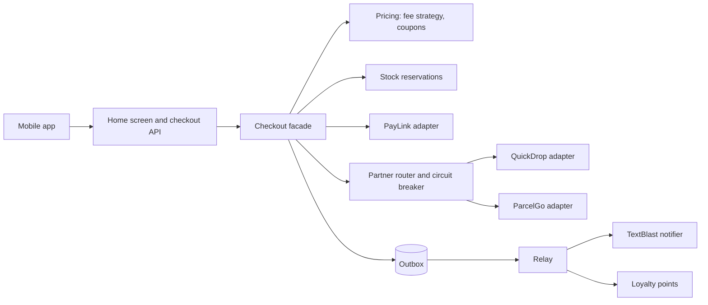

# Capstone: FreshCart

<span class="read-time">⏱ 6 to 20 hours to build</span> · Prerequisites: L1 and L2 for milestones 1 to 2, L3 and L4 for milestones 3 to 6

!!! abstract "TL;DR"
    Build FreshCart, a grocery delivery backend and its mobile client contract, using most patterns in this playbook. You work through six milestones: domain model, pricing, delivery partners, checkout with saga, outbox and idempotency, the mobile contract, and production hardening. Each milestone lists requirements, the patterns to use and acceptance tests. A runnable one-file reference solution and its JUnit tests are included so you can compare.

## The product

FreshCart delivers groceries in Bengaluru and Pune within two hours. Customers order from a mobile app; products come from suppliers such as **DairyDay** and **GreenValley**; deliveries go through partners **QuickDrop** (Bengaluru) and **ParcelGo** (Pune); payments go through **PayLink**; SMS goes through **TextBlast**.



## Milestones

### M1: Domain model (L1 to L2)

**Build:** `Money` and `Product` value objects, a `Line` with a quantity invariant (1 to 20), and an `Order` aggregate whose lifecycle is Placed → Paid → Dispatched, or Cancelled from Placed or Paid.

**Patterns:** value objects with records ([DDD Tactical](../l4-senior/ddd-tactical.md)), [State](../l2-practitioner/state.md) with a sealed interface, [Builder](../l1-foundations/builder.md) optional for orders.

**Done when:**

- [ ] Negative money and invalid quantities can't be constructed.
- [ ] Illegal transitions (dispatching a cancelled order) throw with a clear message.
- [ ] The order records domain events (`OrderPlaced`, `OrderPaid`, …) instead of calling other services.

### M2: Pricing (L1 to L2)

**Build:** a delivery fee rule (free from Rs 500, otherwise Rs 29), and coupon `GREEN10`: 10% off organic items when the basket is at least Rs 300 and contains organic items. Cache catalogue lookups.

**Patterns:** [Strategy](../l1-foundations/strategy.md) for fees, [Specification](../l2-practitioner/specification.md) for eligibility, [Decorator](../l1-foundations/decorator.md) for the caching catalogue.

**Done when:**

- [ ] A new fee rule (members pay nothing) needs no change to checkout code.
- [ ] Coupon conditions combine with `and` / `or` and are unit-tested separately.
- [ ] Repeated catalogue lookups don't hit the database.

### M3: Delivery partners (L2 to L4)

**Build:** adapters for the QuickDrop and ParcelGo SDKs behind one `DeliveryPartner` interface; route by city; when ParcelGo fails, fall back to QuickDrop; after two consecutive ParcelGo failures, stop calling it (circuit open).

**Patterns:** [Adapter](../l1-foundations/adapter.md), [Factory Method](../l1-foundations/factory-method.md) for routing, circuit breaker and fallback from [Resilience Patterns](../l4-senior/resilience-patterns.md).

**Done when:**

- [ ] Partner SDK types never leak outside the adapters.
- [ ] With ParcelGo down, Pune orders still ship and ParcelGo stops receiving calls.

### M4: Checkout (L3 to L4)

**Build:** one `checkout(idempotencyKey, order, coupon)` entry point that reserves stock, charges PayLink, books delivery, and on any failure compensates in reverse (refund, release stock, cancel). The same key must never charge twice. Events are written to an outbox together with the state change and relayed to subscribers.

**Patterns:** [Facade](../l1-foundations/facade.md), saga and transactional outbox ([Distributed Data Patterns](../l4-senior/distributed-data-patterns.md)), idempotency key ([API Design Patterns](../l4-senior/api-design-patterns.md)), [Observer](../l1-foundations/observer.md) for subscribers.

**Done when:**

- [ ] A declined payment leaves stock unchanged and the order cancelled.
- [ ] A failed delivery booking refunds the payment.
- [ ] Retrying with the same key returns the same receipt without a second charge.
- [ ] No event is published unless the state change is stored.

### M5: Mobile client contract (L3)

**Build:** one home-screen endpoint that aggregates what the app needs in a single call.

**Patterns:** aggregator / backend for frontend ([UI and Mobile Patterns](../l3-professional/ui-and-mobile-patterns.md), [Microservice Patterns](../l4-senior/microservice-patterns.md)).

| Endpoint | Method | Purpose | Notes |
|----------|--------|---------|-------|
| `/v1/home` | GET | Loyalty points, recent orders, offers | One call per screen |
| `/v1/checkout` | POST | Place an order | Requires `Idempotency-Key` header |
| `/v1/orders/{id}` | GET | Order status | Cacheable for 10 s |
| `/v1/orders?cursor=` | GET | Order history | Cursor pagination |

Money is sent as integer `totalPaise` so the app never rounds floating-point values. Errors use Problem Details (`application/problem+json`).

**Done when:**

- [ ] The app renders the home screen from one response.
- [ ] Adding a field doesn't break older app versions (tolerant reader).

### M6: Production hardening (L4 to L5)

**Build:** replace the in-memory pieces with real infrastructure and add the checks from the [Production Checklist](../reference/production-checklist.md).

- [ ] Resilience4j instead of the hand-written breaker ([Maven example](https://github.com/khiruashish/java-design-pattern-mobile-app/tree/claude/add-playbook-master-prompt/examples/l4-senior/resilience-patterns/resilience4j)).
- [ ] Caffeine for the catalogue cache ([Maven example](https://github.com/khiruashish/java-design-pattern-mobile-app/tree/claude/add-playbook-master-prompt/examples/l4-senior/caching-patterns/caffeine)).
- [ ] ArchUnit rules for module boundaries ([Maven example](https://github.com/khiruashish/java-design-pattern-mobile-app/tree/claude/add-playbook-master-prompt/examples/l5-staff-principal/evolutionary-architecture/archunit)).
- [ ] A real outbox table and relay (or CDC), and idempotent consumers.
- [ ] Metrics, traces and alerts for checkout success rate and partner health.

## Reference solution

Try each milestone yourself first. The reference solution is a single runnable file, organised by milestone, so the whole flow fits on one screen of scrolling.

```java title="FreshCartCapstoneDemo.java"
--8<-- "examples/projects/capstone/FreshCartCapstoneDemo.java"
```

**Run it:** `java FreshCartCapstoneDemo.java`

```text
--8<-- "examples/projects/capstone/FreshCartCapstoneDemo.expected.txt"
```

**What to notice:**

- GREEN10 takes 10% of the organic spinach only (Rs 18.00 of Rs 180.00), and the delivery fee still applies because the basket is under Rs 500.
- The second checkout with `key-asha-1` returns the stored receipt; PayLink's ledger shows one charge.
- ParcelGo was called twice; the third Pune order went straight to the fallback because the circuit was open.
- The oversized order was declined by PayLink, and the saga put stock back exactly as it was.
- Events were collected in the outbox during checkout and only reached SMS and loyalty when the relay ran.

## Tests

```java title="FreshCartCapstoneTest.java"
--8<-- "examples/projects/capstone/FreshCartCapstoneTest.java"
```

## Assessing your solution

| Level | What a good solution shows |
|-------|----------------------------|
| L1–L2 | Correct value objects and state transitions, patterns used where they remove real duplication, unit tests per rule |
| L3 | Clear package boundaries, idempotent checkout, outbox, consistent error handling, an API contract the app team can use |
| L4 | Resilience tuned per partner, saga failure cases tested, observability, an explanation of consistency trade-offs |
| L5 | Architecture decision records, fitness functions, a plan to split into services only where boundaries are proven |

## Stretch goals

- Split checkout, pricing and delivery into separate services with Kafka between them ([Messaging Patterns](../l4-senior/messaging-patterns.md)).
- Model the order with event sourcing and build an order-history projection ([Distributed Data Patterns](../l4-senior/distributed-data-patterns.md)).
- Add a supplier feed pipeline for DairyDay price updates with a content-based router and dead letter channel.
- Migrate the legacy loyalty system with a strangler fig and parallel run ([Legacy Modernisation](../l5-staff-principal/legacy-modernisation.md)).
