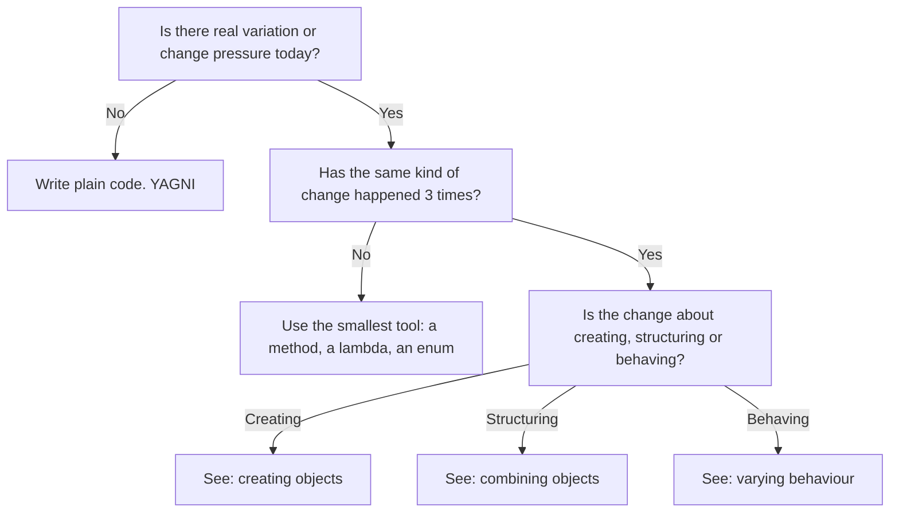
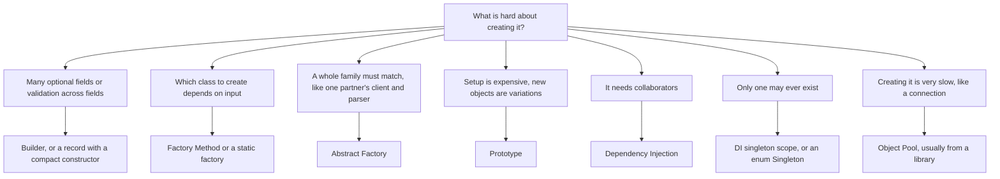
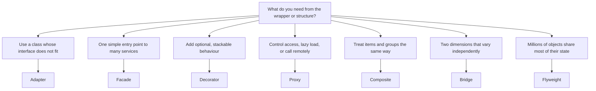
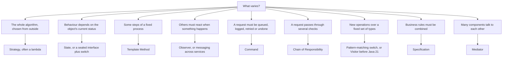
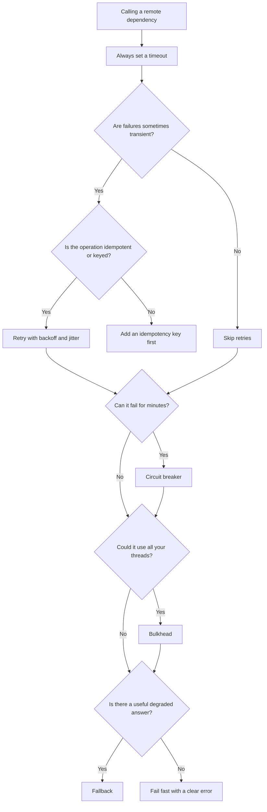
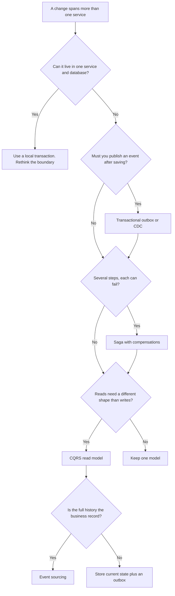
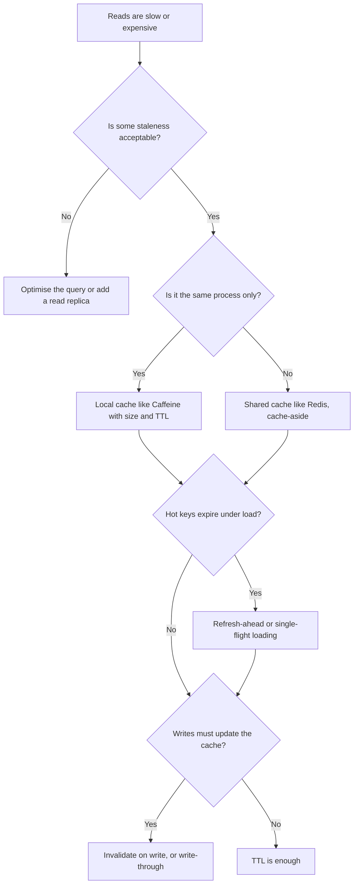
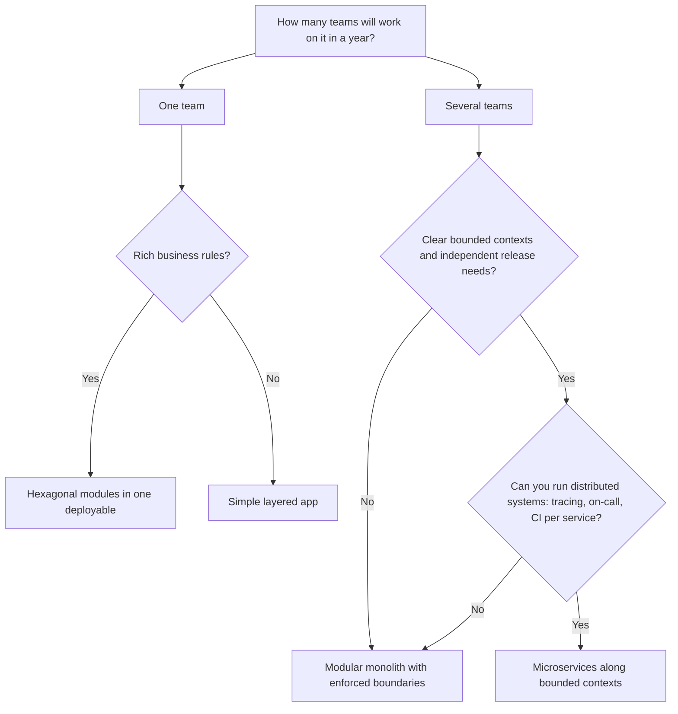
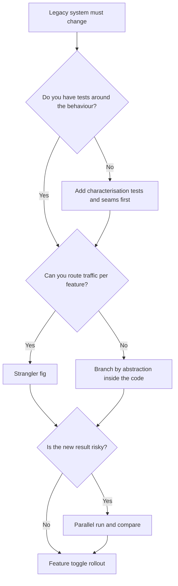

# Decision Guide

!!! abstract "TL;DR"
    "Which pattern when?" as decision trees. Start from the **problem you have**, not the pattern you'd like to use, and always check the first branch: maybe a plain method, a lambda or a record is enough. Each leaf links to the deep dive.

**How to use these trees.** Answer the questions honestly for the code in front of you today. If two leaves seem to fit, read the [Pattern Comparisons](comparisons.md) for that group. If you're unsure whether a pattern pays for itself, use [Choosing Patterns and Trade-offs](../l5-staff-principal/pattern-selection.md).

## Do I need a pattern at all?

## Creating objects

Links: [Builder](../l1-foundations/builder.md) · [Factory Method](../l1-foundations/factory-method.md) · [Abstract Factory](../l2-practitioner/abstract-factory.md) · [Prototype](../l2-practitioner/prototype.md) · [Dependency Injection](../l2-practitioner/dependency-injection.md) · [Singleton](../l1-foundations/singleton.md) · [Object Pool](../l2-practitioner/object-pool.md)

## Combining objects

Links: [Adapter](../l1-foundations/adapter.md) · [Facade](../l1-foundations/facade.md) · [Decorator](../l1-foundations/decorator.md) · [Proxy](../l2-practitioner/proxy.md) · [Composite](../l2-practitioner/composite.md) · [Bridge](../l2-practitioner/bridge.md) · [Flyweight](../l2-practitioner/flyweight.md)

## Varying behaviour

Links: [Strategy](../l1-foundations/strategy.md) · [State](../l2-practitioner/state.md) · [Template Method](../l1-foundations/template-method.md) · [Observer](../l1-foundations/observer.md) · [Command](../l2-practitioner/command.md) · [Chain of Responsibility](../l2-practitioner/chain-of-responsibility.md) · [Visitor](../l2-practitioner/visitor.md) · [Specification](../l2-practitioner/specification.md) · [Mediator](../l2-practitioner/mediator.md)

## Calling another service

Links: [Resilience Patterns](../l4-senior/resilience-patterns.md) · [API Design Patterns](../l4-senior/api-design-patterns.md)

## Keeping data consistent across services

Every consumer of those events should be an **idempotent consumer**. Links: [Distributed Data Patterns](../l4-senior/distributed-data-patterns.md) · [Messaging Patterns](../l4-senior/messaging-patterns.md)

## Caching

Links: [Caching Patterns](../l4-senior/caching-patterns.md)

## Structuring the system

Links: [Architectural Patterns](../l4-senior/architectural-patterns.md) · [DDD Strategic](../l4-senior/ddd-strategic.md) · [Microservice Patterns](../l4-senior/microservice-patterns.md) · [Evolutionary Architecture](../l5-staff-principal/evolutionary-architecture.md)

## Modernising legacy code

Links: [Legacy Modernisation Patterns](../l5-staff-principal/legacy-modernisation.md) · [Refactoring to Patterns](../l3-professional/refactoring-to-patterns.md)
